# 大模型推理优化完整技术手册

> **Inference Optimization：优化目标、核心原理、技术分类、部署实践、性能基准与内容安全模型优化闭环**  
> 版本：V1.0 ｜ 更新日期：2026-11-06 ｜ 适用：Transformer / 大语言模型 / 生成式安全分类模型 / 自定义分类头模型  
> **阅读约定**：下文所有性能数字如未注明为“实测”，均是概念演示或理论计算，不能直接用于宣称实际加速效果。

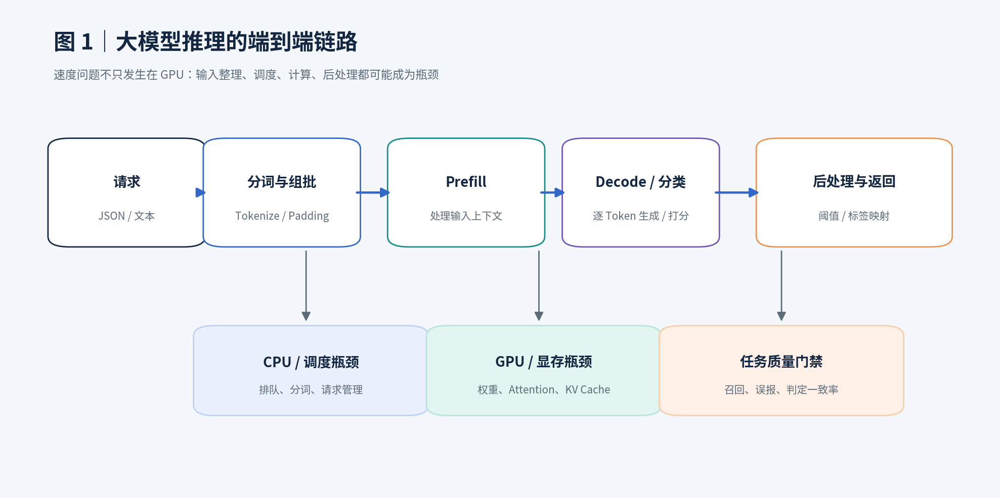

## 目录

- [1. 推理优化到底优化什么](#1-推理优化到底优化什么)
- [2. 了解推理执行过程及瓶颈](#2-了解推理执行过程及瓶颈)
- [3. 推理优化技术全景](#3-推理优化技术全景)
- [4. 低精度、量化与压缩](#4-低精度量化与压缩)
- [5. Attention、KV Cache、前缀缓存](#5-attentionkv-cache前缀缓存)
- [6. 批处理与请求调度](#6-批处理与请求调度)
- [7. 编译、算子、推测解码与架构优化](#7-编译算子推测解码与架构优化)
- [8. 推理框架与兼容性选型](#8-推理框架与兼容性选型)
- [9. 工程实施：从零建立基线](#9-工程实施从零建立基线)
- [10. 如何客观测量优化效果](#10-如何客观测量优化效果)
- [11. 内容安全 4B / 9B 模型优化专项](#11-内容安全-4b--9b-模型优化专项)
- [12. 完整实验矩阵和验收标准](#12-完整实验矩阵和验收标准)
- [13. 常见问题与故障排查](#13-常见问题与故障排查)
- [14. 结论与学习路线](#14-结论与学习路线)
- [参考文献与官方链接](#参考文献与官方链接)

---

## 1. 推理优化到底优化什么

### 1.1 一句话定义

**推理优化就是在特定硬件、任务数据和效果约束下，提高模型从“收到请求”到“返回有效结果”的系统效率。** 这里的“效率”包括单次耗时、批量吞吐、并发能力、显存、设备利用率和单位处理成本。

不要把它与下面两件事混为一谈：

- **模型训练/微调**：改变可学习参数，使模型更擅长业务任务。
- **推理优化**：通常不修改原始任务能力，主要优化数值表示、计算实现、缓存、调度和部署方式；但**量化、蒸馏、Prompt 改写、截断、阈值变化**等会影响效果，必须单独评测。

### 1.2 六大指标与业务意义

| 指标 | 常用单位 | 如何理解 | 优化方向 |
|---|---|---|---|
| 端到端延迟（E2E Latency） | ms/请求 | 从发送请求到拿到最后一个结果，含排队、分词、网络与后处理 | 降低 P50/P95/P99 |
| 首 Token 延迟（TTFT） | ms | 生成任务的第一个 Token 返回前的时间 | 减小 Prefill/排队/网络开销 |
| 每输出 Token 间隔（TPOT/ITL） | ms/token | 长输出任务的生成节奏 | 减少 Decode 单步耗时 |
| 吞吐量（Throughput） | requests/s、texts/s、tokens/s | 单位时间处理量 | 提升 |
| 显存占用（VRAM） | GiB | 权重、KV Cache、激活和临时缓存消耗 | 减少或更有效利用 |
| 任务效果（Quality） | Recall、FPR、AUC 等 | 是否保持业务可接受的判定质量 | 不劣化或在容忍范围内 |

辅助指标：GPU 利用率、实际功耗、CPU 占用、排队深度、OOM 次数、模型启动时间、单位百万请求成本。若部署为实时 API，还需考虑 SLA 和尾延迟。

### 1.3 关键公式

**吞吐量**：

$$
\mathrm{Requests/s}=\frac{N_{\mathrm{completed}}}{T_{\mathrm{wall}}}
$$

**相对加速比**：

$$
\mathrm{Speedup}=\frac{T_{\mathrm{baseline}}}{T_{\mathrm{optimized}}}
$$

**相对延迟降低比例**：

$$
\mathrm{Latency\ reduction}=\frac{T_{\mathrm{baseline}}-T_{\mathrm{optimized}}}{T_{\mathrm{baseline}}}
$$

例如 **200 ms → 100 ms** 是 **2 倍加速、延迟下降 50%**，不是“加速 100%”的精确定义。应清楚注明所采用的指标。

对“处理 5 万条文本”这类任务，若吞吐从 50 texts/s 升至 100 texts/s，则理想情况下执行时间从 1,000 秒缩短至 500 秒；这只是算术示例，现实还有初始化、读写、排队等开销。

### 1.4 性能优化的三个典型目标

| 业务 | 首要目标 | 次要目标 | 不应忽略 |
|---|---|---|---|
| 线上内容审核 API | P95/P99 延迟 | 并发、稳定性 | 召回率、误报率 |
| 离线海量文本审核 | texts/s | GPU 利用率、成本 | 长文本覆盖、漏报 |
| 长文本问答生成 | TTFT + TPOT | KV 显存、成本 | 输出质量 |

> **最重要的工程原则**：先明确业务的**主优化指标**。否则极易出现“吞吐增加而用户延迟变差”或“显存减少但效果下降”的假优化。

---

## 2. 了解推理执行过程及瓶颈

### 2.1 端到端推理流程

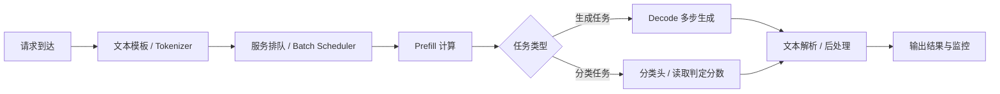

图 1 标示了五种常见瓶颈：CPU 分词、排队调度、GPU Prefill、Decode/分类计算以及后处理。模型 **GPU forward 很快**，不等于线上 **API 响应很快**。

### 2.2 Prefill 与 Decode

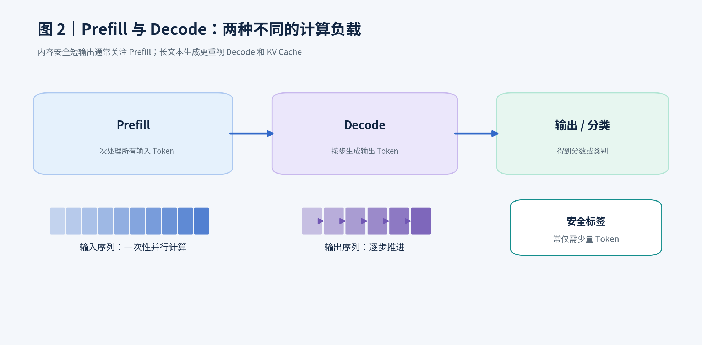

**Prefill**：输入已有的全部 Token，完成该输入的 Transformer 前向计算。通常具有较强的并行性。长输入会增加 Attention 计算与 KV 缓存的需求。

**Decode**：自回归生成模型每次产生一个或少数新 Token，并依赖已有上下文继续生成。此时重复读取权重、KV Cache 的代价更加明显，小 Batch Decode 常受显存带宽/访存约束。

**分类头模型特别说明**：`AutoModelForSequenceClassification` 或自定义 pooling 分类模型可能一次 forward 就直接得到分类 logits，根本没有常规意义上的多步 Decode；优化重点应该是一次 forward、Padding、算子、批处理和后处理。不要机械套用聊天 LLM 的 Decode 优化清单。

### 2.3 为什么大模型“慢”：计算与访存

- **算力瓶颈（compute-bound）**：矩阵乘法占主导；较大 Batch 或长 Prefill 更容易充分使用 Tensor Core。
- **带宽瓶颈（memory-bound）**：频繁读取模型权重、KV Cache；小 Batch Decode 常见。
- **内存容量瓶颈**：模型、KV Cache、并发请求无法全部驻留显存，导致 OOM、换入换出或调度限制。
- **调度/CPU 瓶颈**：数据加载、Tokenizer、Python 调用、进程间通信或请求排队较慢。

可用简单直觉理解 Roofline 模型：

$$
\mathrm{可达计算性能} \lesssim \min(\mathrm{峰值算力},\ \mathrm{内存带宽}\times\mathrm{算术强度})
$$

**算术强度**指每搬运一字节数据执行多少计算。它解释了为什么缩小模型权重**可能**改善带宽受限推理，同时也解释了为什么某些 INT4 后端反而更慢：反量化、额外计算和低效 Kernel 会抵消收益。

### 2.4 先定位，再优化

| 现象 | 首先排查 | 优先技术 |
|---|---|---|
| GPU 利用率低，API 排队高 | CPU 分词、服务进程、批调度 | Tokenizer 多进程、连续批处理 |
| 长输入明显变慢 | Prefill、Attention、Padding | SDPA/FlashAttention、长度分桶 |
| 长输出变慢 | Decode、KV Cache | KV 优化、推测解码、量化 |
| Batch 增大后 OOM | 权重 + 激活 + KV | 降低并发、量化、合理长度上限 |
| 同一份审核规则重复出现 | 重复前缀 | Prefix Caching |
| 量化后漏报变多 | 分数分布与阈值漂移 | 逐条配对、重新校准 |

---

## 3. 推理优化技术全景

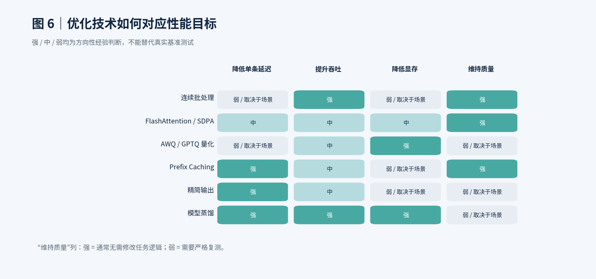

这里按**优化发生的层级**划分，而不是仅凭工具名。

| 技术层次 | 核心手段 | 代表方法 | 主要代价 |
|---|---|---|---|
| 数值与权重 | 少存储、少搬运 | BF16、INT8、GPTQ、AWQ、FP8 | 数值误差、兼容性 |
| Attention 内核 | 减少中间结果读写 | SDPA、FlashAttention、FlashInfer | Kernel / 架构限制 |
| 缓存系统 | 不重复算已有信息 | KV Cache、Paged KV、Prefix Caching | 更多缓存管理、显存驻留 |
| 推理调度 | 让 GPU 更充分运行 | 动态 Batch、Chunked Prefill | 调参、尾延迟权衡 |
| 编译与融合 | 减少调度与 Kernel 开销 | torch.compile、CUDA Graph、Kernel Fusion | 编译时间、形状约束 |
| 生成算法 | 减少昂贵目标模型调用 | Speculative Decoding | 草稿模型、验收复杂度 |
| 任务协议 | 少算无用部分 | 短输出、首 Token 分类、确定性解析 | 标签/概率语义风险 |
| 模型结构 | 换更高效模型 | GQA/MQA、蒸馏、稀疏结构 | 可能需要训练及回归评测 |
| 服务架构 | 提高资源利用率 | DP/TP/PP、异步 API、负载均衡 | 系统复杂度 |

**是否保持任务输出**需要逐项判断：改变权重或任务协议通常是效果敏感优化；纯服务调度和缓存原则上不改变任务定义，但不同 Kernel/浮点规约顺序仍可能产生细微分数偏差。生产环境以逐条测试为准。

---

## 4. 低精度、量化与压缩

### 4.1 FP32、FP16、BF16、FP8、INT8、INT4 的区别

- **FP32（32 位浮点）**：数值范围/精度丰富，权重占用高，LLM 推理通常非首选。
- **FP16（16 位浮点）**：体积减半，适合支持半精度的 NVIDIA GPU；相对 BF16 指数范围较小。
- **BF16（16 位浮点）**：较大的指数范围，常用作推理与训练精度基线；需要 GPU/算子支持。
- **FP8**：浮点 8 位格式，收益强依赖硬件原生能力、Kernel 和模型支持。
- **INT8**：使用 8 位整数表示量化值，需 scale 等量化参数。
- **INT4**：低至 4 位的整数或近似表示，节省权重空间显著，但效果与实际吞吐不一定最好。

### 4.2 理论权重大小计算

$$
\mathrm{权重存储量(GB)} \approx \frac{N_{\mathrm{params}}\times\mathrm{bits}}{8\times 10^9}
$$

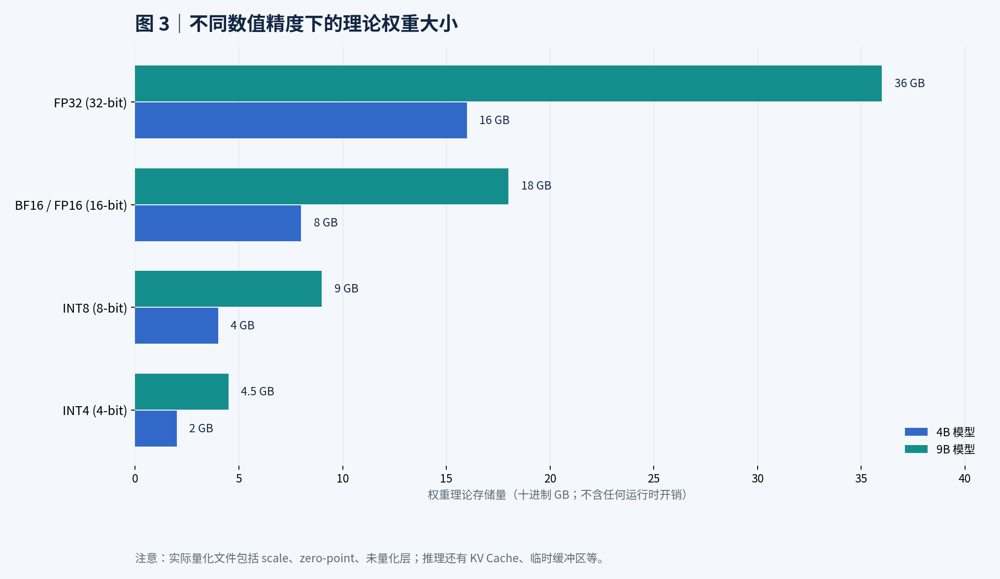

| 模型规模 | FP32 | FP16/BF16 | 8 bit | 4 bit |
|---|---:|---:|---:|---:|
| 4B | 16.0 GB | 8.0 GB | 4.0 GB | 2.0 GB |
| 9B | 36.0 GB | 18.0 GB | 9.0 GB | 4.5 GB |

上表为**仅权重的十进制理论估算**：真实进程的显存还包括量化 scale/元数据、部分未量化层、KV Cache、workspace、CUDA 上下文和图缓存。磁盘模型文件大小也不等于实际显存占用。

### 4.3 常见量化方法比较

| 方法 | 基本思想 | 优势 | 风险/局限 | 推荐场景 |
|---|---|---|---|---|
| Weight-only INT8 | 压缩权重，推理时视后端反量化/融合 | 精度通常相对稳健 | 不保证明显提速 | 初步节省显存 |
| GPTQ | 利用校准数据进行后训练权重量化 | 成熟生态，4 bit 常见 | 校准集、Kernel 强相关 | 已训练模型 PTQ |
| AWQ | 保护对激活敏感的权重通道 | 低比特部署常用 | 兼容性与速度依后端 | 4 bit 服务端推理 |
| W8A8 | 权重/激活均采用 8 位方案 | 可利用兼容的高效算子 | 精度与硬件依赖 | 支持该路径的生产硬件 |
| FP8 | 8 位浮点权重/激活 | 特定硬件高效 | 需核对架构和后端 | 具备原生 FP8 能力的设备 |
| QLoRA | 使用量化底座进行 LoRA 训练 | 训练显存省 | **主要属于训练优化，不等同于生产量化推理** | 资源受限微调 |

对 RTX 4090（Ada 架构），可查 [vLLM 量化兼容矩阵](https://docs.vllm.ai/en/latest/features/quantization/index.html)；不要仅依据“GPU 能加载量化权重”来判断“某量化算子会加速”。

### 4.4 Transformers 量化加载示例

> 仅适用于与 Hugging Face `AutoModelForCausalLM`、bitsandbytes 兼容的模型，并非所有 Jev/自定义分类模型都适用。

```python
import torch
from transformers import AutoModelForCausalLM, BitsAndBytesConfig

quant_config = BitsAndBytesConfig(
    load_in_4bit=True,
    bnb_4bit_quant_type="nf4",
    bnb_4bit_compute_dtype=torch.bfloat16,
)

model = AutoModelForCausalLM.from_pretrained(
    "/path/to/compatible-model",
    quantization_config=quant_config,
    device_map="auto",
    trust_remote_code=False,
).eval()
```

**注意**：NF4/bitsandbytes 省显存不等价于使用经过特定高性能 Kernel 优化的 AWQ/GPTQ INT4；应分别建立实验，不要把所有“4 bit”合并为一个结论。

### 4.5 量化的标准验收

1. 固定同一模型检查点、同一 Tokenizer、Prompt、标签映射与阈值；记录量化方案与依赖版本。
2. 使用固定测试集测量权重、GPU 峰值显存、texts/s、延迟。
3. 使用独立内容安全校准集，检查量化前后 score 分布、最大/平均绝对分差。
4. 计算混淆矩阵、违规召回、正常误报率、精确率、AUC；重点输出**新增漏报样本 ID**。
5. 只有满足业务准入条件时才使用量化模型；否则恢复 BF16 或更保守的量化方法。

**常见误区**：“量化 4 bit → 一定比 BF16 快 4 倍”是错误的。量化主要直接减少权重存储/带宽，真实延迟由计算结构与 Kernel 决定。

---

## 5. Attention、KV Cache、前缀缓存

### 5.1 Attention 为什么贵

常见注意力运算表示为：

$$
\operatorname{Attention}(Q,K,V)=\operatorname{softmax}\left(\frac{QK^{\mathsf T}}{\sqrt{d_k}}\right)V
$$

对普通密集自注意力而言，序列长度为 $L$ 时，注意力矩阵大小是 $L\times L$，随上下文增长会带来显著计算和中间存储开销。FlashAttention 通过 Tiling / Kernel 融合降低对高带宽显存的中间数据读写，并不意味着数学上的密集 Attention 计算量从二次复杂度自动变成线性。

### 5.2 SDPA 与 FlashAttention

| 技术 | 核心机制 | 适合 | 注意 |
|---|---|---|---|
| Eager Attention | 常规 PyTorch 算子组合 | Debug / 对照 | 中间张量开销可能较高 |
| PyTorch SDPA | 根据条件选择优化后端 | 通用首选 | 不同 shape/dtype 会选择不同实现 |
| FlashAttention-2 | IO-aware 的分块融合 Attention | 长输入和兼容 GPU | 需要模型、dtype、mask 等兼容 |
| FlashInfer | 面向多种 Attention/推理 Kernel 优化 | 部分推理服务后端 | 与服务器版本、模型结构耦合 |

代码示例：

```python
from transformers import AutoModelForCausalLM
import torch

model = AutoModelForCausalLM.from_pretrained(
    "/path/to/model",
    dtype=torch.bfloat16,
    attn_implementation="sdpa",  # 先以兼容性较好的 SDPA 建立基线
    device_map="cuda",
)

# 支持对应 Attention 实现和依赖时，再对照：
# attn_implementation="flash_attention_2"
```

参照：[Hugging Face Attention backends](https://huggingface.co/docs/transformers/en/attention_interface)、[PyTorch SDPA](https://docs.pytorch.org/docs/stable/generated/torch.nn.functional.scaled_dot_product_attention.html)。

### 5.3 KV Cache：避免单次生成中的重复计算

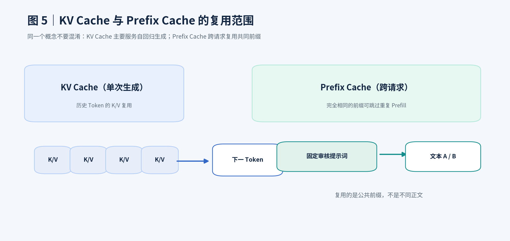

在自回归生成过程中，已生成 Token 的历史 K/V 无须在每一轮从头计算；直接缓存并复用即可。

常见概念：

- **普通 KV Cache**：保存当前序列的 K/V，减少下一 Token 生成中的重复计算。
- **Paged KV Cache / PagedAttention**：以块为单位组织和管理 KV 存储，降低不规则序列带来的内存浪费并支持灵活复用。
- **KV Cache 量化**：减少缓存容量，但有精度/访存/反量化开销，需要测量。
- **KV Offloading**：部分缓存转移到 CPU/其他内存，节省显存，可能增大延迟。

一个简化的 KV 容量公式（标准多层注意力架构）：

$$
M_{KV}\approx 2\times L_{\rm layers}\times N_{\rm seq}\times S_{\rm tokens}\times H_{\rm KV}\times D_{\rm head}\times B_{\rm elem}
$$

其中 $2$ 表示 Key 和 Value；实际还需要考虑分块、padding、层内特殊结构、压缩以及服务端分配方式。**GQA/MQA 可以减少 KV 头数，不应直接用 Attention 总头数替代 KV 头数。**

### 5.4 Prefix Caching：跨请求复用固定审核规则

**跨请求出现完全相同的前缀**时，支持的推理引擎可复用此前 Prefix 对应的 KV 计算。例如：

```text
请求 A = 固定审核规范 + 文本 A
请求 B = 固定审核规范 + 文本 B
请求 C = 固定审核规范 + 文本 C
          └── 共有前缀可复用（符合引擎缓存粒度与条件）
```

收益与**公共前缀长度、命中率、缓存容量和请求模式**有关。若每条 Prompt 有不同时间戳、请求 ID 或动态拼接字段放在前缀中，就可能破坏缓存命中。

> 安全要求：多租户前缀缓存须严格遵守引擎的租户隔离、缓存键与访问控制；不得通过缓存复用泄露别人的私有上下文。Prefix Caching 主要减少 Prefill，**不会自动减少长输出的 Decode 步数**。

参照：[vLLM Automatic Prefix Caching](https://docs.vllm.ai/en/latest/features/automatic_prefix_caching/)。

### 5.5 Chunked Prefill

把长 Prefill 拆分为调度粒度较小的片段，便于与 Decode 或其他请求协同调度。可能改善服务公平性和尾延迟，但不同实现/负载下吞吐可能有权衡。需要重点观察**P95/P99、TTFT、队列长度**。

### 5.6 不要混淆三种“分块”

| 名称 | 分什么 | 目标 | 是否改变任务输入语义 |
|---|---|---|---|
| FlashAttention Tiling | Attention 计算块 | 减少显存 IO | 通常不改变 |
| Chunked Prefill | 模型内部 Prefill 调度块 | 改善调度 | 通常不改变 |
| 长文内容安全分块 | 用户原始文本 | 覆盖长文本、降低单段长度 | **会改变**，需聚合判定 |

尤其对内容安全模型，业务上的“把长文切成多个片段逐条检测”，不能视作无损推理加速：分块带来的上下文缺失、额外请求与聚合误报都要单独量化。

---

## 6. 批处理与请求调度

### 6.1 为什么 Batch 能提升吞吐

GPU 适合执行大量矩阵并行计算。单条文本推理时，可能不能充分利用算力；把多条文本组成 Batch 后，通常可以提高模型计算并行度并减少某些固定开销。

但 Batch 增大会同时增加显存、尾延迟或排队时间。对实时服务，“Batch 越大越好”不成立；对离线任务，最优点也受长度分布影响。

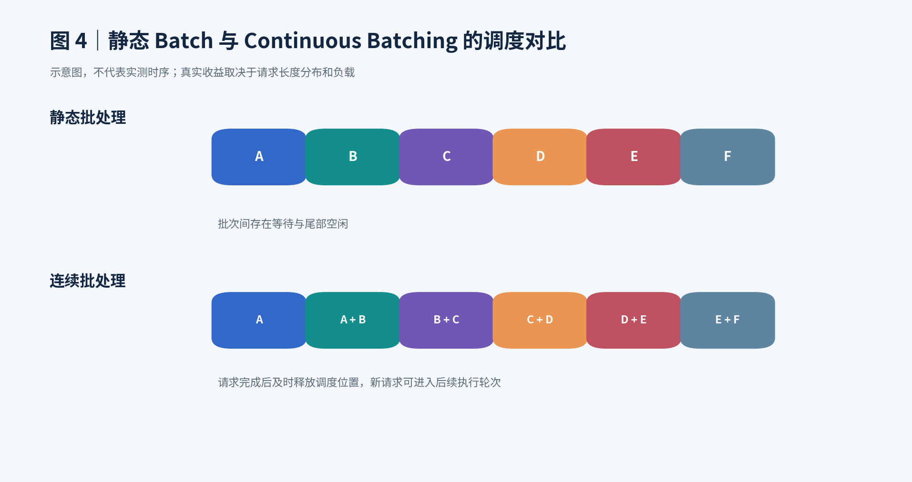

### 6.2 静态 Batch、动态 Batch 与 Continuous Batching

- **静态 Batch**：预先把 N 条样本合并，执行后再处理下一批，适合离线固定任务。
- **动态 Batch**：服务端收集一定窗口内的请求动态组批，适合服务请求合并。
- **Continuous / In-flight Batching**：序列执行期间按调度步动态添加/移除请求，特别适合长度不一的自回归生成。

**短输出分类任务的关键**：若一次 forward 就完成，Continuous Batching 的独特收益可能不如长输出生成任务明显；**合理的静态组批和长度分桶**有时已经非常有效。

### 6.3 Padding 浪费与长度分桶

例如某 Batch 有 4 条输入，Token 长度为 `128、256、512、4096`：

- 不分桶时，统一 padding 到 4096，总计算位置约为 `4 × 4096 = 16384`。
- 有效 Token 实际共 `128 + 256 + 512 + 4096 = 4992`。
- Padding 比例约 `1 - 4992/16384 = 69.5%`。

不同注意力/非填充实现并不一定对 Padding 做等量计算，上述数字是**张量位置占比示意**，不能直接认定 69.5% GPU FLOPs 被浪费。

建议将离线审核文本按长度分桶：`0–256 / 257–512 / 513–1024 / 1025–2048 / >2048` 等，再分别测量吞吐。分桶标准应由真实 Token 长度分布决定，且最后要恢复原样本 ID 顺序。

### 6.4 批大小实验矩阵

| 实验 | Batch Size | 适用 | 必须记录 |
|---|---:|---|---|
| B1 | 1 | 单请求基线 | 请求延迟、显存 |
| B2 | 4 | 初步并行 | texts/s、Padding |
| B3 | 8 | 中等并行 | texts/s、峰值显存 |
| B4 | 16 | 高并行 | OOM、P95、吞吐 |
| B5 | 32 | 压力测试 | OOM、吞吐、尾延迟 |

若 32 OOM，不要硬撑；退到 16 或更小。真实 Batch 上限应由模型大小、输入长度、显存和 Runtime 决定。

### 6.5 多 GPU 并行：TP、PP、DP

| 模式 | 全称 | 工作方式 | 推荐场景 |
|---|---|---|---|
| DP | Data Parallel | 每张 GPU 放一份完整模型、处理不同请求 | 单模型可放单卡、追求总体吞吐 |
| TP | Tensor Parallel | 将同一层的计算切分到多卡 | 单卡放不下、或特定条件下优化延迟 |
| PP | Pipeline Parallel | 模型不同层部署在不同设备 | 超大模型、多节点 |

对单卡可容纳的 4B/9B 模型，**优先比较单卡多个独立实例的 DP 与单模型 TP**，不要默认 TP 更快。TP 需要通信，会引入额外开销。

---

## 7. 编译、算子、推测解码与架构优化

### 7.1 torch.compile 和 Kernel Fusion

PyTorch Eager 模式下，多个小算子可能带来 Python 调度与 Kernel Launch 开销。`torch.compile` 通过捕获和优化计算图，有机会融合算子、减少开销。

```python
# 仅限模型和所运行 PyTorch / CUDA 组合支持时
model = torch.compile(model, mode="reduce-overhead")
```

注意：首次编译可能较慢；动态形状、可变长度和自定义操作可能导致重编译或不支持。应分开记录**冷启动时间**和**稳定运行的热路径延迟**，不能把第一次编译耗时混入常规稳态结果。

### 7.2 CUDA Graph

预先捕获可复用的 GPU 执行图，减少 CPU 发起一串 CUDA Kernel 的开销。对小 Batch / 短输出场景可能有帮助。限制来自动态 Shape、Graph 捕获显存和框架支持。很多推理引擎已经封装相关优化，不建议在服务引擎之外再随意套一层 Graph。

### 7.3 Speculative Decoding（推测解码）

**核心流程**：较小的草稿模型先提出多个候选 Token，目标大模型并行校验并决定接受多少，以降低逐步调用目标模型的成本。

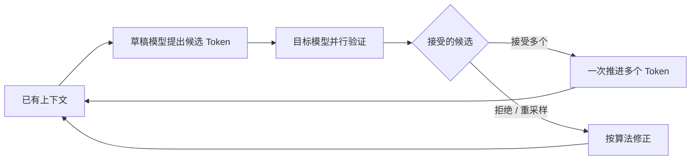

**优点**：长文本生成的某些负载可以受益。**限制**：额外草稿模型、显存占用、接受率和实现复杂度。严格正确的接受/拒绝机制可保持目标生成分布，但并非所有“猜测多个 Token”的自定义实现都有此保证。

对仅输出 `安全/违规` 或 `0/1` 的生成式安全模型，通常不值得首先投入推测解码：输出步数太短，收益空间有限。

### 7.4 任务协议优化

针对安全分类场景，常见的协议级优化包括：

1. 固定 Prompt，删除纯冗余说明（不应删除影响政策判断的规则）。
2. 使用严格短输出标签（例如两个明确定义的 Token），减少解释文本输出。
3. 当决策确实由第一 Token 概率决定时，直接读取相应 logits/score，而不是生成长说明。
4. 分类头模型直接读取分类 logits，不经过自由文本生成和反解析。
5. 在**同一有效标签空间**内做概率映射和温度校准；不要把标签 token 的未归一化 logit 误认为概率。

**首 Token 打分的细节**：标签可能拆成多个 Token；不同模板或有前缀空格时，Token ID 也可能不同；如果模型输出的是自由文本解释，取首 Token 不一定代表完整分类；对于多标签模型还需区分独立 sigmoid 与互斥 softmax。生产系统必须先定义评分协议、再优化。

### 7.5 模型蒸馏与架构改造

蒸馏通过教师模型指导学生模型，使小模型尽可能保留目标任务效果；GQA/MQA 等架构减少 KV 头数，结构稀疏/专家模型通过激活子网络减少部分计算。它们是**模型级**改进，通常需要训练、重新部署或更换模型架构，不属于纯 Runtime 无损提速。

---

## 8. 推理框架与兼容性选型

| 方案 | 特点 | 优先适用任务 | 是否可直接支持任意自定义分类头 |
|---|---|---|---|
| Transformers + PyTorch | 最灵活、易调试，能完整复现自定义 forward | 研究 / 精确对照 | 需原始实现支持 |
| vLLM | 高吞吐服务、连续批处理、Paged KV、量化等 | 标准生成模型和支持的 pooling/classification 模型 | **不能假定** |
| SGLang | 高性能 LLM Serving、前缀缓存/调度技术 | 对话、复杂提示词、高并发 | 取决于模型与版本 |
| TensorRT-LLM | NVIDIA GPU 优化、Kernel/引擎部署 | 对性能和工程投入要求高的场景 | 取决于模型转换与支持 |
| llama.cpp | 面向资源受限部署、GGUF 量化生态 | 端侧与轻量部署 | 需要模型架构适配 |

官方链接：[vLLM](https://docs.vllm.ai/en/latest/) · [vLLM 分类模型](https://docs.vllm.ai/en/latest/models/pooling_models/classify/) · [SGLang](https://docs.sglang.ai/) · [TensorRT-LLM](https://nvidia.github.io/TensorRT-LLM/) · [Transformers](https://huggingface.co/docs/transformers/)。

### 8.1 针对 Jev/StartLux/QwenGuard 的兼容性检查顺序

先确认模型究竟属于哪类：

- **A 类：标准 CausalLM 生成式判定**：使用 `.generate()` 输出标签字符串、数字或 JSON。
- **B 类：标准 SequenceClassification / Pooling**：直接 `.forward()` 产出分类 logits。
- **C 类：自定义模型 / 自定义安全 Head / 自定义 scoring protocol**：需要专门的 forward、路由逻辑、特殊 Token 或输出校准流程。

C 类很容易被误判成“vLLM 不支持”或“加上 `--trust-remote-code` 就可以”，两种简化都不正确：**必须检查模型配置、代码、引擎的已支持架构与任务，以及输出是否数值/语义一致。**

### 8.2 一份可执行兼容性清单

```bash
# 1. 检查 GPU 和 CUDA
nvidia-smi

# 2. 检查当前依赖版本（在项目虚拟环境中执行）
python - <<'PY'
import torch, transformers
print('torch:', torch.__version__)
print('CUDA:', torch.version.cuda)
print('transformers:', transformers.__version__)
print('GPU:', torch.cuda.get_device_name(0) if torch.cuda.is_available() else 'No CUDA')
PY

# 3. 查看模型配置（不擅自执行不可信模型代码）
python - <<'PY'
from transformers import AutoConfig
cfg = AutoConfig.from_pretrained('/path/to/model', trust_remote_code=False)
print(cfg.__class__.__name__)
print(cfg.architectures)
print(getattr(cfg, 'model_type', None))
PY
```

加载失败表示需要先排查模型兼容性，**不意味着该模型一定不可部署**。

---

## 9. 工程实施：从零建立基线

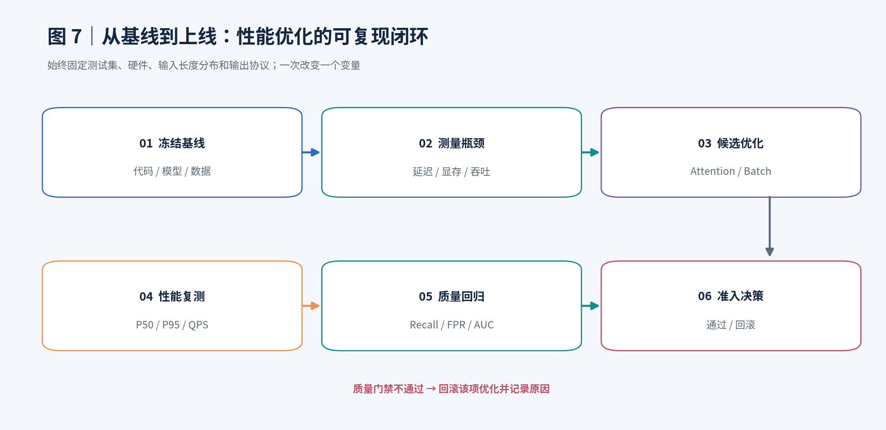

### 9.1 环境隔离

训练与推理环境最好使用不同 venv，避免 PyTorch / CUDA / FlashAttention / vLLM 依赖相互覆盖。

```bash
python3 -m venv ~/envs/llm-infer
source ~/envs/llm-infer/bin/activate
python -m pip install --upgrade pip

# 安装 PyTorch 与 Transformers 时，优先匹配 NVIDIA 驱动/CUDA 和官方安装指引。
# 下面仅示意：
python -m pip install torch transformers accelerate

# 按实际 Python/CUDA 兼容矩阵安装可选引擎，不必一次装齐。
# python -m pip install vllm
```

在不允许联网的 GPU 服务器，需准备相容版本的离线 wheel、索引或内部镜像，**不要强行使用 `--break-system-packages` 修改系统 Python**。

### 9.2 固定 Baseline 的“六个不能变”

1. 模型检查点、合并 LoRA 的方式、温度配置。
2. Tokenizer 版本、Special Token、Chat Template。
3. 输入文本和样本 ID、采样策略、长度分布。
4. 输出格式、Token 映射、分类标签定义、阈值。
5. GPU 型号、设备独占程度、CUDA/PyTorch 等运行环境。
6. 测量口径：预热次数、计时起止、同步、请求速率、并发。

### 9.3 使用附带脚本测量通用 CausalLM

打包目录中有：`code/benchmark_hf.py`。

**输入 JSONL**：

```jsonl
{"text":"示例：这是一条需要检测的文本 A"}
{"text":"示例：这是一条需要检测的文本 B"}
```

**运行**：

```bash
python code/benchmark_hf.py \
  --model /path/to/compatible-causallm \
  --data samples.jsonl \
  --batch-size 8 \
  --max-samples 200 \
  --max-input-tokens 8192 \
  --max-new-tokens 8 \
  --dtype bf16 \
  --out run_bf16_bs8.json
```

**该脚本的边界非常重要**：

- 使用标准 Transformers `AutoModelForCausalLM.generate()`，**不能直接用于自定义 Jev 分类头模型**。
- 若生产采用 System Prompt/Chat Template，必须在测试样本中构造**完全相同**的真实输入；脚本不猜测业务模板。
- 统计了整个批次的 GPU 生成耗时、CPU 分词耗时及吞吐；报告中的 P50/P95 是**批级 GPU 时间**，不是线上每请求 P50/P95。
- 为防止悄悄改变审核任务，**输入超过 `--max-input-tokens` 时立即报错，不自动截断**。
- 仅用于性能；不代表已完成业务标签解析、温度校准和召回率验证。

### 9.4 vLLM 标准生成模型示例

> **执行前提**：确认目标模型是当前 vLLM 版本已支持的 `generate` 架构，并且检查设备显存、模型路径和 Tokenizer。

```bash
CUDA_VISIBLE_DEVICES=0 vllm serve /path/to/compatible-model \
  --dtype bfloat16 \
  --tensor-parallel-size 1 \
  --max-model-len 8192 \
  --gpu-memory-utilization 0.85 \
  --max-num-seqs 16
```

命令参数含义：

- `--max-model-len`：引擎可处理上下文的长度上限；不等于强制任务截断规则。
- `--max-num-seqs`：调度中可同时运行的序列数上限；越大不一定越快。
- `--gpu-memory-utilization`：用于引擎 GPU 内存预算；应留足其他服务空间。
- `--tensor-parallel-size 1`：单 GPU 模型并行设置。

若使用 Prefix Caching，对比开启/关闭的效果，可核对当前版本的 `--enable-prefix-caching` / `--disable-prefix-caching` 命令选项。不同版本的**默认值可能变化**，不要仅凭默认行为做实验结论。

### 9.5 vLLM 线上吞吐基准

```bash
# 先启动 API Server，再在另一个终端进行负载测试：
vllm bench serve --help

# 使用实际支持的 --dataset-name / --input-len / --output-len
# 及 --request-rate、--num-prompts 选项；具体以安装版本 --help 为准。
```

重点分别做：

- **低并发**：关注单请求延迟、TTFT、TPOT。
- **固定请求速率**：关注稳定运行 QPS 和 P95/P99。
- **离线饱和吞吐**：关注最大 texts/s、GPU 占用和 OOM。

不能将三种负载下的测量结果放进同一行直接比较。参考：[vLLM 基准工具](https://docs.vllm.ai/en/latest/cli/)、[vLLM Serving Benchmark](https://docs.vllm.ai/en/latest/api/vllm/benchmarks/serve/)。

---

## 10. 如何客观测量优化效果

### 10.1 时间口径

对线上 API：

$$
T_{E2E}=T_{network}+T_{queue}+T_{tokenize}+T_{GPU}+T_{postprocess}
$$

对离线批处理：总时间还包括数据读取、序列构造、结果写盘和聚合。将“模型 forward GPU 耗时”和“完整业务流程耗时”**分开报告**。

### 10.2 正确计时

CUDA 操作异步执行，仅用 `time.perf_counter()` 包裹 Python 调用而不做 CUDA 同步，可能测得过小的运行时间。可采用：

```python
import time
import torch

torch.cuda.synchronize()
start = time.perf_counter()
with torch.inference_mode():
    outputs = model(**inputs)
torch.cuda.synchronize()
latency_s = time.perf_counter() - start
```

更细粒度的 GPU Kernel 计时可使用 `torch.cuda.Event`、PyTorch Profiler、Nsight Systems / Compute，但要避免把 profiler 本身的开销当作真实线上延迟。

### 10.3 性能评测协议

| 维度 | 规定 |
|---|---|
| 硬件 | GPU 型号、数量、可见显存、功率限制、驱动版本 |
| 软件 | OS、Python、PyTorch、Transformers、CUDA、推理引擎版本 |
| 数据 | 固定样本 ID、输入长度分位数、输出长度和 Prompt |
| 预热 | 至少记录并隔离 Warmup / 编译 / 首次加载 |
| 重复试验 | 建议每配置多轮测量，统计均值与波动 |
| 延迟 | P50/P95/P99，声明是否包含排队和网络 |
| 吞吐 | requests/s、texts/s、input/output tokens/s |
| 显存 | 峰值 allocated、reserved、`nvidia-smi` 进程显存 |
| 稳定性 | OOM、异常率、拒绝请求数、超时率 |
| 质量 | 固定业务判定协议和冻结阈值的 Recall/FPR/AUC |

### 10.4 何时 P95 比平均值更重要

线上审核需面对长文本、并发和排队，平均延迟可能保持不变但长尾延迟恶化。因此上线报告不能只有 `average latency`；应有同一负载下的 P50、P95、P99、错误率，最好附上不同请求速率的吞吐-延迟曲线。

### 10.5 演示性结果表（**不是实测**）

| 方案 | texts/s | P95 ms | 峰值 GiB | Recall | FPR | 结论 |
|---|---:|---:|---:|---:|---:|---|
| BF16 + Batch 1 | 待测 | 待测 | 待测 | 待测 | 待测 | 基线 |
| BF16 + Batch 8 | 待测 | 待测 | 待测 | 待测 | 待测 | 观察吞吐 |
| BF16 + SDPA | 待测 | 待测 | 待测 | 待测 | 待测 | 注意力优化 |
| AWQ INT4 | 待测 | 待测 | 待测 | 待测 | 待测 | 量化检验 |
| 推理引擎替换 | 待测 | 待测 | 待测 | 待测 | 待测 | 兼容性检验 |

**“待测”而不填写虚构加速比**，是报告可复现的基本要求。

---

## 11. 内容安全 4B / 9B 模型优化专项

在内容安全任务里，**判定质量是硬约束，推理速度是优化目标**。这与常规长文本聊天模型不同。

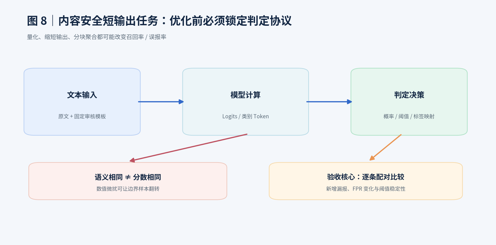

### 11.1 先明确模型输出属于哪一种

| 判定类型 | 典型输出 | 重点优化方向 |
|---|---|---|
| 二分类头 | 违规概率或二类 logits | 单次 forward、批量分桶、SDPA |
| 多标签分类头 | 每个标签独立 score | 单次 forward、每类阈值/校准不变 |
| 生成式二分类 | `0`/`1`、`safe`/`unsafe` | Prefill、首 Token 分数、短输出 |
| 生成式多类别 | 先生成安全类别，再生成解释 | 标签约束、短输出、首 Token/类条件分数 |
| 自定义决策模型 | 专有头、专有温度/路由 | 先复现原始 forward 和 config，再迁移引擎 |

### 11.2 4B / 9B 的最佳起点

**A. 先用原生 BF16 做基线**：尽量不更改模型决策，关注真实业务评测与延迟拆分。  
**B. 先做无损倾向的优化**：合适 Batch、按长度分桶、SDPA/兼容的 FlashAttention、减少重复 CPU 解析。  
**C. 再检验引擎**：对于已支持的 CausalLM，可尝试 vLLM/SGLang；分类头或特殊架构先做输出一致性测试。  
**D. 最后做效果敏感的优化**：INT8/INT4 量化、短标签、首 Token 或概率计算方式变更、蒸馏。

### 11.3 判定分数不能只看最终“正常/违规”

假设原模型某条文本输出分数 `0.501`，优化后为 `0.498`，固定阈值 `0.5`，虽然绝对分差只有 `0.003`，最终却从“违规”翻转为“正常”。所以要同时报告：

- score 的平均绝对误差、最大绝对误差和分位数；
- 预测一致率，以及**新增漏报**与**新增误报**；
- 不同长度、类别、置信度区间的翻转率；
- 在冻结阈值下的 Recall、FPR 和 AUC；
- 必要时再在独立校准集上重新做温度/阈值校准，并使用**未参与调参**的测试集复验。

**尤其注意**：对已有按题型温度校准的模型，温度配置是推理协议的一部分；只加载模型权重而不加载校准配置，就已经不是同一个基线。

### 11.4 安全分类评测公式

设 `违规=正类（1）`，`正常=负类（0）`：

$$
Recall=\frac{TP}{TP+FN},\quad FPR=\frac{FP}{FP+TN}
$$

$$
Precision=\frac{TP}{TP+FP},\quad Accuracy=\frac{TP+TN}{N}
$$

当类别分布变化时，Precision 会受到正类比例影响。对于业务底线通常需单独明确 Recall 与 FPR；不能仅凭 Accuracy 宣称“模型效果保持不变”。

### 11.5 可执行逐样本比较工具

随文档提供 `code/compare_safety_predictions.py`。两个文件都需要下面三个字段：

```jsonl
{"id":"s001","y_true":1,"score":0.93}
{"id":"s002","y_true":0,"score":0.07}
```

两个文件必须拥有**完全相同的 id 集合和真实标签**。运行：

```bash
python code/compare_safety_predictions.py \
  --baseline baseline_predictions.jsonl \
  --candidate optimized_predictions.jsonl \
  --threshold 0.5 \
  --out paired_report.json
```

工具输出基线/候选的 TP、FP、TN、FN、Recall、FPR、分数变化，以及新增漏报/新增误报等样本 ID。它不提供统计显著性推断，也不自动选择更优阈值；若要做正式统计比较，还应报告置信区间与配对检验。

### 11.6 长文本：整篇检测 vs 分块检测

以内容审核为例，长文本可能超出模型实际上下文，或某个局部片段的违规信息被整篇语义稀释。

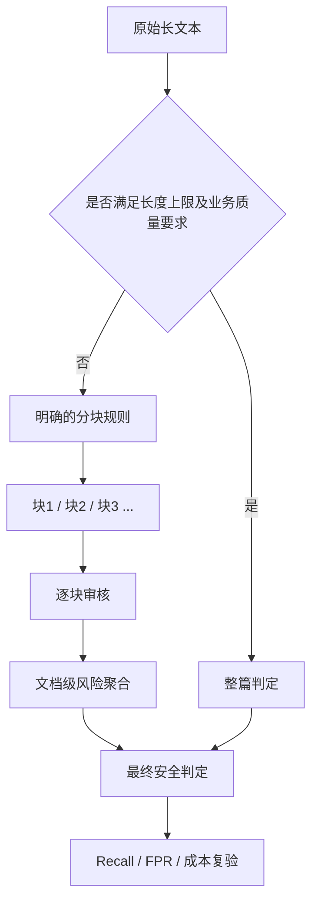

需要同时考虑：

- **窗口大小**：按 Token 而非仅按汉字数量设置。
- **Overlap（重叠）**：防止跨窗口的违规内容被截断，但增加重复计算。
- **聚合方式**：max-score、任一违规即违规、Top-k 或可校准融合。
- **统计风险**：块越多，“任一块误报即整篇误报”可能抬高整体 FPR。

若每个块误报概率为 $p$，并**假设块间误报独立**，含 $k$ 块的整篇误报概率为：

$$
P(\text{整篇误报})=1-(1-p)^k
$$

现实中窗口重叠导致误报相关，这个表达式只用于说明多次判定的累积风险，**不能直接用来预测真实 FPR**。长文本分块通常是提高覆盖与质量的策略，不应在推理性能优化报告中假装其免费。

### 11.7 三类模型的建议路线

| 模型类别 | 第一批实验 | 第二批实验 | 验收重点 |
|---|---|---|---|
| 自定义 JevAny / Jev 类 | 复现原始接口、Batch / Padding、SDPA | 若引擎支持再测 vLLM、量化 | 自定义 Head 与标签映射 |
| StartLux-Decision 4B/9B | 分清 Instant/AutoThink、固定路由与温度 | 批处理、注意力、量化 | 阈值 0.5、召回/FPR、分数一致 |
| Qwen3Guard-Gen 类 | 锁定生成模板与首 Token 打分协议 | 短输出、批调度、引擎、量化 | Token 映射、各类分数稳定性 |

这里不是断言这些具体模型对所有引擎均兼容，而是给出**检查和实验优先级**。

---

## 12. 完整实验矩阵和验收标准

### 12.1 从低风险到高风险的六组实验

| 实验编号 | 改动 | 要回答的问题 | 是否要重跑任务效果 |
|---|---|---|---|
| E0 | 原始推理代码 / BF16 | 基线性能是多少？ | 是（作为基线） |
| E1 | Batch 1/4/8/16/32 | 吞吐-显存最佳点？ | 建议抽样 + 关键全集 |
| E2 | SDPA vs FlashAttention | Attention 是否是瓶颈？ | 是，比较数值差异 |
| E3 | 静态分桶 / 动态组批 | Padding 和调度是否拖慢？ | 是，确保 ID 对齐 |
| E4 | 引擎替换 / Prefix Cache | 服务调度能否获益？ | **是，先验证语义等价** |
| E5 | INT8/AWQ/GPTQ INT4 | 是否用小幅质量代价换性能？ | **必须全量复测** |
| E6 | 首 Token / 短输出 / 蒸馏 | 是否可以通过任务协议/模型调整提速？ | **必须重新定义与验证协议** |

### 12.2 推荐性能测试工作负载

按真实文本 Token 分布分层，而不是只跑一种 128 Token 输入：

| 输入类别 | 示例区间（Token） | 测试重点 |
|---|---|---|
| 短 | 1–256 | 启动/调度、batch 利用率 |
| 中 | 257–1024 | 常规线上审核 |
| 长 | 1025–4096 | Prefill/Attention/显存 |
| 超长 | 4097–模型允许上限 | 截断风险、OOM、窗口策略 |

请先计算生产数据的 P50/P90/P95/P99 长度，再调整这些实验边界。不同长度组的样本 ID 要固定，以便配对比较。

### 12.3 推荐验收口径（**示例标准，必须按业务签字确认**）

- 违规召回率下降不超过 **0.2 个百分点**；新增漏报需要逐条列出与复核。
- 正常 FPR 上升不超过 **0.2 个百分点**。
- 无静默截断、标签映射错误、Prompt 漂移、漏加载校准参数。
- 固定负载下吞吐提升至少 **20%**，或 P95 延迟下降至少 **15%**。
- 满足设备显存与线上稳定性约束，连续压力测试无 OOM/异常飙升。

这些是可用于建立初版验收协议的**示例阈值**，不是通行行业标准。更严格业务可能要求完全不增加高风险内容的漏报；阈值设定应结合样本量、业务损失、置信区间和上线风险。

### 12.4 正式结果表模板

| 配置 | 模型版本 / 量化 | Batch | 平均 ms | P95 ms | texts/s | 显存 GiB | Recall | FPR | 新增漏报 |
|---|---|---:|---:|---:|---:|---:|---:|---:|---:|
| E0 | 原生 BF16 | 1 | — | — | — | — | — | — | — |
| E1 | 原生 BF16 | 8 | — | — | — | — | — | — | — |
| E2 | BF16 + FlashAttention | 8 | — | — | — | — | — | — | — |
| E3 | BF16 + 分桶 | 8 | — | — | — | — | — | — | — |
| E4 | 替换引擎 | 8 | — | — | — | — | — | — | — |
| E5 | AWQ/GPTQ（若兼容） | 8 | — | — | — | — | — | — | — |

**先选择业务能接受的效果约束，再从满足约束的方案中选择性能最优的一项。** 不应先选最快模型，再在效果报告中淡化回退。

### 12.5 推荐目录结构

```text
inference_optimization/
├── config/
│   ├── baseline.yaml        # 硬件/软件/版本/阈值
│   └── experiment_matrix.yaml
├── data/
│   ├── benchmark.jsonl      # 冻结样本及 ID
│   └── calibration.jsonl    # 独立校准集
├── scripts/
│   ├── bench_hf.py
│   ├── bench_engine.py
│   ├── compare_predictions.py
│   └── build_report.py
├── runs/
│   ├── E0_baseline/
│   ├── E1_batch/
│   ├── E2_attention/
│   └── ...
└── report/
    ├── summary.md
    ├── latency.png
    ├── throughput.png
    ├── confusion_matrix.png
    ├── flips.jsonl
    └── manifest.json
```

**推荐留下可复现实验清单**：Git commit、模型文件摘要（SHA-256）、数据集摘要、完整启动命令、环境 `pip freeze`、GPU 信息和报告生成时间。

---

## 13. 常见问题与故障排查

### Q1：模型已经能放进 GPU，还需要量化吗？

不一定。若瓶颈是 CPU/排队或本来就能高效占满 GPU，量化未必改善吞吐；还可能增加 Kernel 开销。应先尝试 Batch、SDPA、长度分桶，再与量化方案对照。

### Q2：为什么 `nvidia-smi` 利用率高但 throughput 低？

可能输入很长导致单次 Prefill 计算多、Batch Padding 严重、数据传输/CPU 造成空洞，或 GPU 看似忙但访存效率不佳。结合 tokens/s、texts/s、GPU profiler、CPU 采样进一步定位。

### Q3：为什么 vLLM 无法加载 Jev 类模型？

可能是 `architectures` 不受支持、自定义 Head 缺失、输出任务类型不匹配、权重格式或版本冲突。先尝试用原始 Transformers forward 复现，再核对 [vLLM Classification Usage](https://docs.vllm.ai/en/latest/models/pooling_models/classify/) 与支持模型/扩展指南；不能认为“加 `--trust-remote-code` 一定解决”。

### Q4：模型越大越该使用多卡 TP 吗？

不绝对。需要看是否放得下单卡、模型层配置和 GPU 互联。单卡能容纳且追求总体吞吐时，DP 往往值得优先对比；TP 有通信开销。

### Q5：首 Token 概率和最终类别分数一样吗？

不一定。它取决于任务定义、标签 token、Prompt 模板、归一化方法、判定头、生成约束与校准方式。必须以原始模型已有的业务评分协议为标准逐项核对。

### Q6：缩短 `max_model_len` 是否意味着加速？

不直接。它常影响缓存/容量预算，但**不能偷换成自动截断输入**。同一真实输入长度下的加速是否存在，需要实测。

### Q7：为什么用了 FlashAttention 却没变快？

输入过短、Attention 非瓶颈、Kernel 未成功启用、Padding 过多、CPU 瓶颈或模型使用不同 Attention 结构。先确认实际调用的后端和 profiling 结果。

### Q8：为什么量化后 AUC 接近，但召回率下降？

AUC 度量整体排序表现；固定阈值处的 Recall/FPR 取决于分数分布和校准。量化可能轻微改变分数，使一些边界样本越过阈值。必须分析逐样本翻转，并在独立校准集检验温度/阈值。

### Q9：并发调到最大是不是最好？

不是。并发增加可能导致 GPU 显存不足、排队积压、P95/P99 变差；应该绘制吞吐-延迟曲线找满足 SLA 的最佳区域。

### Q10：论文和工程报告是否可以直接引用“理论量化显存省 75%”做结论？

只能说理论权重容量从 16 位到 4 位下降 75%，**不能**说实际总显存降低 75% 或速度提升 4 倍。需要实测数据支持。

---

## 14. 结论与学习路线

### 14.1 一页总结

1. **优化目标**：延迟、吞吐、显存、并发、成本，前提是业务效果可接受。
2. **执行瓶颈**：分清 Tokenizer/排队、Prefill、Decode、缓存和后处理。
3. **优先技术**：对短输出安全审核任务，先考虑 Batch/分桶、SDPA/FlashAttention、引擎适配；随后再尝试量化。
4. **避免误用**：推测解码偏向长输出；KV Cache 不能解决一切；业务长文分块不是无损加速；量化未必更快。
5. **验收方式**：同一数据、同一阈值、同一硬件，对比性能和样本级判定；发现新增漏报需优先查因。

### 14.2 建议三阶段学习路线

| 阶段 | 学什么 | 亲手完成什么 | 交付物 |
|---|---|---|---|
| 基础（1） | Prefill/Decode、Latency/Throughput、BF16、KV | 跑通 HF Benchmark 和显存监控 | Baseline JSON |
| 进阶（2） | SDPA/FA、Batch、长度分桶、vLLM | 做 3–5 组单变量性能对比 | 性能矩阵与瓶颈图 |
| 工程（3） | 量化、校准、质量门禁、压力测试 | 复现完整内容安全数据集效果 | 生产准入报告 |

> **建议最终项目名称**：`content-safety-inference-optimization`，同时交付性能曲线、混淆矩阵、逐条翻转案例、版本指纹和可重复执行的命令。这样才称得上“推理优化闭环”，而不是简单把模型换到另一个推理框架。

---

## 参考文献与官方链接

以下均为工程实现和原理学习的优先参考资料，版本可能持续变化；编写和运行时应固定实际文档版本。

1. Hugging Face — [Optimizing inference](https://huggingface.co/docs/transformers/main/llm_optims)：Attention、量化、连续批处理等。
2. Hugging Face — [Attention backends](https://huggingface.co/docs/transformers/en/attention_interface)：SDPA、FlashAttention 的用法及限制。
3. Hugging Face — [Cache strategies](https://huggingface.co/docs/transformers/main/kv_cache)：各种 KV Cache、量化缓存、Offloading。
4. Hugging Face — [Optimization overview](https://huggingface.co/docs/transformers/main/optimization_overview)：量化、缓存等官方概览。
5. PyTorch — [Scaled Dot Product Attention](https://docs.pytorch.org/docs/stable/generated/torch.nn.functional.scaled_dot_product_attention.html)：底层 Attention API。
6. PyTorch — [Transformer optimization tutorial](https://docs.pytorch.org/tutorials/intermediate/transformer_building_blocks.html)：SDPA、nested tensors、torch.compile。
7. vLLM — [CLI](https://docs.vllm.ai/en/latest/cli/)：推理服务及基准命令。
8. vLLM — [Automatic Prefix Caching](https://docs.vllm.ai/en/latest/features/automatic_prefix_caching/)：跨请求前缀复用、适用场景与局限。
9. vLLM — [Quantization](https://docs.vllm.ai/en/latest/features/quantization/index.html)：不同 GPU 架构量化兼容性。
10. vLLM — [Classification Usages](https://docs.vllm.ai/en/latest/models/pooling_models/classify/)：分类与 Pooling 模型支持。
11. vLLM — [Serving Benchmark](https://docs.vllm.ai/en/latest/api/vllm/benchmarks/serve/)：线上性能基准工具。
12. SGLang — [Official Documentation](https://docs.sglang.ai/)：高性能推理调度和服务。
13. NVIDIA — [TensorRT-LLM](https://nvidia.github.io/TensorRT-LLM/)：NVIDIA GPU 推理工具链。
14. NVIDIA — [TensorRT-LLM User Guide](https://docs.nvidia.com/deeplearning/triton-inference-server/user-guide/docs/getting_started/trtllm_user_guide.html)：In-flight Batching、KV 相关功能、服务部署。

---

## 附录 A｜随文档提供的图片与代码

**图片**（均为本手册绘制的教学示意，不是实验测量图）：

- `assets/01_inference_pipeline.png`：端到端推理链路。
- `assets/02_prefill_decode.png`：Prefill 与 Decode。
- `assets/03_quant_memory.png`：4B/9B 权重体积。
- `assets/04_continuous_batching.png`：静态 / 连续批处理。
- `assets/05_kv_prefix_cache.png`：KV / Prefix Cache。
- `assets/06_optimization_matrix.png`：技术—目标对应关系。
- `assets/07_experiment_loop.png`：实验闭环。
- `assets/08_safety_validation.png`：内容安全质量门禁。

**代码**：

- `code/benchmark_hf.py`：通用生成式 HF 模型的性能基线脚本。
- `code/compare_safety_predictions.py`：内容安全模型的逐样本、同阈值配对质量对比。

**依赖**：`benchmark_hf.py` 需 `torch` 与 `transformers`；`compare_safety_predictions.py` 使用 Python 标准库。代码只适配说明中明确标注的输入和模型接口，生产使用前应进行工程适配和单元测试。

**版权与使用**：正文、图示和配套示例脚本均为本次专门编制；引用第三方项目仅使用名称、文档入口及简要技术介绍，不包含第三方文档全文。
