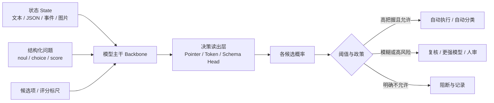
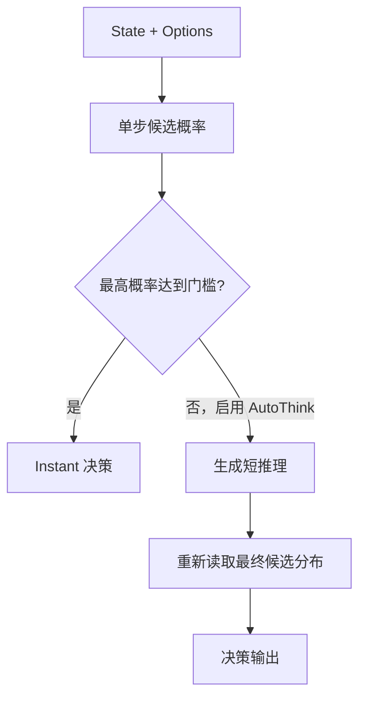
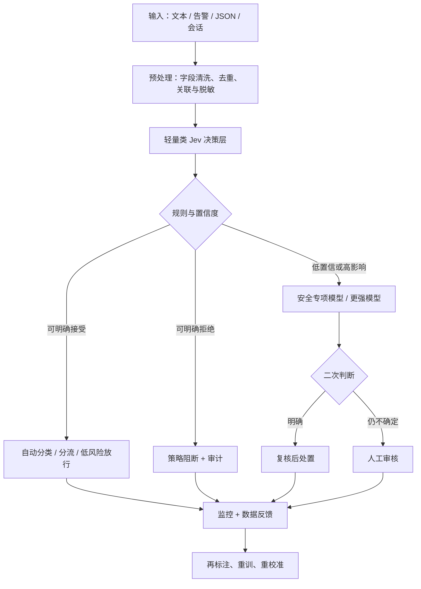
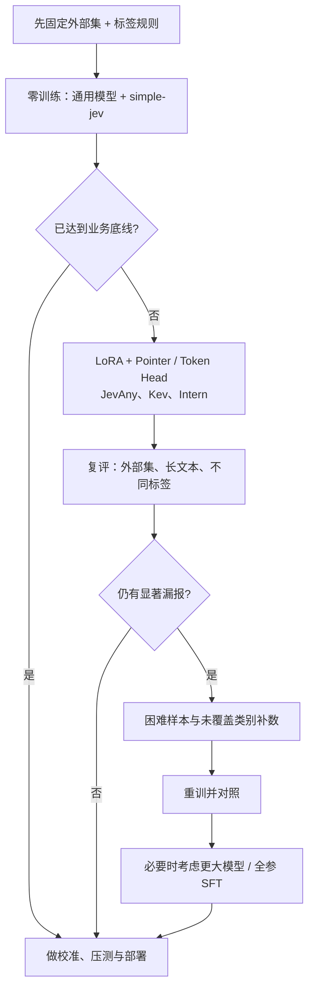

# 类 Jev（System One）结构化决策模型全景调研与工程选型指南

> **调研基准日：2026-11-06**  
> **主题**：Jev 同类结构化决策模型、开源训练/推理框架，以及与内容安全 / 安全告警研判模型的区别  
> **适用读者**：模型研发、微调、数据标注、内容安全审核、安全运营（SOC）、智能体工具调用与工程部署人员  
> **核验原则**：优先引用项目官方 GitHub、Hugging Face 模型卡、厂商技术文档；“官方自报结果”和“第三方评测”严格区分。本文并非所有现存衍生检查点的穷尽目录。

---

## 0. 一页先读懂

**类 Jev 模型**不是某一种违规检测模型的专称，而是以 **“给定状态（state）+ 结构化问题（questions）+ 可选答案（criteria/options）→ 直接输出各选项概率”** 为核心的一类**单次前向决策模型**。它们擅长分类、分流、打分、规则判断、Agent 动作选择和安全审核；但**业务违规标签、网络攻击标签、攻击行为判定能力需要靠训练或验证获得**，不能因为支持 `noul` 就自动认为能检测 SQL 注入、恶意流量或涉政文本。[S01][S02]

本次优先研究以下 18 条代表性路线：

1. **Jev / Jev 1.13 / 1.14**：商业接口、原型参照。
2. **JevAny**：开源“自训 Jev”基础设施及五个公开模型。
3. **StartLux-Decision**：0.8B–27B，多尺寸，Instant / AutoThink 双路线。
4. **Intern-Decision**：0.8B / 2B / 4B，训练、评测与温度校准流程公开。
5. **Kev**：0.8B / 4B / 9B / 27B，LoRA + pointer 读出。
6. **simple-jev（Featherless）**：让通用开放权重模型提供 Jev 风格分类接口的服务框架。
7. **Cloudflare Clef / Clef-flash**：27B / 9B，开源权重及托管服务。
8. **Perplexity pplx-decider**：27B，v1.1 决策专用模型。
9. **Microsoft-Decision-1**：9B 级商业托管决策模型。
10. **H2O-Lightning**：4B、31B 等，文本和图像决策。
11. **Strands Decider**：2B 及 Gemma 4 系列，偏 Agent 低时延场景。
12. **Nace.AI Drex**：9B / 35B-A3B，GGUF、llama.cpp/Ollama。
13. **Surogate Rune**：26B-A4B，长上下文、图像与条件思考。
14. **AutoJev-27B**：公开完整权重训练与评测链路。
15. **Laya**：约 421M 小型双向编码器决策模型。
16. **JevK5**：约 4B 的 Jev 风格蒸馏路线。
17. **SemIf**：开放模型的单步语义条件判断方案。
18. **OpenJev**：多种开放权重底座的兼容运行与服务工程。

**相邻但不等价的安全专用模型**：Qwen3Guard、Llama Guard、Granite Guardian、ShieldGemma 等。这些用于安全政策检测的“Guard”模型与通用决策模型存在明显的目标和输出差异，下文另列专章。

---

## 1. 什么是类 Jev 模型？

### 1.1 和普通 LLM、固定分类器有什么区别

| 维度 | 通用生成式 LLM | 常规固定标签分类器（BERT 等） | 类 Jev / System One 决策模型 | 安全 Guard 专用模型 |
|---|---|---|---|---|
| 主要目标 | 生成回答、解释、推理 | 在固定标签空间分类 | 给定选项/量表，直接决策与评分 | 依据特定安全政策识别风险 |
| 典型输出 | 文本/JSON（生成） | 固定类别 logits | `choice` / `noul` / `score`，候选概率 | safe/unsafe、风险类别、风险分数等 |
| 选项是否可在请求时变化 | 可在提示词中描述 | 通常须改头或重新训练 | **通常支持动态候选**（有模型实现限制） | 通常依赖模型自带类别或提示政策 |
| 计算路径 | 往往需要逐 token 解码 | 一次前向 | 多采用一次前向 + 专用读出头 | 生成式或分类式实现均有 |
| 适合什么 | 开放问题、复杂分析 | 稳定、高吞吐固定任务 | 分类、分流、仲裁、Agent 决策 | 内容安全、越狱检测、风险控制 |
| 重要风险 | 格式漂移、幻觉、推理开销 | 难以动态增加类别 | 问题表述敏感、概率未必校准 | 类别覆盖、策略迁移、语言域差异 |

### 1.2 工作流程图



**三个标准问题类型：**

- `noul`：判断一个命题是否成立。例如“该请求是否包含真实的凭证窃取意图？”输出 `P(true)`。
- `choice`：在指定候选中选一项。例如 `normal / phishing / brute_force / exploit / uncertain`，输出每类概率。
- `score`：对有序刻度评分。例如风险等级 `0/1/2/3/4`，可计算离散分布与期望得分。

**注意**：上面三种问题是通用接口语义，**不同项目的 JSON schema、`score` 标尺上限、问题数量、候选项限制并不完全一致**。需要以对应项目文档为准。

### 1.3 一个适用于安全告警的结构化决策示意

以下 JSON **是跨项目的概念示例，并不保证在所有服务端直接执行**：

```json
{
  "state": "WAF日志: src=192.0.2.10; path=/login; 5分钟失败登录82次; 用户账号12个; 已有单次成功登录",
  "questions": {
    "malicious": {
      "type": "noul",
      "instructions": "这段事件是否高度疑似恶意攻击？",
      "criteria": {"true": "具有攻击迹象", "false": "无充分证据"}
    },
    "attack_type": {
      "type": "choice",
      "instructions": "最匹配的事件类型是什么？",
      "criteria": {
        "brute_force": "口令爆破或密码喷洒",
        "credential_stuffing": "撞库",
        "benign": "正常用户操作",
        "uncertain": "信息不足"
      }
    },
    "severity": {
      "type": "score",
      "instructions": "按所给证据评估告警严重度",
      "criteria": ["低", "中", "高", "严重"]
    }
  }
}
```

这段示例中“失败次数多”只是相关证据，**不能代替 IP 信誉、会话关联、正常基线、真实成功登录行为和人工制定的处置策略**；输出概率并不是攻击事实的证明。

---

## 2. 核心模型全景对比

> 说明：**“可本地”**指存在可用的公开权重或可本地运行的框架，仍受基座许可证、具体硬件和依赖约束；**“多模态”**以对应检查点或官方实现是否提供路径为依据；参数量为官方标称/基座近似值。模型可用性和服务入口会变动。

| 模型家族 | 代表尺寸 / 版本 | 主要实现路线 | 权重/代码 | 多模态现状 | 典型适用方向 | 主要链接 |
|---|---|---|---|---|---|---|
| Jev | 1.13、1.14（不同接入平台） | 托管决策 API | 以 API 为主 | 以对应服务说明为准 | 决策基准、业务接入 | [官方接入文档](https://jev-ai.org/docs/models/)、[第三方模型目录](https://thejevai.com/models) |
| JevAny | Gemma 4B、Qwen 4B/27B、Muse 30B | 冻结基座 + LoRA + pointer/direct-token | 开源基础设施、公开模型 | 支持视觉路径的部分底座 | 自训练、微调、部署 | [GitHub](https://github.com/SimpleJev/JevAny) |
| StartLux-Decision | 0.8/2/4/9/27B，v1.1 | Instant / AutoThink | 开源权重及推理工程 | 部分配置支持图像 | 低延迟决策、难例升级 | [GitHub](https://github.com/StartLuxLabs/StartLux-Decision) |
| Intern-Decision | 0.8/2/4B | 微调 Qwen3.5 主干、专用决策头 | 开源仓库、权重链接 | 可选图像 | 可复现实验、温度校准 | [GitHub](https://github.com/InternLM/Intern-Decision) |
| Kev | 0.8/4/9/27B | LoRA + pointer；27B 全参 | 开源权重/代码 | 主要看具体底座 | 本地训练、轻量部署 | [GitHub](https://github.com/jaredpalmer/kev) |
| simple-jev | 灵活（取决于底座） | 通用 LLM 上单步候选打分 | 开源服务框架 | 部分视觉底座 | 快速接入现有模型 | [GitHub](https://github.com/featherless-ai/simple-jev) |
| Cloudflare Clef | 27B / 9B Flash | Schema 联合打分头 + LoRA | Apache-2.0 权重、云端服务 | 支持图像/视频输入的指定服务 | 边缘服务、业务决策 | [官方发布](https://developers.cloudflare.com/changelog/post/2026-10-01-clef-workers-ai/) |
| pplx-decider | v1.1 27B | 专用 readout + 非因果注意力配置 | 开放权重/推理代码 | 以卡片为准 | 批量分类、决策研究 | [模型卡](https://huggingface.co/perplexity-ai/pplx-decider-v1.1-27b) |
| Microsoft-Decision-1 | Qwen3.5-9B 派生 | 云端单步决策 | Foundry / OpenRouter | **文本** | 企业路由、优先级、审核 | [微软文章](https://commandline.microsoft.com/microsoft-decision-1-model-foundry/) |
| H2O-Lightning | 4B、31B 等 | 结构化读出、可配置决策模式 | 公开模型权重（许可证不一） | 文本与图像 | OCR/图文案件、评测研究 | [4B](https://huggingface.co/h2oai/h2o-lightning-4b)、[31B](https://huggingface.co/h2oai/h2o-lightning-31b) |
| Strands Decider | 2B、Gemma E2/E4/12/26B | LoRA + pointer | 开源模型及训练代码 | Qwen 视觉路径与 Gemma 文本路线有差异 | Agent 决策、低成本 | [GitHub](https://github.com/strands-labs/strands-decider) |
| Drex | v1.5 9B、v2.0 35B-A3B | 决策头 + 多引擎服务 | 公开权重，许可证因版本不同 | 以各版为准 | 本地 Ollama/llama.cpp | [GitHub](https://github.com/nace-ai/drex-decision-models) |
| Surogate Rune | v3 26B-A4B | Gemma4 MoE 选项打分，条件思考 | 公开权重 | 文本、图像 | 大上下文、多模态 | [模型卡](https://huggingface.co/surogate/rune-26b-a4b-GGUF) |
| AutoJev | 27B | Qwen3.8 全参数 SFT + 温度校准 | 开源代码/权重 | 声称支持多模态 | 全参训练研究 | [GitHub](https://github.com/denis-pplx/autojev) |
| Laya | 421M | ModernBERT 双向编码器 + 决策头 | 开放权重 | 文本 | 极小型分流、邮件审核 | [模型卡](https://huggingface.co/convaiinnovations/laya) |
| JevK5 | 4B | 蒸馏 / 单步候选 readout | 公开权重 | 主要文本 | 小尺寸蒸馏实践 | [模型卡](https://huggingface.co/alibiserikbay/JevK5) |
| SemIf | 4B 路线 | 通过开放权重模型读候选分数 | 开源 | 主要文本 | 研究型基线、快速原型 | [项目索引](https://decisioneval.dev/built-with/theoleecj/semif/) |
| OpenJev | 多底座、多尺寸 | Jev 协议兼容推理服务器 | 开源工程 | 依底座 | 兼容 API / 多模型比较 | [GitHub](https://github.com/razorback16/openjev) |

---

# 第一部分：逐模型详细介绍

## 3. Jev（TypeSafe 系列）——这个领域的接口参照

**定位。** Jev 的核心不是生成长文本，而是把材料转化为多个结构化判断：一个状态可同时回答是否、选择和等级评分问题，并输出候选概率。相较在普通聊天模型上写 JSON 提示词，其关键设计目标是让业务程序直接消费决策，而不是解析自然语言。[S01]

**模型与版本。** 部分 Jev 兼容服务文档公开提供 `jev-1.13` 固定版本与 `jev-latest` 浮动别名，示例限制包括 32k 上下文、单请求最多 20 个问题。另一个独立第三方平台目录列出 `typesafe/jev-1.14`，并称其 2026-10-15 已被某浮动别名引用。**不同平台的版本路由/可用性不能合并为同一官方事实**；接入时必须向实际 API 查询 `/models`、保存 `model_version`，避免复现实验时偷偷换版本。[S02][S03]

**训练/推理特点。** 公开兼容 API 可一次下发多个问题；用户不需要为每个类别分别生成自然语言答案。原始 Jev 的完整训练数据、全部权重及细节，不能像 JevAny 那样视作“完整开源自训方案”。

**优势。** 接口与评测生态成熟度相对高；设计目标明确；适合作为商业参照或少样本决策能力的对照组。

**限制。** 不能本地随意改权重；决策概率不等于领域召回率；API 路由、计费、请求限制由供应商决定；评测须固定版本。

**工程用途。** 适合作为 ① 安全工单分流；② 可疑告警升级/忽略建议；③ 内容审核的结构化复核基线；④ 自训模型的质量参考。

- 文档：<https://jev-ai.org/docs/>、<https://jev-ai.org/docs/models/>
- 第三方兼容平台目录：<https://thejevai.com/models>

## 4. JevAny —— 最适合研究“自己训练一个 Jev”的开源框架

**定位。** JevAny 并不是一个单独的基座模型，而是**数据准备 → 选择底座 → LoRA 训练 → 决策头 → 校准/评测 → 推理服务**的一套开源基础设施。项目发布多个预训练适配器，强调 `state + questions + options` 接口。[S04][S05]

**官方公开的五个检查点：**

| 检查点 | 读出方式 | 核心差异 | 选择建议 |
|---|---|---|---|
| JevAny-Gemma-4B | Pointer | Gemma 小模型主干 | 比较不同基座在同一格式下的泛化 |
| JevAny-Qwen3.5-4B | Pointer | Qwen 小模型、动态候选 | 低资源微调首选之一 |
| JevAny-Qwen3.5-4B-Direct-Token | LM token | 直接基于 token 得分读出 | 研究 token head 与 pointer 的取舍 |
| JevAny-Qwen3.8-27B | Pointer | 更大容量，项目默认发布模型 | 对照高性能上限，部署成本较高 |
| JevAny-Muse-Glimmer-30B | Pointer | 不同基座路线 | 模型族泛化对照 |

**两类决策头原理。** `pointer` 把问题与每个候选选项的特征投影到同一空间，计算候选 logits；优势是选项灵活，理论上不被固定 token 标签表严格限制。`lm_token` 将选项映射到冻结的单 token 标签表，利用语言模型现有输出头直接计算分数；实现有 255 候选标签表限制。两者都可避免完整的逐 token 文本生成。[S05]

**官方训练示例（应在仓库根目录执行）：**

```bash
python -m pip install -e '.[train]'
jevany data init --out data/starter
jevany data validate data/starter/train.jsonl
jevany train --config recipes/sft.toml --dry-run
jevany train --config recipes/sft.toml
```

官方 starter 使用 Qwen3.5-0.8B、LoRA rank 16、3 epochs，是跑通工程路径的演示，不是已经针对安全审核最优的参数。项目公开声明其模型训练采用约 **177 万条文本记录 / 218 万个标注决策**；这是**项目自报训练规模**，不代表你的领域无需重训。[S04][S05]

**优势。** 真正支持从零定义任务、制作标签和微调；易扩展到安全告警、工单、内容风险；配套验证、断点继续、训练配置；多个底座可对照。

**限制。** 模型与底座须匹配，不能任意交换权重或读出头；非所有模型都能在小显存单卡完成训练；特定数据转换与类别定义仍需研发；训练标签污染会影响校准。

**建议。** 若目标是“从日志/文本自动生成样本，训练一个类似 Jev 的定制模型”，JevAny 应列为**优先复现项目**；先 0.8B 冒烟，再 4B 完整实验。与已有自动化微调流水线对接时，把 `state/questions/labels` 作为可替换适配层。

- 仓库：<https://github.com/SimpleJev/JevAny>
- 中文介绍：<https://simplejev.org/JevAny/docs/zh.html>
- 训练指南：<https://simplejev.org/JevAny/docs/TRAINING.html>
- 快速入门：<https://simplejev.org/JevAny/docs/quickstart.html>

## 5. StartLux-Decision —— Instant 与 AutoThink 双模式

**定位。** StartLux 的优势是把“多数简单决策”与“需要补充推理的模糊决策”分开。`Instant` 在一次前向中直接打分；`AutoThink` 在置信度不足时触发短推理，再读取答案。它仍然是通用决策模型，不能直接把 Decision Index 排名当作内容安全排行榜。[S06]

**v1.1 家族：**

| 尺寸 | Instant | AutoThink | 适用思路 |
|---|---|---|---|
| 0.8B | 有 | 官方 v1.1 主表未列 | 极轻量、边缘 / 快速过滤 |
| 2B | 有 | 官方 v1.1 主表未列 | 低预算在线判断 |
| 4B | 有 | 有 | 性价比、领域微调对比 |
| 9B | 有 | 有 | 相对更高的复杂决策容量 |
| 27B | 有 | 有 | 更强通用决策、较高资源要求 |

官方还保留 v1 系列部分 35B-A3B 等版本。v1.1 在公开 `Decision Index 0.3` 与 `DecisionPivot` 上发布了各版本分数；例如 4B Instant 的前者为 **67.88**、4B AutoThink 为 **68.21**，但这些**不是安全告警召回率，也不是可直接与其他基准版本混用的指标**。[S06]

**机制图：**



**优势。** 支持不同尺寸和多推理后端；可做高吞吐 S1 + 难例 S2 路由；适合业务分流、内容策略层、Agent 行为许可建议。官方仓库说明支持其专用 vLLM 插件、llama.cpp、MLX、Transformers 等；注意这些后端的 Instant/AutoThink/图像特性支持程度有差异。[S06]

**限制。** AutoThink 会增加低信心样本的延迟，不一定提高安全类的最关键指标；自信但错误的样本不会自动触发升级；阈值 0.6/0.9 是决策门槛而非统一内容违规阈值；训练时的标签空间与生产标签必须核查。

**安全应用建议。** 4B Instant 适合作为低成本可微调候选；4B AutoThink 应只作为同底座消融或升级实验，**不能凭“会思考”就假设召回更高**；对长文本要独立验证切块策略、实体上下文及不同长度分布。

- 仓库：<https://github.com/StartLuxLabs/StartLux-Decision>
- 官方介绍和结果：<https://decision.startlux.com/>
- 详细结果：<https://github.com/StartLuxLabs/StartLux-Decision/blob/main/docs/results.md>

## 6. Intern-Decision —— 开源实验复现和校准较完整

**定位。** Intern-Decision 用 Qwen3.5 语言主干实现 `choice / score / noul`，可提供可选图像；官方仓库包含训练、两种推理后端、基准评测、温度校准及浏览器示例。[S07]

**发布尺寸。** 0.8B / 2B / 4B。文档说明在多模态设置中微调语言主干，冻结视觉塔和投影模块；仓库**未随代码发布全部原始训练数据、内部验证记录及图片**，要区分“提供复现脚本”与“完全复现原作者训练”。

**官方项目公布的一组七套任务准确率平均值**（均在其指定测试集合上）：0.8B **79.38%**、2B **84.68%**、4B **90.02%**。此数为该项目自列实验结果，**不等于跨框架通用准确率，也不等于中文安全违规效果**。[S07]

**优势。** 有明显的端到端研究框架；温度校准和 Brier/ECE 指标可供直接参考；轻量尺寸适合做多随机种子对照；有中文说明。

**限制。** 视觉训练细节与原始数据不完全公开；模型在具体领域分类上需要重新做同源/跨源评测；不同模型的发布温度不可盲目移植。

**建议。** 与 JevAny、Kev 做三方对比时，用同一个输入 schema 转换器、同一测试集和同一温度校准集，重点比 **召回、FPR、ECE、P95 延迟、显存及外部集漂移**。

- 官方代码与中文说明：<https://github.com/InternLM/Intern-Decision/blob/main/README_zh-CN.md>

## 7. Kev —— 本地可训练、模型卡及工程细节透明

**定位。** Kev 是基于 Qwen 主干的开放权重 Jev 风格系列。主要做法是：冻结 Qwen 底座（小模型）+ LoRA + pointer 决策头；27B 的公开版本采用全参数微调。目标是让业务输入直接变成候选概率，并尽量与 System One API 兼容。[S08]

| Kev 版本 | 主要基座 | 训练方式 | 工程提示 |
|---|---|---|---|
| 0.8B | Qwen3.5-0.8B-Base | LoRA + pointer | 轻量、低显存 |
| 4B | Qwen3.5-4B-Base | LoRA + pointer | 优先试验尺寸 |
| 9B | Qwen3.5-9B-Base | LoRA + pointer | 更高容量、更高内存 |
| 27B | Qwen3.8-27B | 全参微调 | 公开文档建议更高显存 |

**训练方法。** 小尺寸主体使用 rank=16 LoRA；训练样本包含公开分类数据、合成策略样本和规则结构样本；每个检查点附校准温度。官方还提供了较完整的训练数据来源、实验记录和测量说明。[S08]

**优势。** 自训脚本可复用；硬件档位覆盖广；模型卡强调“训练覆盖长度”和“真实验证长度”不同，工程资料扎实；易与业务的概率阈值/拒识机制联动。

**限制。** 4B/9B 的长文能力不应根据服务允许 65k tokens 推断；项目明确一些小模型在超出验证范围后会掉点；选项顺序可能影响结果；面向安全领域的低基率事件会使校准更加困难。[S08]

**建议。** Kev-4B 是“对照自训 JevAny-4B”很有价值的控制组，因为架构路线类似，容易从 readout、数据质量和训练超参解释差别。

- 仓库：<https://github.com/jaredpalmer/kev>
- 版本与检查点：<https://github.com/jaredpalmer/kev/releases>

## 8. Featherless simple-jev —— 不重新训练也能暴露 Jev 风格接口

**定位。** `simple-jev` 首先是**推理/服务与评测基础设施**，不是一组已经由原作者按 Jev 训练方式完全复现的专用 Jev 权重。其目标是将多种开放权重 LLM/VLM 放进统一 `classifier / System One` 风格接口，用候选分数避免生成式 JSON 解析。[S09]

**主要能力。** 支持 `choice/noul/score`；可以选择 Qwen、Gemma 等不同基座；特定视觉模型可读图像上下文；包含 JevBench 评测工具和不同候选模板策略。README 明确：它**不声称重现 TypeSafe Jev 原版架构、训练，也不保证相同准确率或校准**。[S09]

**优势。** 如果团队已有现成的 Qwen/Gemma 权重，希望“先做候选概率决策实验，不进行微调”，可快速对照；支持模型服务统一入口；无须在每个任务都手写生成式解析器。

**限制。** 单纯的候选 token 读出不保证业务概率质量；提示/模板策略可能显著影响结论；不同底座的输出标尺需要独立温度拟合；它与 JevAny 一套完整 LoRA 训练器的定位不同。

**建议。** 在验证“专门训练决策头是否必要”时，建立三组：通用 LLM + simple-jev、通用 LLM + 生成式 JSON、LoRA 决策模型。按同等标签和算力做对照。

- 仓库：<https://github.com/featherless-ai/simple-jev>

## 9. Cloudflare Clef / Clef-flash —— 面向工程的开放权重决策家族

**定位。** Cloudflare 在 2026-10-01 发布 Clef（27B）和 Clef-flash（9B），支持 System One 风格请求，部署在 Workers AI，同时公开 Apache-2.0 权重。它们将候选打分作为推理主路径，而不是生成文字。[S10]

**模型机制。** 官方介绍将其描述为冻结 Qwen3.8-27B / Qwen3.5-9B 基座，结合 rank-256 LoRA 与**候选相关的双阶段注意力路由和 schema 联合打分**，让不同问题能够共享上下文但依据各自条件评分。[S11]

**对比。** Clef 适合更强调复杂判别与多字段交互的任务；Clef-flash 优先降低延迟。官网给出 64k 上下文及在 Workers AI 上的托管接口。官方榜单示例包含银行意图、工具选择、事件处理等任务，但**不是中文网络攻击拦截专项评测**。

**优势。** 权重和服务双形态，利于先 API 再自托管；较完善的云原生使用路径；多问题统一判断；有云端计费说明。

**限制。** 离线量化可能造成指标偏移；图像/视频支持、实际 token 上限、问题上限以调用后端及具体版本为准；海外云托管与合规、数据出境应单独审批。

- 官方发布：<https://developers.cloudflare.com/changelog/post/2026-10-01-clef-workers-ai/>
- 技术详解：<https://blog.cloudflare.com/clef-decision-models/>
- Clef 服务文档：<https://developers.cloudflare.com/workers-ai/models/clef/>

## 10. Perplexity pplx-decider-v1 / v1.1-27b —— 大参数量的候选评分模型

**定位。** 基于 Qwen3.8-27B 的公开权重决策模型，v1.1 官方模型卡称改进主要来自解除部分因果掩码、扩展训练数据及校准；通过专用 `readout.safetensors` 打分候选。[S12]

**关键技术点。** README 指出 255×5120 的独立 readout 权重形状，以及不同注意力层的非因果推理配置；用通用生成模型的默认 causal 路径可能无法复现官方结果。预测时的校准温度应只施加一次，不能在服务端与前端重复校准。

**自报结果。** 官方卡列出的 Decision Index 总分从 v1 的 **56.4** 上升至 v1.1 的 **61.56**，Jev 比较值约 57.9；该比较必须绑定该版 Decision Index，不应拿去和新版 0.3 数值比较。[S12]

**优势。** 权重可下载，明确推理细节；适合研究非因果注意力对单步分类的影响；大模型可作为“高资源上限”参照。

**限制。** 对自定义推理引擎适配要求高；高显存；安全任务依旧需要复核训练标签、中文分布和误报率。

- 模型卡：<https://huggingface.co/perplexity-ai/pplx-decider-v1.1-27b>
- 前一版：<https://huggingface.co/perplexity-ai/pplx-decider-v1-27b>

## 11. Microsoft-Decision-1 —— 商业托管的文本决策服务

**定位。** Microsoft 在 2026-10-09 公布 Microsoft-Decision-1，基于 Qwen3.5-9B 后训练，提供结构化候选打分，可用于路由、优先级、内容分类、事件处理与 Agent 控制。通过 Microsoft Foundry 和 OpenRouter 提供服务。[S13]

**能力。** 按微软文档，支持 yes/no、多选、等级评分和规则评分；官方描述文本输入上下文最多 32k token。**微软 Foundry 模型清单明确其仅处理文本，不接受图片、音频或视频**。[S14]

**优势。** 企业云接入和权限管理方便；可用于工程生产系统；不必自行训练或运维；官方列出输入 token 计费（价格会变动，请以平台实时价格为准）。

**限制。** 当前主要依赖托管服务，不属于“公开权重本地训练”的首选；厂商自报跨 36 基准优势不能代替同集审查；数据驻留和可用区域须单独确认。

**建议。** 用于企业安全工单自动分类的 API 对照组；如果必须内网离线训练，应优先开源权重家族。

- 官方介绍：<https://commandline.microsoft.com/microsoft-decision-1-model-foundry/>
- Foundry 文档：<https://learn.microsoft.com/zh-tw/azure/foundry/foundry-models/concepts/models-sold-directly-by-azure>

## 12. H2O-Lightning —— 多尺寸、多模态与可配置拒识机制

**定位。** H2O.ai 的 Lightning 系列针对文本、JSON、会话、图像等材料输出 typed decisions。公开了 4B（Qwen3.5 相关底座）和 31B（Gemma 4 相关底座）等权重。[S15][S16]

**4B。** 官方卡表述为基于 Qwen3.5-4B 的决策模型，支持 `choice/noul/score`，可结合图像进行判断；适合低资源图文检索、审核或表单分类探索。[S15]

**31B。** 官方卡基于 Gemma 4 31B；提供 JevBench、Decision Index、AA/auto 等多种服务模式，包含“不知道”候选的特殊拒识策略，并在其卡片公开了不同评测模式、阈值和权重版本。**31B 模型明确为非商业许可证**，不能把“可下载”视为“可以直接商用部署”。[S16]

**优势。** 关注图文输入和不确定性；模型卡包含部署与评测细节；可作为 OCR、扫描文档、图形化安全事件的研究上限。

**限制。** 大版本硬件成本较高；型号间许可证不统一；拒识机制对指标分母有强影响，不能和“不允许拒识”的模型直接比较；视觉能力必须按同一图像缩放/分辨率协议测。

**建议。** 文本内容审核优先测 4B；扫描图像、截图线索或复杂图文再引入 31B 作为上限；商用前逐一看模型卡 LICENSE。

- H2O-Lightning-4B：<https://huggingface.co/h2oai/h2o-lightning-4b>
- H2O-Lightning-31B：<https://huggingface.co/h2oai/h2o-lightning-31b>

## 13. Strands Decider —— Agent 决策导向、训练与评测记录齐全

**定位。** Strands Decider 面向“LLM 做规划，决策模型在有限候选中选择下一步”的 Agent 生态。项目从 Qwen3.5-2B 发展到 Gemma 4 E2B、E4B、12B、26B-A4B 等版本。[S17]

**架构。** 在语言模型主干上训练 LoRA，替换生成头为轻量 pointer head，通过 `<answer>` 位置与各选项位置的表示计算相对分数。Qwen 路线提供额外的视觉路径，而仓库明确 Gemma 4 那组属于**文本输入**。[S17]

**已公开的模型尺寸与 JevBench 231 题表现**（项目自报，不代表专业安全性能）：

| 系列 | 官方自报 JevBench 正确数 | 主要考虑 |
|---|---:|---|
| Qwen3.5 2B（v1） | 180/231 | 小模型 Agent 路由 |
| Gemma 4 E2B | 180/231 | 极轻量 Gemma 路线 |
| Gemma 4 E4B | 187/231 | 轻量高性价比 |
| Gemma 4 12B | 200/231 | 较大模型的规则理解 |
| Gemma 4 26B-A4B | 207/231 | MoE 大容量 |

**优势。** 对外部题库、困难任务和概率打分有明确实验表；适合复现 pointer 决策头的设计；模型卡与代码强调“有限候选、拒绝自由生成”。

**限制。** JevBench 样本数量有限；报告还需结合不同版本、公开题与私有题的区分；对于 SOC 任务，过高置信度的错误许可比一般问答错误更危险。

- 仓库：<https://github.com/strands-labs/strands-decider>
- JevBench 评测说明：<https://github.com/strands-labs/strands-decider/blob/main/evaluation/jevbench.md>

## 14. Nace.AI Drex —— Ollama / GGUF 路线较鲜明

**定位。** Drex 是能够使用 `state + typed questions` 并返回概率的开放决策模型家族。官方仓库列有 v1.5、v2.0、DLM 等不同路线，均主张无需生成长文本。[S18]

**版本差异。** v1.5 基于 9B 蒸馏 Qwen 相关主干与 pointer 头；v2.0 基于 Qwen3.6-35B-A3B（总 35B，约 3B 激活）的 MoE 底座；DLM 使用扩散语言模型路线。仓库表示支持 Python、llama.cpp 和 Ollama 的特定分支。[S18]

**许可重要提醒。** v1.5/v2.0 在官方表格中标注 **Nace.AI Open RAIL-M**，DLM 标注 **CC BY-NC 4.0**；不是整套都 Apache 2.0。部署前必须逐版检查限制。

**优势。** 对更偏本地服务和 GGUF 的团队较有吸引力；支持小/大不同模型；可用在安全事件分派、准入决策、策略判断。

**限制。** Ollama / llama.cpp 的官方 fork 与主线能力未必相同；量化后概率分布仍须校准；非商用和行为许可约束不容忽视。

- 仓库：<https://github.com/nace-ai/drex-decision-models>
- v1.5 详细说明：<https://github.com/nace-ai/drex-decision-models/blob/main/models/drex-v1.5/README.md>

## 15. Surogate Rune 26B-A4B —— 长上下文多模态 MoE

**定位。** Rune v3 基于 Gemma4 26B-A4B（26.5B 总参数、8/128 专家激活），能够接受文本、结构化材料或图片，通过单步选项概率完成判断；官方模型卡宣称支持 262k 级上下文。[S19]

**特色。** 默认单步读出；可选 `thinking: true`，当信心低于给定门槛时短推理；对文本可独立做温度校准。模型卡明确展示：温度从 1 调到 2 时，其测试中的 ECE 从 **12.5%** 降至 **2.2%**，而 argmax 分类结果不变——这说明“概率质量”与“准确率”是两回事。[S19]

**多模态。** 视觉塔保留；模型卡专门评估截图选点、文档、图表、日常照片等，且证实提高视觉 token 预算会改变结果与延迟。**视觉 token 预算不是免费参数**，安全图像场景须固定预处理策略。

**优势。** 研究多模态、图文混合告警、大篇幅材料时潜力大；提供比较具体的性能/失败说明；MoE 活跃参数低于总参数。

**限制。** 总权重 BF16 仍非常大（模型卡约 51.6GB，仅权重）；MoE 激活参数少不等于显存只占 4B；官方仓库名虽带 `GGUF`，v3 官方卡说明当时主要发布 BF16 safetensors，不能仅按 repo 名推断 GGUF 可用；注意引擎版本与稳定性。[S19]

- 模型：<https://huggingface.co/surogate/rune-26b-a4b-GGUF>

## 16. AutoJev-27B —— 全参微调的研究基线

**定位。** AutoJev-27B 公开代码、权重、训练流程及 API/Playground，基于 Qwen3.8-27B，目标是做单步候选概率决策。其“Auto”主要指**项目开发由自动化代理执行的过程**，不等于每次推理都自动多步思考。[S20]

**训练信息。** 官方描述使用单台 H200、全参数 SFT、约 73,000 条独立训练样本、286 次更新，最终公开的是第 200 次更新检查点。校准采用单独标量温度。[S20]

**自报评估**（自定义评测集）：AutoJev 整体准确率约 **84.60%**、Jev 约 **82.79%**，并附 ECE / Brier；这不能与 JevBench 或 Decision Index 的不同测试混排。

**优势。** 公开训练流程，适合观察全参 SFT 与 LoRA 的取舍；自动化训练项目可参考其资产化方式。

**限制。** 大模型全参微调成本高；训练数据并未在仓库完整附带；不建议将其作为有限 GPU 预算下的首个安全项目。

- 仓库：<https://github.com/denis-pplx/autojev>
- 权重：<https://huggingface.co/denis-pplx/autojev-27b>

## 17. Laya —— 421M 级的“小模型决策”路线

**定位。** Laya 以 ModernBERT-large 为双向编码器基础（约 395M），加入两层决策头后总量约 **421M**，支持 `choice/noul/score`。该路线很适合检验：很多简单分流任务是否根本不需要 4B 生成式主干。[S21]

**应用示例。** 邮件垃圾信息/钓鱼判断、部门路由、简单票据审核、低复杂度规则判断。项目卡片提及邮箱分流领域微调及按候选数量调整温度的校准设计。[S21]

**优势。** 体积小，CPU 或低档 GPU 部署更友好；双向编码器适用于大量短文本；成本和延迟潜力突出。

**限制。** 相比大模型，对复杂多条规则、长文跨段证据、上下文推理能力可能有限；若任务含大量未见攻击概念，要专测迁移；不同语言的真实质量需验证。

**建议。** 将 Laya 列入“传统 ModernBERT/DeBERTa 分类器 vs Jev 类模型”的轻量基线，便于判定增加参数是否值回成本。

- 模型：<https://huggingface.co/convaiinnovations/laya>

## 18. JevK5 —— 4B 单步决策蒸馏路线

**定位。** JevK5 的公开权重位于 `alibiserikbay/JevK5`，以 Qwen3.5-4B 相关底座为主，模型卡列出蒸馏与 Jev 风格单步读出相关来源。[S22]

**技术视角。** 蒸馏希望让较小模型在固定决策问题上学到较大教师的判别方式，因此很适合低资源工程研究：① 用大教师生成概率标签；② 加入人工标注；③ 训练小学生；④ 校准；⑤ 用外部数据考查迁移。

**优势。** 4B 量级易做推理与消融；相比纯生成式模型更容易形成结构化决策接口；模型文件和卡片公开。

**限制。** 蒸馏容易继承教师偏差；某一 JevBench 版本高分不能视为安全拦截高召回；必须核验 checkpoint 版本、量化与推理模板。

- 模型：<https://huggingface.co/alibiserikbay/JevK5>

## 19. SemIf —— 以开放权重模型复刻语义 `if` 的极简路线

**定位。** SemIf 的思想是：不一定针对每个判定都生成一段自然语言，可把自然语言中的判断条件转成模型对候选的相对打分。项目在 JevBench 早期榜单中被列为开放决策替代路线之一。[S23]

**优势。** 适合对照“训练专用头是否真的必要”；有助于理解候选模板、解码方式、标签概率提取如何影响结果；原型验证成本可低于全参微调。

**限制。** 需要格外关注语言模型 token 偏置、选项顺序、提示模板以及概率校准；具体模型/推理实现以项目仓库实时文档为准，**不将第三方索引中的热度数据当作性能证明**。

- 项目介绍索引：<https://decisioneval.dev/built-with/theoleecj/semif/>
- 第三方基准：<https://github.com/fstandhartinger/jevbench>

## 20. OpenJev —— 协议兼容与多模型推理服务工程

**定位。** OpenJev 提供一个独立的 System One 风格服务实现，可将扩散式、传统小编码器、JevK5、Clef 等多种路线接到统一决策接口，方便做 API 对照及离线部署。[S24]

**不是单一模型。** 同一运行框架包含 DiffusionGemma、Laya、Verdict、CLM 等不同模型，不能把 OpenJev 一个名词等同于某个固定参数或一组统一权重。

**优势。** 适合做多模型统一服务协议；对于研发而言，方便将多个后端挂接到相同业务 API，再比较响应时间、概率和稳定性。

**限制。** 很多集成模型是第三方权重，许可证与可信来源不同；某些后端需要专门的 vLLM/llama.cpp 分支；兼容接口不代表等价结果。

- 仓库：<https://github.com/razorback16/openjev>

---

# 第二部分：与 Jev 有交集、但不是同一类的安全护栏模型

## 21. 先划清边界

**通用类 Jev 决策模型**的核心问题是“在你指定的一组选项里，做什么判断”；**安全 Guard 模型**的核心问题是“内容/行为是否违反某套安全政策，以及违反哪一条”。实际项目可组合使用，但不能把两者的默认标签完全等价。

| 模型 | 类型 | 典型输出 | 最适合承担的环节 |
|---|---|---|---|
| Qwen3Guard-Gen | 生成式内容审核模型 | 风险等级/类别等模型规定结构 | 用户输入、LLM 输出审核 |
| Qwen3Guard-Stream | 流式内容审核模型 | token 级安全监控 | 实时模型输出中的持续检测 |
| Llama Guard 4 | 多模态安全审核模型 | 安全分类及相应风险标签 | Prompt / Response 安全检查 |
| IBM Granite Guardian | 多风险评估模型 | jailbreak、RAG 证据性等风险判断 | RAG/Agent 系统护栏 |
| ShieldGemma 1/2 | Google 内容安全模型 | 政策下文本/图像风险 | 特定政策与图像内容审核 |

## 22. Qwen3Guard —— 业务安全审核更直接的专用选择

**官方定位。** Qwen3Guard 基于 Qwen3，公开 **0.6B / 4B / 8B** 的 `Gen` 与 `Stream` 两类模型。官方说明训练数据规模约 **119 万条**带安全标注的提示与回复。[S25]

**Gen 与 Stream 的真正区别：**

- **Gen**：对完整用户请求、模型回复进行审核，适合批量离线评测与入口/出口审核；可根据其规定输出做风险分级和分类。
- **Stream**：加入 token 级分类头，适合检测逐 token 产生的输出，不必等整个回答完成才评估。

**优点。** 原生为安全审核构建；比通用类 Jev 更容易直接作为内容审核 baseline；提供多尺寸和统一安全专用数据。

**不足。** 原生类别定义不必然覆盖每个企业审核细类；中文多标签、广告营销、侮辱谩骂、行业禁语、组合标签可能需要额外标注和规则融合；模型输出类别与最终业务决策必须分离。

**工程建议。** 如果你的主要目标是**中文内容安全**，Qwen3Guard-Gen-4B 与 JevAny/StartLux-4B 在**相同外部验证集**上对比，才有实际意义。类 Jev 擅长“动态政策选择”，Qwen3Guard 擅长“已定义的安全审核任务”。

- 仓库：<https://github.com/QwenLM/Qwen3Guard>

## 23. Llama Guard 4 —— 面向对话模型的多模态安全守卫

**官方定位。** Llama Guard 4 是 **12B** 参数、多模态安全审核模型，主要检测用户输入和模型输出中的问题，并面向 Llama 系列集成。[S26]

**特点。** 对多轮会话、图文组合 Prompt 进行判断；官方注明其优化重点是英语，且模型并非纯图片分类器，图像应与提示文本联合处理。**中文安全审核应单独做语言域测试**。

**优势。** 多模态、对话式大模型生态；安全类别与使用方式较清晰。

**不足。** 中文/地方性违规策略可能与训练政策不同；较重；其多模态支持不是“对所有图片均无限制审核”。

- 官方卡：<https://dev.meta.ai/llama/docs/model-cards-and-prompt-formats/llama-guard-4>

## 24. IBM Granite Guardian —— RAG 和 Agent 风险的专用工具

**官方定位。** Granite Guardian 聚焦 LLM 系统的 Prompt/Response 风险，包括越狱尝试、粗俗内容、RAG 不忠实、工具调用相关幻觉等；同时支持 Bring Your Own Criteria（用户自定义判断标准）。项目在 2026 年还公开了增强自定义规则判断的 Granite Guardian 4.1 8B 进展。[S27]

**优势。** 对安全运营中“AI 系统行为是否符合政策”有明显针对性，适合 RAG、Agent 安全工具链。

**不足。** 它不是网络入侵检测器：没有流量和攻击上下文训练就不能直接认定为 IDS；自定义条件不能等价于形式化授权执行。

- 仓库：<https://github.com/ibm-granite/granite-guardian>

## 25. ShieldGemma —— 文本政策审核和图像安全分别看版本

**定位。** 不能将 “ShieldGemma 2” 描述为“纯文本安全审核 4B 模型”：官方说明 **ShieldGemma 1 为 Gemma 2 的 2B/9B/27B 文本审核路线，而 ShieldGemma 2 是基于 Gemma 3 的 4B 图像安全模型**。[S28]

**优势。** 可定义审核政策；针对图像内容安全有明确目标；发布权重以便做专门的政策适配。

**不足。** 文本与图像版本、输入格式和许可条件必须逐版核查；不建议把图像模型直接作为 WAF 文本日志分类器。

- 官方产品介绍：<https://deepmind.google/models/gemma/shieldgemma-2/>
- 模型卡：<https://ai.google.dev/gemma/docs/shieldgemma/model_card_2>

---

# 第三部分：怎么评估、微调和落地

## 26. 面向业务任务的选型矩阵

| 目标 | 建议先试 | 主要理由 | 不应忽略 |
|---|---|---|---|
| **自训练一个通用类 Jev** | JevAny-4B、Kev-4B、Intern-Decision-4B | 训练与适配相对公开 | 数据转换、读出头、温度校准 |
| **只做 Jev API 等价能力验证** | simple-jev、Clef、Jev 托管 API | 原型迅速、API 可比较 | API 兼容不等于指标等价 |
| **低延迟文本分类/分流** | Laya、Strands 2B、Kev-0.8B、StartLux-0.8B | 尺寸小、推理路径短 | 复杂文本召回率可能下降 |
| **更强复杂规则决策** | StartLux-9B AutoThink、Clef 27B、Rune | 更高容量、条件推理等 | 显存、p95 延迟、错误高置信 |
| **中文内容安全审核** | Qwen3Guard-Gen-4B（专项基线）+ JevAny/StartLux-4B（候选） | 安全专用与通用决策互补 | 原生风险标签不等于企业标签 |
| **网络攻击告警研判** | JevAny/Intern/Kev 4B + 专用规则/IDS/检索 | 适合结构化判断与告警分流 | 需要攻击日志领域样本，不能零样本代替 IDS |
| **Agent 工具调用准入** | Jev 类模型做风险评分 + 确定性授权执行器 | 低延迟、候选动作打分 | **模型不是授权根**；强制检查必须用代码 |
| **图文混合审核** | H2O Lightning、Rune、Clef；安全图像用 ShieldGemma 2 | 视觉输入支持 | 输入分辨率、视觉 token 预算、许可 |

### 26.1 一个务实的两级系统



此图是**建议的工程设计**，不是任何单个开源模型的原始系统架构。合规/授权关键路径务必由独立策略执行器完成强约束。

## 27. 安全日志 / 攻击告警要怎样构建模型输入？

**原始日志不等于判决证据。** 高质量 `state` 不只是拼接一条日志。建议把检测上下文结构化：

1. **事件主体**：源地址、目的资产、协议、时间窗口、请求方法、URL、关联账户（敏感字段应脱敏）。
2. **检测事实**：规则 ID、原始特征、触发次数、行为序列、行为基线、历史相关告警。
3. **攻击证据**：载荷是否明确包含攻击特征、是否存在回显、是否出现权限变更、是否验证成功。
4. **反证据**：可信扫描器、演练窗口、已知误报模式、合法运维任务、告警数据缺失。
5. **输出问题**：是否可疑（`noul`）、攻击类型（`choice`）、严重度（`score`）、是否值得升级（`noul`）。

示例结构：

```json
{
  "timestamp_window": "2026-11-06T08:00:00+08:00/2026-11-06T08:05:00+08:00",
  "source": {"ip": "192.0.2.10", "reputation": "unknown"},
  "target": {"asset_role": "web-login", "exposure": "internet"},
  "observations": {
    "failed_login_count": 82,
    "distinct_accounts": 12,
    "success_count": 1,
    "prior_30d_baseline": "unknown"
  },
  "context": {"authorized_test_window": false, "telemetry_complete": false}
}
```

此示例刻意包含 `unknown` 和 `telemetry_complete=false`：在证据不完整时，模型应具备**拒识/转人工能力**，而不是高置信放行。

## 28. 针对中文内容安全：标签如何设计？

不建议直接照搬任何通用模型的预设候选项。可采用**两阶段、多标签外加最终决策**：

- **一级**：安全 / 需要审核 / 明确违规（业务阈值不同）。
- **二级**：业务定义的违规类型，允许多标签并保留 `unknown` / `other`。
- **理由与证据**：仅作为辅助解释，避免将生成式解释当成模型判断的硬证据。
- **处置**：放行、降权、人工复核、阻断，这一层要由可审计策略与阈值决定，而非简单映射 `argmax`。

通用 `choice` 通常是**单选归一化**，不适合直接表示一段文本同时包含多种违规类型；多标签场景应拆成多个 `noul`、使用多标签头，或使用允许多标签的安全专项模型及后处理。注意不同 `noul` 的概率不一定天然可跨问题比较。

## 29. 统一评测：至少做这些，而不是只看准确率

| 指标 | 公式 / 含义 | 重点 |
|---|---|---|
| Recall / TPR | `TP / (TP + FN)` | 违规/攻击漏报多少 |
| FPR | `FP / (FP + TN)` | 正常内容/正常日志被误封多少 |
| Precision | `TP / (TP + FP)` | 告警有多少真实有害 |
| F1 | `2PR / (P+R)` | 兼顾查准查全，但忽略业务成本 |
| PR-AUC | 精确率-召回率曲线下面积 | 低基率违规通常值得看 |
| ROC-AUC | TPR-FPR 曲线下面积 | 衡量排序能力，不是固定阈值业务点 |
| ECE | 置信度分箱与实际正确率差异 | 判断“0.9 信心”是否可信 |
| Brier | 概率预测的均方型误差 | 概率质量与校准能力 |
| NLL | 对正确类别预测概率的对数损失 | 严重惩罚自信但错误的判断 |
| Coverage–Risk | 自动覆盖率 vs 自动决定错误率 | 决策模型实际落地核心 |
| p50/p95/p99 | 端到端延迟 | 在线生产是否稳定 |
| 显存与吞吐 | 峰值显存、req/s、单位成本 | 可否长期部署 |

**评测必须冻结以下条件：**

1. 原始文件校验和、划分种子、样本 ID、数据去重规则和外部集不可泄漏的承诺。
2. 模型 repo / commit / revision、基座 / LoRA / decision head / tokenizer / 校准参数。
3. 相同候选词、标签解释、模板、输入截断/切分策略。
4. 相同正负标签定义、二分类阈值、宏微平均、无标签/拒识样本处理方式。
5. 各模型独立使用训练外的校准集；**不允许在最终测试集上拟合温度**。
6. 主结果要报告 95% 置信区间、同样本配对比较以及各风险子类混淆矩阵。
7. 对长文本、对抗改写、编码绕过、混杂多类别、跨来源样本单列结果。

### 29.1 为什么不要把不同排行榜数值放在同一个“排名表”

- **Decision Index 0.2 / 0.2.1 / 0.3 / 0.3.1**：版本、权重、测试板块和指标可能不同。不同版本数值不可直接比大小。
- **JevBench**：也有多个发布版本，评分包含智能、校准、延迟、成本等不同权重；固定版本才可以比较。[S29]
- **厂商自报**：通常能代表特定实验，不能直接替代第三方复现。
- **安全任务专测**：中文内容、SIEM、WAF、IDS 公开基准的标签和真实生产风险不同，必须补企业自有的冻结外部数据。

### 29.2 温度校准通俗解释

假设某模型 100 条判断都报告“90% 自信”，真实只正确 70 条，说明它**太自信**。温度缩放通常按 `softmax(logits/T)` 调整概率分布。**它通常不改变 `argmax` 选项，因此不会自动提高固定 argmax 准确率**，但能改进告警分级、自动执行阈值与人工兜底分流。

## 30. 微调方法推荐：从最便宜到最贵



**推荐优先级**：先做严格同集评测和标签对齐；再对 4B 量级做 LoRA；性能不足时优先修正标注覆盖、负样本分布、长文本切分与阈值，最后才考虑 9B/27B 或全参数微调。模型参数更大不意味着目标业务更好。

### 30.1 LoRA 的数据样例需要什么

训练类 Jev 一般需要**输入状态 + 结构化问题 + 正确的候选标签**。训练实现可能要求：

- 每个问题的 gold 选项（`choice`）或 yes/no 标签（`noul`）。
- 对 `score` 指定有序等级、标签范围和校准约束。
- 是否引入软标签分布（teacher soft targets）；并保留原始标注与教师评分版本。
- 保留“难判/信息不足/无可选答案”样本，避免强迫模型在不完整证据下做确定性判断。

**切记**：不同 repo 的 `train.jsonl` 格式不同；不要直接把上面的示例当成 JevAny 的合法训练数据，而应先运行 `jevany data init` 并按其 schema 生成。

## 31. 算力与部署：如何估显存？

**仅模型 BF16 权重**的粗略体积近似 `参数量 × 2 字节`，不含 KV cache、视觉塔额外张量、LoRA、框架开销、激活与优化器状态：

| 尺寸 | BF16 权重理论量级 | 实际提醒 |
|---|---:|---|
| 0.8B | ~1.6 GB | 仍须算额外缓存与环境 |
| 2B | ~4 GB | 多问题长上下文时内存会上升 |
| 4B | ~8 GB | 通常适合 24GB 级 GPU 做量化/LoRA 探索，但取决于序列长度 |
| 9B | ~18 GB | 24GB 级 GPU 上训练/长文本可能吃紧 |
| 12B | ~24 GB | 单卡 BF16 权重就接近 24GB，实际更高 |
| 27B | ~54 GB | 需要大显存、量化或多卡 |
| 31B | ~62 GB | 还应考虑视觉/缓存与许可证 |

**特别提醒**：MoE “26B-A4B / 35B-A3B”中的 A4B/A3B 是大致每 token 激活参数，不表示所有权重只占 4B/3B 的显存。4bit 的权重量级可以下降，但**分类概率、校准与阈值必须重新复验**。

## 32. 实际推荐的基线试验矩阵

将“直接类 Jev”和“安全专用”拆为不同试验组：

| 试验组 | 选择 | 目的 |
|---|---|---|
| G0 固定标签传统模型 | ModernBERT/DeBERTa + 分类头 | 测量小模型底线与吞吐 |
| G1 生成式基线 | 通用 Qwen + 固定 JSON 输出 | 测试自由生成转换的成本 |
| G2 零训练类 Jev | simple-jev + 相同通用 Qwen | 衡量读出方式的贡献 |
| G3 专用开源决策 | JevAny-Qwen 4B | 测量 LoRA + 决策头的贡献 |
| G4 第二实现对照 | Kev-4B / Intern-Decision-4B | 避免只对单仓库架构下结论 |
| G5 低延迟专用决策 | StartLux-4B Instant | 评估生产时延与召回折中 |
| G6 安全专用 | Qwen3Guard-Gen-4B | 直接面向审核的主要参考线 |
| G7 强模型上限（可选） | Clef 27B / Rune / 更大 StartLux | 判断增大模型是否有上限收益 |

### 32.1 成功判据要先冻结

例如内容安全：固定最大可接受 FPR 后，比较能达到的违规 Recall；或固定最低违规 Recall 后，比较最低 FPR 与审核运营成本。对于 SOC：应额外定义**真实攻击的高危漏报代价、自动阻断造成的业务中断代价、未知事件拒识比例和回滚机制**。

### 32.2 一套最小闭环交付

- `dataset_manifest.json`：样本来源、hash、标签、时间窗、分布。
- `model_manifest.json`：基座、LoRA、head、版本、量化和许可证。
- `eval_config.yaml`：候选项、阈值、拒识规则和切分设置。
- `predictions.jsonl`：逐样本真实标签、预测分布、阈值、错误类型。
- `confusion_matrix.csv` + `metrics.json`：分类型指标、区间估计。
- `calibration.json` + 曲线：温度缩放与可靠性图。
- `latency_report.json`：p50/p95、吞吐、显存、成本。
- `error_cases.md`：漏报/误报案例聚类，明确数据问题和模型问题。
- `deployment_card.md`：许可证、适用域、不可自动决策场景、回滚条件。

---

# 第四部分：总结与建议

## 33. 六个最重要的结论

1. **Jev 是通用决策模型而非专属违规模型**；类 Jev 的核心能力是“动态候选 + 单步概率打分”。
2. **想自己训练：优先 JevAny、Kev、Intern-Decision**；它们提供不同程度的训练与评测公开性。
3. **想做生产低时延：关注 StartLux Instant、Cloudflare Clef-flash、Strands、Laya**；要通过自己硬件和真实请求压测。
4. **想做中文内容审核：Qwen3Guard 等安全专用模型必须并列入选**，不要只看通用决策模型的排行榜。
5. **想做真实攻击拦截：模型仅负责风险评分和案件分流**；确定性安全策略、证据关联与阻断必须在工程系统里实现。
6. **决定谁最好，最终只能靠同数据、同任务、同阈值约束下的独立评测**；论文或项目主页排名不能代替本地复验。

## 34. 给研发负责人的具体落地建议

**第一批：4B 与小模型对照。** 选择 JevAny-Qwen3.5-4B、Kev-4B、Intern-Decision-4B、StartLux-Decision-4B Instant、Qwen3Guard-Gen-4B，以及小参数的 Laya/ModernBERT 作为速度基线。先不急于 27B，重点验证数据标签、外部泛化、长文本、漏报聚类、概率校准和部署成本。

**第二批：如果 4B 的关键漏报无法靠数据/规则修复，再引入强模型或组合模型。** 在相同外部集上测试 Clef 27B、StartLux 9B AutoThink、H2O Lightning 或 Rune，计算增量收益；若只是训练标签缺失而非能力不足，大模型通常也不会自动解决业务政策覆盖。

**第三批：形成可持续复评的平台。** 把“候选 schema / 标签映射 / 概率校准 / 业务阈值 / 数据版本”作为独立配置，对所有模型生成统一的 `metrics.json` 与错误样本报告。通过 CI 或日常回归发现版本升级导致的召回/FPR 变化。

---

# 参考来源与官方链接

> 来源编号对应正文 `[Sxx]`。价格、版本、模型卡内容可能更新，推荐使用固定 commit / revision 进行复现实验。

- **[S01]** Jev AI Introduction — <https://jev-ai.org/docs/>
- **[S02]** Jev AI Models (1.13 / latest 与 API 限制) — <https://jev-ai.org/docs/models/>
- **[S03]** TheJevAI 第三方模型目录（含 1.14，非 Jev 官方统一目录）— <https://thejevai.com/models>
- **[S04]** SimpleJev / JevAny 官方 GitHub — <https://github.com/SimpleJev/JevAny>
- **[S05]** JevAny 官方训练文档 — <https://simplejev.org/JevAny/docs/TRAINING.html>
- **[S06]** StartLux-Decision 官方 GitHub — <https://github.com/StartLuxLabs/StartLux-Decision>
- **[S07]** Intern-Decision 中文 README — <https://github.com/InternLM/Intern-Decision/blob/main/README_zh-CN.md>
- **[S08]** Kev 官方 GitHub 与 releases — <https://github.com/jaredpalmer/kev> · <https://github.com/jaredpalmer/kev/releases>
- **[S09]** Featherless simple-jev GitHub — <https://github.com/featherless-ai/simple-jev>
- **[S10]** Cloudflare Clef 官方发布日志（2026-10-01）— <https://developers.cloudflare.com/changelog/post/2026-10-01-clef-workers-ai/>
- **[S11]** Cloudflare Clef 技术文章 — <https://blog.cloudflare.com/clef-decision-models/>
- **[S12]** pplx-decider-v1.1-27b 官方模型卡 — <https://huggingface.co/perplexity-ai/pplx-decider-v1.1-27b>
- **[S13]** Microsoft-Decision-1 官方介绍（2026-10-09）— <https://commandline.microsoft.com/microsoft-decision-1-model-foundry/>
- **[S14]** Microsoft Foundry 模型能力目录 — <https://learn.microsoft.com/zh-tw/azure/foundry/foundry-models/concepts/models-sold-directly-by-azure>
- **[S15]** H2O-Lightning-4B 官方模型卡 — <https://huggingface.co/h2oai/h2o-lightning-4b>
- **[S16]** H2O-Lightning-31B 官方模型卡（注意非商业许可）— <https://huggingface.co/h2oai/h2o-lightning-31b>
- **[S17]** Strands Decider 官方 GitHub — <https://github.com/strands-labs/strands-decider>
- **[S18]** Nace.AI Drex 官方 GitHub — <https://github.com/nace-ai/drex-decision-models>
- **[S19]** Surogate Rune v3 官方模型卡 — <https://huggingface.co/surogate/rune-26b-a4b-GGUF>
- **[S20]** AutoJev 官方 GitHub 与模型卡 — <https://github.com/denis-pplx/autojev> · <https://huggingface.co/denis-pplx/autojev-27b>
- **[S21]** Laya 官方模型卡 — <https://huggingface.co/convaiinnovations/laya>
- **[S22]** JevK5 官方模型卡 — <https://huggingface.co/alibiserikbay/JevK5>
- **[S23]** SemIf 项目索引（第三方）— <https://decisioneval.dev/built-with/theoleecj/semif/>
- **[S24]** OpenJev 官方 GitHub — <https://github.com/razorback16/openjev>
- **[S25]** Qwen3Guard 官方 GitHub — <https://github.com/QwenLM/Qwen3Guard>
- **[S26]** Meta Llama Guard 4 官方模型卡 — <https://dev.meta.ai/llama/docs/model-cards-and-prompt-formats/llama-guard-4>
- **[S27]** IBM Granite Guardian 官方 GitHub — <https://github.com/ibm-granite/granite-guardian>
- **[S28]** Google DeepMind ShieldGemma 官方资料 — <https://deepmind.google/models/gemma/shieldgemma-2/>
- **[S29]** JevBench 官方仓库（注意不同版本）— <https://github.com/fstandhartinger/jevbench>
- **补充**：Decision Index / 对照结果 — <https://huggingface.co/spaces/multimodalart/jev-decision-index>；StartLux 结果 — <https://github.com/StartLuxLabs/StartLux-Decision/blob/main/docs/results.md>

---

*文档状态：基于截至 2026-11-06 可访问的公开资料编写。所有跨项目排名均需核对基准版本、测试集、推理引擎、量化、硬件及评分分母。*
