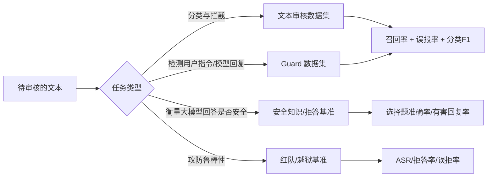
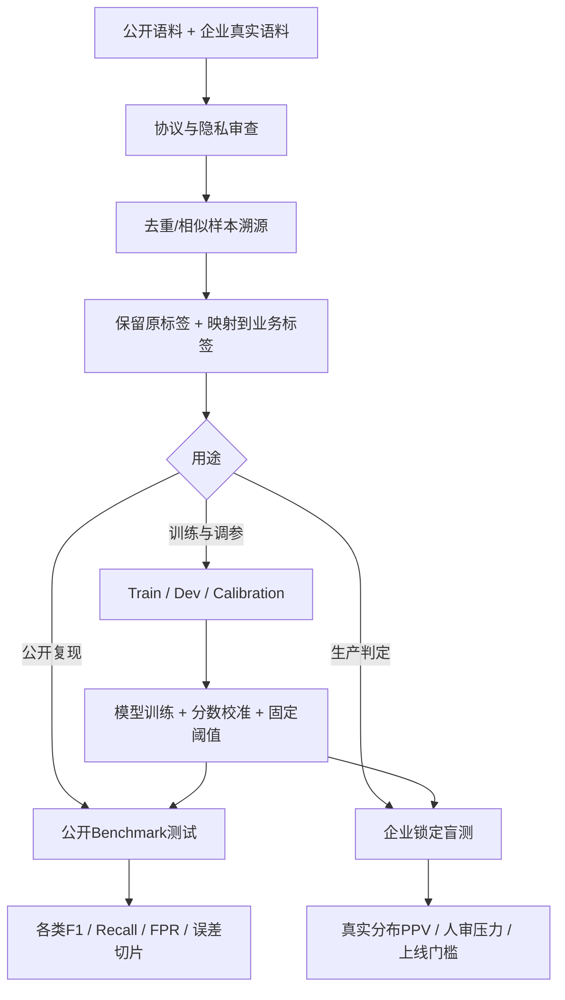

# 内容安全公开数据集与 Benchmark 全面调研（文本为主）

> **版本**：2026-11-06  
> **范围**：中文、英文、多语言的文本内容安全检测、审核模型（Safety Guard / Moderation）、大语言模型安全评测、越狱与误拒答。  
> **重点**：面向中文内容审核模型的训练、外部评估、阈值校准及生产上线选型。  
> **说明**：公开可访问 ≠ 开源可商用。下载前以具体数据集页面的最新协议、访问条件和使用条款为准；表内数量是官方公开版本的规模，可能随版本更新。文档只列已能定位到项目主页、论文、仓库或数据卡的资源；尚未核实的数据量明确不填写。

---

## 目录

1. [先搞清楚：数据集与 Benchmark 有什么不同](#1-先搞清楚数据集与-benchmark-有什么不同)
2. [快速选型：哪些最适合中文内容审核](#2-快速选型哪些最适合中文内容审核)
3. [中文文本内容安全数据集详解](#3-中文文本内容安全数据集详解)
4. [英文与多语言内容安全数据集详解](#4-英文与多语言内容安全数据集详解)
5. [公开 Benchmark 与评测框架详解](#5-公开-benchmark-与评测框架详解)
6. [各数据集与业务风险标签如何映射](#6-各数据集与业务风险标签如何映射)
7. [建议的标准化评测协议](#7-建议的标准化评测协议)
8. [可运行的 Python 评测模板](#8-可运行的-python-评测模板)
9. [针对中文内容安全项目的落地路线](#9-针对中文内容安全项目的落地路线)
10. [统一地址索引与补充资源](#10-统一地址索引与补充资源)

---

## 1. 先搞清楚：数据集与 Benchmark 有什么不同

**数据集（Dataset）** 是一批样本及其标注。可以拿来训练、验证或测试，但并不是所有数据集都有可信的独立测试集。

**Benchmark（基准测试）** 是一整套相对固定的测评对象、任务定义、输入输出规范、评分指标以及有时附带的排行榜或执行代码。例如，Jigsaw 同时是数据集和竞赛基准；GuardBench 则是统一封装多个数据集的评测工具；HarmBench 更偏向越狱攻击和生成响应的风险评估。

**必须区分四种任务：**

| 任务 | 输入 | 模型输出 | 主要指标 | 典型资源 |
|---|---|---|---|---|
| **A. 文本审核** | 待审核的帖子/评论/广告/长文 | 正常/违规、违规类型、分数 | 违规召回、正常误报率、Macro-F1、AUROC/AUPRC | ChineseHarm-Bench、COLD、ToxiCN、Jigsaw、Civil Comments |
| **B. LLM Guard 判别** | 用户 Prompt 或 Prompt+Response | 输入是否有害、回复是否有害、是否拒答 | Prompt/Response F1、Precision/Recall、FPR | ToxicChat、WildGuardTest、Aegis 2.0、OpenAI Moderation Eval |
| **C. LLM 安全知识/安全行为** | 选择题或风险问题 | 答案或拒答/安全回应 | 选择题 Accuracy、危险回答率、合理拒答率 | SafetyBench、CHiSafetyBench、ChineseSafe、Do-Not-Answer |
| **D. 越狱/红队** | 攻击提示词 | 目标模型生成的回答 | 攻击成功率 ASR、危险输出率、过度拒答 | HarmBench、JailbreakBench、SALAD-Bench、StrongREJECT、XSTest |

**关键结论**：如果目标是给一段中文文本判定“是否违规”，应优先使用 A、B 类中的分类标注数据；不能把 C 类选择题正确率或 D 类越狱成功率当成生产内容审核召回率。



---

## 2. 快速选型：哪些最适合中文内容审核

### 2.1 重点推荐的 12 项

| 优先级 | 名称 | 语言 | 公开规模 | 更适合的目的 | 能否直接用作中文审核评测 |
|---|---|---|---|---|---|
| ★★★★★ | [ChineseHarm-Bench](https://github.com/zjunlp/ChineseHarm-bench) | 中文 | **15,515 条** | 赌博/色情/辱骂/诈骗/违规广告/正常的真实文本分类 | **非常适合**，但需做规则对齐 |
| ★★★★★ | [ChineseSafe](https://huggingface.co/datasets/SUSTech/ChineseSafe) | 中文 | **20,000** | 多主题中文文本是否违规+主题标签 | **很适合**，需检查标注口径 |
| ★★★★★ | [COLD](https://github.com/thu-coai/COLDataset) | 中文 | **37,480** | 冒犯/辱骂、针对个人或群体的攻击 | **适合对应子类** |
| ★★★★★ | [ToxiCN](https://github.com/DUT-lujunyu/ToxiCN) | 中文 | **约 12,000** | 仇恨、歧视、显性/隐性冒犯、对象识别 | **适合对应子类** |
| ★★★★☆ | [ShieldLM 部分训练集](https://github.com/thu-coai/ShieldLM) | 中英 | **中英各 2,000 条公开训练样本** | 生成内容三分类及可定制安全规则 | 适合 Guard 任务补充 |
| ★★★★☆ | [WildGuardMix / WildGuardTest](https://huggingface.co/datasets/allenai/wildguardmix) | 主要英语 | Train **86,759**；Test **1,725 条记录** | Prompt/Response/Refusal 三任务 | 英语 Guard 外部对照 |
| ★★★★☆ | [Aegis 2.0](https://huggingface.co/datasets/nvidia/Aegis-AI-Content-Safety-Dataset-2.0) | 主要英语 | **33,416** | 多风险分类、输入/输出审核 | 适合跨体系迁移与对比 |
| ★★★★☆ | [Nemotron Safety Guard v3](https://huggingface.co/datasets/nvidia/Nemotron-Safety-Guard-Dataset-v3) | **12 语言含中文** | **514,617** | 多语言 Guard 训练/测试 | 适合中文迁移，需检验合成偏差 |
| ★★★★☆ | [ToxicChat](https://huggingface.co/datasets/lmsys/toxic-chat) | 英语 | **10,166** | 真实用户—AI 交互中有害 Prompt 和 jailbreak | 良好的跨域外测 |
| ★★★★☆ | [HateCheck](https://github.com/paul-rottger/hatecheck-data) | 英语 | **3,728** | 反事实、否定、引用等“容易误判”功能测试 | 适合构造中文对应硬例 |
| ★★★★☆ | [GuardBench](https://github.com/AmenRa/GuardBench) | 多个数据集 | **统一对接约 40 个评测集** | 审核模型横向复现、导出报告 | 值得作为评测基础设施 |
| ★★★☆☆ | [SafetyBench](https://github.com/thu-coai/SafetyBench) | 中文/英语 | **11,435** | 大模型安全知识、风险推理 | **不直接等于审核分类测评** |

### 2.2 按目标选，而不是按数据量选

- **训练中文文本审核分类器**：ChineseHarm-Bench 的任务结构和类别最贴近实际业务；再根据需要引入 ChineseSafe、COLD、ToxiCN。公开集补充“真实业务数据没有覆盖的风险类型”，不应覆盖企业自己的审核标准。
- **评测审核模型在外部域能否泛化**：ChineseHarm-Bench 独立测试、ChineseSafe、COLD、ToxiCN，并使用公司自己“人工复核、未参与任何训练/阈值调整”的锁定测试集。
- **评测 Guard 类输入输出安全判别器**：ToxicChat、WildGuardTest、Aegis 2.0；中英跨语言实验加 Nemotron Guard v3 的中文测试部分。
- **评测拒答/过度防御**：Chinese Do-Not-Answer、XSTest。**评测越狱**：JailbreakBench、HarmBench、SALAD-Bench。
- **有商用计划**：先筛查许可证。ChineseHarm-Bench 数据、ChineseSafe、BeaverTails、Do-Not-Answer 等带非商业条件，不应未经授权混入商业训练。

---

## 3. 中文文本内容安全数据集详解

### 3.1 ChineseHarm-Bench：最贴近中文商业文本审核

- **官方仓库**：https://github.com/zjunlp/ChineseHarm-bench
- **项目主页**：https://zjunlp.github.io/project/ChineseHarm-Bench/
- **数据入口**：https://github.com/zjunlp/ChineseHarm-bench/tree/main/benchmark
- **Hugging Face 数据页**：https://huggingface.co/datasets/zjunlp/ChineseHarm-bench
- **直接获取 JSON**：https://huggingface.co/datasets/zjunlp/ChineseHarm-bench/resolve/main/bench.json
- **数据规模**：官方 Hugging Face 数据页公布 **15,515 条**；其 `train` 是数据托管平台显示的 split 名称，不代表可在正式 Benchmark 实验中直接用于模型训练。
- **模型/资源集合**：https://huggingface.co/collections/zjunlp/chineseharm-bench
- **任务**：专业标注的中文有害内容检测，多类别文本分类；提供规则知识库、基线模型和计算指标的脚本。
- **官方类别**：**Gambling（赌博）、Pornography（色情）、Abuse（辱骂）、Fraud（诈骗）、Illicit Ads（违规广告）、Non-Violation（不违规）**，即 5 类风险 + 1 类正常。
- **数据来源与特点**：论文/项目说明含真实业务场景专业标注，致谢腾讯数据支持；较一般“让大模型拒答”的公开集更接近用户发布内容审核。
- **使用流程**：下载 `benchmark/bench.json` → 确认 `标签` 等字段 → 将本地审核模型的输出映射为六类 → 使用项目的 `calculate_metrics.py` 算类别 F1 / Macro-F1 → 再另算二分类召回、正常误报率、混淆矩阵。
- **优点**：有正常类；涵盖许多学术安全集少见的**赌博、诈骗、违规广告**；给出行业相关知识增强基线及可复现脚本。
- **限制**：这六类**不覆盖所有审核政策**；“违规广告”需明确与自家政策对齐；已核实发布总量 15,515 条；各类分布和变体版本仍应读取实际文件统计，不宜据论文图猜测。
- **许可**：仓库代码显示 MIT，但**项目明确声明 Benchmark 数据以 CC BY-NC 4.0 许可发布**；不要把代码许可误当数据商用许可。
- **建议**：中文分类器外部评测第一梯队；如需“证券荐股引流、政治/宗教、垃圾营销、黑灰产”，仍需额外构造对应业务金标集。

### 3.2 ChineseSafe：大规模中文“违规/不违规”文本评测

- **数据地址**：https://huggingface.co/datasets/SUSTech/ChineseSafe
- **论文**：https://arxiv.org/abs/2410.18491
- **数量**：**20,000**，公开数据卡提供 `test` split。
- **格式**：`text`（文本）、`label`（违规/不违规）、`subject`（主题类别；数据查看器展示 11 种主题值）。
- **任务**：检测中文文本是否违规，并细分主题；同时包含正常文本，适合计算二分类误报率。
- **优点**：可直接按文本输入安全判别器；不必先生成回答。还可按 `subject` 进行类别分析。
- **限制**：数据卡中一些心理健康或隐私话题的“违规”定义可能比企业审核标准宽，**必须在本地抽样复审**。公开 `test` 不代表可拿来训练后再报告独立成绩。
- **许可**：CC BY-NC 4.0。
- **建议**：中文外部泛化测试；试运行时先做 200–500 条人工抽样核对争议标签。

### 3.3 COLD：中文冒犯语言检测经典基准

- **仓库**：https://github.com/thu-coai/COLDataset
- **论文**：https://aclanthology.org/2022.emnlp-main.796/
- **数据规模**：**37,480** 条微博/知乎等中文评论。
- **标签**：训练/验证是 0=`safe`、1=`offensive`；测试集进一步区分：对个人攻击、对群体攻击、反偏见的安全文本、其他正常文本。
- **任务**：脏话、冒犯、语言攻击，尤其适合检查反偏见语句被错判为辱骂的问题。
- **用法**：保留官方划分；二分类看 Recall/FPR，四类测试报告细粒度指标；可用官方 RoBERTa-COLD 基线对照。
- **优点**：真实中文社交媒体，且包含“反偏见但表面出现敏感词”的硬负例。
- **短板**：主要是冒犯性，不是覆盖色情、违法、广告、诈骗的通用审核全集。
- **许可**：项目仓库 Apache-2.0；复用平台内容应同时检查源数据条件。

### 3.4 ToxiCN：显性与隐性歧视、仇恨细粒度检测

- **仓库**：https://github.com/DUT-lujunyu/ToxiCN
- **数据**：https://huggingface.co/datasets/JunyuLu/ToxiCN
- **论文**：https://aclanthology.org/2023.acl-long.898/
- **规模**：约 **12k** 条知乎、贴吧评论。
- **标签层次**：`toxic`（是否有害）；`toxic_type`（正常/一般冒犯/仇恨）；`target`（受攻击群体）；`expression`（显性/隐性/报告性表述）。涉及性别、地区、族群、LGBTQ 等对象。
- **使用**：先做 `toxic` 二分类，再做类别/对象识别；重点查看 `expression=implicit` 的漏报和 `reporting` 的误报。
- **优势**：专门覆盖**隐晦、反讽、群体攻击**，比只检测脏词更能衡量语义能力。
- **限制**：不要把所有“提及敏感群体”的语句自动判为仇恨；作者明确说明资源**仅用于科研、禁止商业用途**。

### 3.5 STATE-ToxiCN：中文仇恨的片段级证据定位

- **仓库**：https://github.com/shenmeyemeifashengguo/STATE-ToxiCN
- **成果**：ACL 2025 Findings。
- **任务**：不是只输出一句话的二分类，而是抽取与攻击对象、毒性相关的文本片段（span）。
- **用法**：适合训练/评测“违规片段定位”“命中理由高亮”“人工审核解释”。
- **优势**：为可解释审核和样本错误分析提供证据；补充 COLD/ToxiCN 的句级标签。
- **限制**：span 标注与业务审核规则可能不一致；不适合作为多类业务违规的唯一主基准。

### 3.6 ShieldLM：中英可解释安全检测器及部分开放训练数据

- **仓库**：https://github.com/thu-coai/ShieldLM
- **定位**：双语内容安全评估器，支持 `safe / unsafe / controversial`，可配置判定规则、输出解释。
- **已公开训练数据**：官方说明公开一部分，**2,000 条中文 + 2,000 条英文**；不是完整训练语料。
- **使用**：参考 `train_code/` 进行转换和微调；对争议类不要强行映射为“正常”，应按自家 policy 单列审核或复核。
- **优势**：能向模型明确告知规则，适合多种审核政策的迁移实验和对比。
- **限制**：本质更接近 LLM 输出安全检测；公开样本量有限。底座模型授权与训练数据授权需分别确认。

### 3.7 Safety-Prompts（中文）：中文有害指令场景库

- **仓库**：https://github.com/thu-coai/Safety-Prompts
- **数据卡**：https://huggingface.co/datasets/thu-coai/Safety-Prompts
- **规模**：约 **100,000** 条中文风险场景 Prompt 及模型回复。
- **覆盖**：侮辱、歧视、违法犯罪、身体伤害、心理健康、隐私财产、伦理道德，以及目标劫持、提示泄漏、角色扮演等指令攻击。
- **用法**：选择特定风险主题，生成目标模型响应，再用人工或安全判别器评估；也可把风险 Prompt 作为 Guard 输入样本，但必须重新明确二分类“是否有害”的政策定义。
- **优点**：中文安全场景覆盖广，适合补训练集覆盖面和红队用例。
- **限制**：它主要不是“普通用户评论 + 经人工复核的正常/违规金标”的审核基准。项目也推荐 SafetyBench 用于更标准的知识式评测。HF 上嵌套 JSON 可能需按 `field` 分块读取，不能假定一行一个样本。
- **许可**：项目数据卡标注 Apache-2.0；仍应查看原仓库内容条款。

### 3.8 Chinese Do-Not-Answer：中文风险提示与误拒答对照

- **仓库**：https://github.com/Libr-AI/do-not-answer （含 Chinese Do-Not-Answer 章节）
- **论文**：https://aclanthology.org/2024.findings-acl.184/
- **规模**：扩展后的 **3,042** 条中文问题，基础风险问题 1,014 条，并构造 FN 和 FP 对照。
- **设计**：风险表达绕过（检查漏识别）和含敏感词但实际正常（检查过度敏感）。
- **适用**：中英文安全护栏、拒答模型、prompt 判别器的风险灵敏度与误杀测试。
- **局限**：问题集的“应该拒答”政策不能自动等价为平台对用户发布内容的“违规”。
- **许可**：仓库说明**数据 CC BY-NC-SA 4.0**；代码 Apache-2.0，不能混淆。

### 3.9 SafetyBench：中英大模型安全知识选择题

- **仓库**：https://github.com/thu-coai/SafetyBench
- **数量**：**11,435** 道中英文多项选择题，涵盖 7 类风险。
- **评测**：zero-shot / five-shot，抽取选项并算 Accuracy；2025-07-28 官方宣布开放全部测试答案。
- **适用**：检查模型能否理解安全知识和规范；对不同底座安全认知水平作横向比较。
- **不适用**：不能拿选择题 Accuracy 直接与生产文本拦截召回率比较，考试题和真实评论语体不同。
- **许可**：GitHub 仓库 MIT；下载测试集时复核数据侧声明。

### 3.10 CHiSafetyBench：中文分层风险识别 + 拒答评测

- **数据/仓库**：https://github.com/UnicomAI/UnicomBenchmark/tree/main/CHiSafetyBench
- **论文**：https://arxiv.org/abs/2406.10311
- **风险体系**：**5 个风险大域、31 个细分类**。
- **任务**：多选题（风险识别）和问答题（风险应答/拒答），部分问答引入对话历史。
- **指标**：风险识别 ACC；拒答率、负责任回应率和有害回复率。
- **适用**：中文 LLM 风险分类和安全响应能力的多层级诊断。
- **限制**：主要测生成大模型行为，不是纯生产审核器测试。数据总量以仓库实际配置为准。

### 3.11 ChineseSafe、CSEI 与 CValues 的区别

**CSEI-SafetyBench**

- 地址：https://huggingface.co/datasets/BAAI/CSEI-SafetyBench
- 规模：**1,000** 条中文 Prompt，其中 **600 显性风险、400 隐性/上下文依赖风险**。
- 适合：判断隐晦风险识别和语境迁移；数据仅提供 Prompt，不能直接作为具有完整安全/不安全金标的准确率测试。
- 许可：数据卡标注 `other`；仓库 LICENSE 需人工核实，不能默认可商用。

**CValues / CValues-Comparison**

- 地址：https://github.com/X-PLUG/CValues
- 规模：公开的 `CValues-Comparison` 约 **145k 正负回答比较对**，为安全对齐/奖励模型用途。
- **重要可用性区别**：论文里的 **1.3k 安全 prompts、2.6k 安全 MC prompts 明确没有公开**。不能因为论文提及就把它们列成“可以下载的公开测试集”。实际对外提供的包括 Comparison 与责任评估相关数据。
- 适合：偏好训练、Reward Model、回答安全对齐；不优先用作普通用户文本内容分类主测试集。

### 3.12 ZHateBench：中文生成式冒犯数据补充（慎用）

- 地址：https://huggingface.co/datasets/RYOAL/ZHateBench
- 数据卡称约 **53,609** 条 harmful/safe 对，分色情暗示、辱骂攻击、社会偏见。
- 用法：作为中文句子级训练增强/压力测试候选。
- 风险：生成语料与真实分布偏离，标注/许可需核查；如未发表可靠的独立验证研究，不应把成绩作为核心论文结论。

---

## 4. 英文与多语言内容安全数据集详解

### 4.1 Jigsaw Toxic Comment Classification（经典六标签审核）

- **Kaggle**：https://www.kaggle.com/c/jigsaw-toxic-comment-classification-challenge/data
- **训练集**：常用公开版训练约 **159,571** 条 Wikipedia 讨论区评论；测试集另行提供，竞赛数据含未计分记录。
- **六个非互斥标签**：`toxic`、`severe_toxic`、`obscene`、`threat`、`insult`、`identity_hate`。
- **用途**：多标签文本毒性分类、BERT/DeBERTa 等基础能力对照、阈值优化。
- **限制**：英语维基百科语体偏差强；“辱骂”不等于所有违法违规。计算分数时要处理官方 `test_labels=-1`（不计分）数据。
- **访问**：通常须接受 Kaggle 竞赛条款；项目描述提及数据集 CC0、底层 Wikipedia 文本 CC-SA 3.0 等许可事项，应以实际资源页为准。

### 4.2 Civil Comments / Jigsaw Unintended Bias（偏见和误报）

- **Hugging Face**：https://huggingface.co/datasets/google/civil_comments
- **Kaggle**：https://www.kaggle.com/c/jigsaw-unintended-bias-in-toxicity-classification/data
- **规模**：约 **200 万** 条 Civil Comments（具体配置/切分有别）。
- **核心列**：`text`、`toxicity`、`severe_toxicity`、`identity_attack`、`insult`、`obscene`、`sexual_explicit`、`threat` 等，部分标签为连续值。
- **用途**：训练/测量偏差与过度拦截，评估“提及身份词汇但并无仇恨”时的误报。
- **限制**：需要固定将连续标签转成阳性/阴性的阈值；上游样本之间可能有上下文依赖，拆分时要排查泄漏。
- **许可**：官方发布信息描述 CC0，但应核验所使用镜像及原始文本细节。

### 4.3 Jigsaw Multilingual Toxic Comment（多语种迁移）

- **地址**：https://www.kaggle.com/c/jigsaw-multilingual-toxic-comment-classification/data
- **内容**：主要英语训练数据，测试与验证含多种非英语维基评论。
- **标签**：`toxic` 二分类，数据可带 `lang`。
- **用途**：衡量“只用英语训练，在其他语言预测”是否退化，报告 per-language F1/FPR。
- **限制**：不要当作“中国业务语境已被真实覆盖”的证据；具体语种列表及样本量按当前下载版本统计。

### 4.4 ToxicChat（真实 AI 对话中的有害用户输入）

- **数据**：https://huggingface.co/datasets/lmsys/toxic-chat
- **项目说明**：https://www.lmsys.org/blog/2023-10-30-toxicchat/
- **规模**：**10,166** 条，官方最初 10K 版本；来源于 Vicuna / Chatbot Arena 真实互动中的用户输入。
- **标注**：是否 Toxic，以及是否 Jailbreaking；官方描述总体毒性比例约 7.18%。
- **适合**：面向用户 Prompt 的 Guard 模型，尤其能发现传统社交平台 toxic 训练集迁移到 AI 对话时的性能下降。
- **注意**：其中并非所有有害意图都通过粗俗词表达；数据分布正例很少，主报 AUPRC、Precision、Recall 和 FPR，不能只报 Accuracy。

### 4.5 WildGuardMix / WildGuardTest（最推荐的 Guard 外部测评之一）

- **地址**：https://huggingface.co/datasets/allenai/wildguardmix
- **代码**：https://github.com/allenai/wildguard
- **训练集 WildGuardTrain**：**86,759** 条，其中 **48,783 prompt-only、37,976 prompt-response**。
- **测试集 WildGuardTest**：**1,725 条样本记录**，可用于三个任务：`prompt harmfulness`、`response harmfulness`、`response refusal`。注意有些论文把三个任务的标注合计称为约 5,299 个人工标注单元，**不要误认为有 5,299 条独立测试记录**。
- **优势**：正常/有害、普通/对抗样本同时存在；不仅看输入有害，还看回答本身是否有害、是否拒答；人工复核测试标注。
- **限制**：以英语为主，合成比例较高；如训练过 WildGuardTrain，务必另留真正独立的外部基准。

### 4.6 Aegis AI Content Safety Dataset 2.0（行业 Guard 训练数据）

- **地址**：https://huggingface.co/datasets/nvidia/Aegis-AI-Content-Safety-Dataset-2.0
- **规模**：**33,416** 条，官方 `train=30,007`、`validation=1,445`、`test=1,964`。
- **标签体系**：12 个一级危险类，加细分子类（官方描述有 9 个细分子类）。
- **任务**：用户请求和 LLM 回复的风险分类，可用于训练或横向评测 Guard 类模型。
- **优势**：有明确的训练/验证/测试划分及可扩展风险体系；适合对照 Llama Guard/Aegis/NemoGuard 风格分类器。
- **限制**：部分样本及响应来自已有偏好数据和模型生成，原生不代表中国商业审核分布。
- **许可**：NVIDIA 发布资源说明为 CC BY 4.0；使用时以数据卡为准。

### 4.7 Nemotron Safety Guard Dataset v3（包含中文的大规模多语安全数据）

- **地址**：https://huggingface.co/datasets/nvidia/Nemotron-Safety-Guard-Dataset-v3
- **规模**：**514,617** 条，覆盖 **12 种语言**，包括中文（Mandarin）。有 `train/valid/test`。
- **字段**：`prompt`、`response`、`prompt_label`、`response_label`、`violated_categories`、`language` 等。
- **构造**：较大比例通过翻译、文化适配和合成数据构建；标签沿 Aegis 风险体系。
- **用途**：用于中英多语 Guard 训练、比较同一模型跨语言漏报与误报。
- **注意**：它**并非 51 万纯中文真实评论**。应该单独选择 `language=zh` 的测试样本，并说明其合成/翻译来源，不得把全部 12 语言结果当作中文成绩。
- **许可**：HF 数据卡 CC BY 4.0。

### 4.8 BeaverTails 与 PKU-SafeRLHF（多类对话有害性与安全偏好）

- **仓库**：https://github.com/PKU-Alignment/BeaverTails
- **分类数据**：https://huggingface.co/datasets/PKU-Alignment/BeaverTails
- **偏好数据**：https://huggingface.co/datasets/PKU-Alignment/PKU-SafeRLHF
- **独立风险提示集**：https://huggingface.co/datasets/PKU-Alignment/BeaverTails-Evaluation
- **规模**：BeaverTails **30 万以上**问答与风险标签；PKU-SafeRLHF 公开有 **30 万以上**比较实例的项目描述，实际可用版本/切分按 HF 数据卡；BeaverTails Evaluation **700** 条风险 Prompt。
- **14 类**：虐待动物、侵害儿童、政治争议、歧视、毒品武器、财产金融犯罪、仇恨、误导信息、非暴力不道德、隐私、自伤、成人性内容、恐怖犯罪、暴力等。
- **适用**：对话输入输出风险判断、细分类多标签、偏好与安全对齐。
- **限制**：同一 QA 可对应多个类别；**QA 是否安全**与只读 Prompt 的安全性不能直接混用。数据卡显示 BeaverTails `cc-by-nc-4.0`，注意商用限制。

### 4.9 OpenAI Moderation Evaluation Dataset（小型权威八标签评测集）

- **官方仓库**：https://github.com/openai/moderation-api-release
- **文件**：https://github.com/openai/moderation-api-release/tree/main/data
- **规模**：**1,680** 条，`samples-1680.jsonl.gz`。
- **涉及标签**：性内容、仇恨、暴力、骚扰、自伤、未成年人性内容、威胁性仇恨、血腥暴力等；**没有出现的标签字段意味着未知，而不一定是 0**。
- **用途**：快速做多风险审核器外部 sanity check，检查分类系统的广泛覆盖。
- **限制**：太小，不足以得出极低误报率或细小类别稳定结论；项目仓库已于 2026-05-29 归档为只读，但资源仍可访问。

### 4.10 HateXplain（能解释“为什么判违规”）

- **地址**：https://github.com/hate-alert/HateXplain
- **规模**：约 **20,148** 条。
- **类别**：仇恨、冒犯、正常；另有目标人群与词元级 rationale 标注。
- **用途**：模型可解释性、违规片段高亮、审核原因定位。
- **限制**：仅聚焦仇恨/冒犯；解释标注不是全部类别的审核证据。

### 4.11 HateCheck（专门排查模型“误报”的功能测试）

- **地址**：https://github.com/paul-rottger/hatecheck-data
- **规模**：**3,728** 条、**29** 种测试功能。
- **核心**：通过构造否定、引用、讨论仇恨、反事实表达等对照情况，检查模型是否把正常语句当作仇恨，以及是否漏掉隐晦攻击。
- **最适合**：作为模型上线前的**固定回归测试**，尤其适合小规模高价值的“困难正常样本”。
- **限制**：功能性合成数据不能代表真实生产样本占比；应用时按功能单独报准确率/FPR。

### 4.12 ToxiGen（隐性仇恨合成样本）

- **仓库**：https://github.com/microsoft/TOXIGEN
- **数据**：https://huggingface.co/datasets/toxigen/toxigen-data
- **规模**：约 **274k** 合成英语陈述；另发布 **27,450** 条人工标注记录。
- **功能**：识别没有脏词、但含歧视性隐意的陈述。
- **限制**：机器生成语言风格可能成为捷径；HF 页面可能需要申请访问。仓库已在 2026-07-15 归档为只读。

### 4.13 OLID（OffensEval 官方数据）

- **地址**：https://sites.google.com/site/offensevalsharedtask/olid
- **规模**：官方说明 **14,200** 条英语推文。
- **三层分类**：A 是否冒犯；B 冒犯类型；C 是否针对个人/群体/其他目标。
- **用途**：社交评论审核、层级化标签构造；可参加/复现 SemEval 2019 Task 6 协议。
- **限制**：推文语体、年代与中文平台差异明显。

### 4.14 WildJailbreak（高难度有害/伪有害训练数据）

- **数据**：https://huggingface.co/datasets/allenai/wildjailbreak
- **框架**：https://github.com/allenai/wildteaming
- **规模**：官方描述 **262k** 条“普通/越狱 × 有害/无害”Prompt-Response 配对。
- **用途**：增强对有害请求隐藏意图的识别，同时借助“看上去像越狱但其实正常”的负例减少误拒。
- **限制**：它主要服务 LLM 安全与对抗鲁棒性；部分 HF 页面预览的是特定子集，不应误把预览行数当作完整训练语料。

### 4.15 其他值得保留在候选池中的集合

- **Jigsaw Toxic Severity**：https://www.kaggle.com/c/jigsaw-toxic-severity-rating/data —— 不是普通二分类，衡量毒性严重程度的相对排序；适合多级风险阈值。
- **DynaHate**：可通过 https://github.com/AmenRa/GuardBench 的统一评测适配获取 —— 动态构建的仇恨及反例，适合 OOD 稳健性测试；使用时核实原始发布版本与切分。
- **ProsocialDialog**：https://huggingface.co/datasets/allenai/prosocial-dialog —— 有害对话情境与建设性/亲社会回应，更适合安全回复生成训练而非直接二分类。

---

## 5. 公开 Benchmark 与评测框架详解

### 5.1 纯审核/Guard 类：应作为主体成绩

| Benchmark | 官方地址 | 类型/核心任务 | 主要指标 | 建议 |
|---|---|---|---|---|
| **ChineseHarm-Bench** | https://github.com/zjunlp/ChineseHarm-bench | 中文六类文本审核 | Macro-F1、分类 Recall、FPR | **中文业务核心** |
| **ChineseSafe** | https://huggingface.co/datasets/SUSTech/ChineseSafe | 中文违规二分类、细分主题 | Recall、FPR、Macro-F1 | **中文跨源外测** |
| **COLD** | https://github.com/thu-coai/COLDataset | 中文冒犯检测 | F1、子集混淆矩阵 | 中文辱骂专项 |
| **ToxiCN** | https://github.com/DUT-lujunyu/ToxiCN | 中文显/隐性歧视和对象检测 | Binary/Macro-F1、分组召回 | 中文仇恨专项 |
| **ToxicChat** | https://huggingface.co/datasets/lmsys/toxic-chat | 真实 AI 对话请求风险/jailbreak | F1、AUPRC、FPR | Prompt Guard 外测 |
| **WildGuardTest** | https://huggingface.co/datasets/allenai/wildguardmix | Prompt harm、Response harm、Refusal | 各任务 F1、Precision/Recall | **Guard 推荐** |
| **Aegis 2.0 test** | https://huggingface.co/datasets/nvidia/Aegis-AI-Content-Safety-Dataset-2.0 | 多类别 Prompt/Response 违规 | Macro-F1、分类召回 | 多类安全外测 |
| **OpenAI Moderation Eval** | https://github.com/openai/moderation-api-release | 8 类内容风险，少量金标 | Per-label F1、漏报率 | 小型核验 |
| **HateCheck** | https://github.com/paul-rottger/hatecheck-data | 29 个针对性功能测试 | 每功能准确率/FPR | **误报诊断** |
| **Jigsaw Toxic Challenge** | https://www.kaggle.com/c/jigsaw-toxic-comment-classification-challenge | 英文多标签评论审核 | 标签 AUROC / log loss 等官方竞赛规则 | 英文基线 |

### 5.2 统一评测框架（比单个数据集更接近 Benchmark 工程）

#### GuardBench

- **官方**：https://github.com/AmenRa/GuardBench
- **数据集索引**：https://github.com/AmenRa/GuardBench/blob/main/docs/datasets.md
- **定位**：Python Guardrail 模型评测库；官方宣称支持约 **40** 个评测集，有统一的模型预测接口。
- **功能**：下载/标准化评测集，算 Precision、Recall、F1、MCC、AUPRC、Sensitivity、Specificity、FPR/FNR，导出可用于论文的表格。
- **适合**：实现“一个推理适配器，多组外部 Benchmark”自动评测。需要审核内部标签是否与库预置二分类标注含义相符。
- **安装**：`pip install guardbench`（运行前先固定依赖和版本）。
- **限制**：它是评测**工具**而不是单一独立测试集；不同数据集之间分布、风险定义不同，不能把全部 F1 简单平均成“模型通用安全分”。

#### Ai2 Safety Evaluation Suite

- **地址**：https://github.com/allenai/safety-eval
- **特点**：同时评价生成模型与安全分类模型；Guard 三任务（用户输入、模型输出、拒答），并可串联多个安全基准。
- **适合**：统一运行 WildGuard、ToxicChat、越狱、误拒等测试，服务论文中的对照实验。
- **限制**：用自动 judge 计算“回答是否有害”时，应报告 judge 版本，并以一部分人工标注验证其可靠性。

### 5.3 大语言模型安全知识、响应与拒答

| 名称 | 地址 | 官方规模 | 主要测什么 | 不应混淆的地方 |
|---|---|---|---|---|
| **SafetyBench** | https://github.com/thu-coai/SafetyBench | **11,435** | 中英多选题的安全知识与辨识 | ACC 不是内容审核 Recall |
| **CHiSafetyBench** | https://github.com/UnicomAI/UnicomBenchmark/tree/main/CHiSafetyBench | 5 大域/31 小类 | 中文多选+拒答 | 是 LLM 行为评估 |
| **ChineseSafe** | https://huggingface.co/datasets/SUSTech/ChineseSafe | **20,000** | 中文文本违规/正常 | 与上两项不同，更适合直接分类 |
| **Chinese Do-Not-Answer** | https://github.com/Libr-AI/do-not-answer | **3,042** | 中文有害问题的识别、无害词汇误杀 | 拒答政策 ≠ 平台审核政策 |
| **Do-Not-Answer** | https://github.com/Libr-AI/do-not-answer | **939** | 英语拒答和安全输出 | 几乎全是应拒的 Prompt，无法独立估计正常 FPR |
| **BeaverTails Evaluation** | https://huggingface.co/datasets/PKU-Alignment/BeaverTails-Evaluation | **700** | 14 类潜在有害指令的安全回复 | 缺少业务正常样本对照 |
| **CSEI-SafetyBench** | https://huggingface.co/datasets/BAAI/CSEI-SafetyBench | **1,000** | 显性/隐性中文安全 Prompt | Prompt 不是直接具备完整安全标签的分类集 |
| **AIR-Bench 2024** | https://github.com/stanford-crfm/air-bench-2024 | **5,694** | 314 风险子类的法规/政策对齐 | 看拒答/安全行为，不直接看生产拦截率 |

#### AIR-Bench 2024 说明

- 依托 **8 部政府规制与 16 家公司政策**构建的四级 AI 风险分类，细分到 **314** 类，共 **5,694** 风险提示词。
- 非常适合“合规类风险覆盖率、规则差异”比较；但不同辖区/公司的政策彼此未必一致，不能把其政策标签强制当作本地法规或审核规则。
- 官方 HELM 榜单：https://crfm.stanford.edu/helm/air-bench/latest/

### 5.4 越狱、防御、误拒答类 Benchmark

#### SALAD-Bench

- **仓库**：https://github.com/OpenSafetyLab/SALAD-BENCH
- **论文**：https://aclanthology.org/2024.findings-acl.235/
- **覆盖**：约 **21k** 基础有害问题，按 **6 大域、16 任务、约 66 细类**组织（论文/README 不同段落存在 65/66 的措辞差异；实际使用须以发布数据版本为准）。
- **流程**：测试 Prompt → 模型回答 → MD-Judge/MC-Judge 判定安全性与任务表现 → 汇总安全指标。
- **用途**：安全对齐与对抗攻击评测；不是直接用其输入求用户内容的误报率。

#### HarmBench

- **仓库**：https://github.com/centerforaisafety/HarmBench
- **主页**：https://www.harmbench.org/explore
- **覆盖**：官方说明有 200 标准行为、100 版权行为、100 上下文行为、110 多模态行为；其中“多模态”部分超出本文纯文本范围。
- **流程**：生成攻击测试例 → 让目标 LLM 生成回答 → 用专用判别器判断是否达成有害目标。
- **用途**：比较攻击方法和防护机制，衡量 ASR 与抗越狱能力。
- **注意**：对“单纯接收文本并做正常/违规标签”的审核器，必须另外编写明确的输入判别任务，不能照搬原 ASR。

#### JailbreakBench

- **仓库**：https://github.com/JailbreakBench/jailbreakbench
- **数据**：https://huggingface.co/datasets/JailbreakBench/JBB-Behaviors
- **规模**：JBB-Behaviors 含 **100 个恶意行为 + 100 个良性行为**，还有攻击提交与判别器工具。
- **用途**：越狱攻击与防御的统一评测、对抗性测试用例回归。
- **注意**：良性对照尤其有利于同时考察“守住不该答的、放行该答的”。

#### StrongREJECT

- **仓库**：https://github.com/alexandrasouly/strongreject
- **数据**：https://huggingface.co/datasets/walledai/StrongREJECT
- **规模**：官方数据卡描述 **313** 个恶意 Prompt。
- **用途**：检查所谓“越狱成功”是否真产生有实际帮助的有害回答，避免以“没有出现拒答模板”就误判攻击成功。
- **注意**：重点是评审响应质量，而不是普通内容分类数据。

#### XSTest

- **仓库**：https://github.com/paul-rottger/xstest
- **规模**：**250 安全 + 200 不安全**，总 **450** 个 Prompt。
- **核心**：识别模型因为词汇联想而对正常请求**过度拒答（over-refusal）**的问题。
- **使用**：分安全/不安全两个子集分别算安全请求的误拒和危险请求的拒答；不可只报一个“总体拒答率”。
- **建议**：作为所有安全 Guard/LLM 的固定上线回归小测试。

### 5.5 不建议混在一个排行榜里的项目

1. **安全知识答题**（SafetyBench） vs **文本安全分类**（ChineseHarm-Bench）：预测目标不同。
2. **Prompt 风险**（ToxicChat） vs **Prompt+Response 是否违规**（BeaverTails、Aegis）：输入条件不同。
3. **响应是否拒答**（XSTest、Do-Not-Answer） vs **响应是否有害**（WildGuardTest Response）：拒答可能不充分，也可能误拒。
4. **生成模型攻击成功率 ASR**（HarmBench） vs **内容审核器漏报率 FNR**：二者不是一个分母，也不能直接相减。

---

## 6. 各数据集与业务风险标签如何映射

### 6.1 标注方案建议：首先保留原始标签

推荐中间数据格式：

```json
{
  "sample_id": "source-v1-000001",
  "text": "这是一条示例审核文本",
  "task": "statement_moderation",
  "language": "zh",
  "original_dataset": "ChineseHarm-Bench",
  "original_label": "Non-Violation",
  "is_unsafe": 0,
  "mapped_categories": [],
  "mapping_version": "policy_map_v1",
  "split": "test",
  "source_url": "https://github.com/zjunlp/ChineseHarm-bench",
  "annotation_status": "original_unreviewed",
  "policy_version": "internal_policy_2026_11"
}
```

不允许只有 `label` 一个字段而丢弃原始标签、原始数据源、审核政策版本、数据切分。下表为**建议映射**，不是作者原始标签的等价宣称。

| 业务审核分类 | 公开数据集对应来源 | 匹配度 | 易犯的错误 |
|---|---|---|---|
| 正常 | ChineseHarm Non-Violation、COLD safe、ChineseSafe 不违规、HateCheck non-hateful | 中—高 | 把政治、金融、成人教育等**话题提及**一概判违规 |
| 辱骂/人身攻击 | ChineseHarm Abuse、COLD offensive、Jigsaw insult、HateXplain offensive | 高 | 忽略引用、转述、否定、反骚扰语境 |
| 偏见/歧视/仇恨 | ToxiCN、COLD 群体攻击、Jigsaw identity_hate、ToxiGen、HateCheck | 高 | 同一群体提及并不必然构成歧视 |
| 色情/性内容 | ChineseHarm Pornography、ChineseSafe 淫秽色情、Aegis Sexual、Jigsaw sexual_explicit | 中—高 | 色情招揽与性教育/医学描述不能混为一谈 |
| 赌博 | ChineseHarm Gambling | 高 | 大多数通用英语 LLM 安全集覆盖不足 |
| 诈骗 | ChineseHarm Fraud、部分 Aegis/BeaverTails 财产犯罪 | 中—高 | 讨论诈骗案例不等于实施诈骗 |
| 违规广告/营销 | ChineseHarm Illicit Ads | 高（限具体标注口径） | 正常商业广告 ≠ 违法营销；荐股引流/虚假承诺要另列规则 |
| 违法犯罪/黑灰产 | Safety-Prompts、Aegis、BeaverTails、ChineseSafe | 中 | LLM“拒答”标准不等于平台内容删除标准 |
| 暴力/恐怖主义 | Safety-Prompts、Aegis、BeaverTails、OpenAI Moderation | 中—高 | 新闻报道与鼓动暴力相区别 |
| 自伤 | Aegis、BeaverTails、OpenAI Moderation | 中—高 | 求助者的情绪表达不能一律归入违规 |
| 隐私泄露 | Aegis、BeaverTails、ChineseSafe、ShieldLM | 中 | 询问隐私常识与泄露真实 PII 不等价 |
| 政治、宗教、价值观相关 | Safety-Prompts、ChineseSafe、CHiSafetyBench、CValues、AIR-Bench | **低—中，依政策** | **不能直接将“政治/宗教内容”标签映射为违规**；需按适用规则、危害行为和语境重标 |
| 提示词攻击/越狱 | ToxicChat、WildJailbreak、Safety-Prompts、JailbreakBench | 高（Guard） | 普通社区发帖与针对 LLM 的攻击不能混合评测 |
| 股票荐股/金融推广 | ChineseHarm 中部分 Fraud/Illicit Ads、通用财产犯罪集 | **仅弱覆盖** | 需要独立定义“合规讨论、一般行情、荐股引流、收益承诺、仿冒投顾”等标签 |

### 6.2 常见标签不一致示例

- **有害请求 vs 有害陈述**：用户要求“教我如何实施违法行为”可能属于应拒答的 Prompt；新闻报道同类行为不等于违规陈述。
- **正例政策不同**：某个数据集把泛泛谈论敏感话题判为风险，另一个只把鼓吹仇恨或侵害权益算正例。
- **二分类不能随便 OR**：如原集多标签只覆盖辱骂和色情，合并所有标签后得到的 `unsafe` 并不等于公司“全类违规”。
- **原本未知不可当正常**：尤其 OpenAI Moderation Eval 未出现的细分类标注代表未知，不是负例。

---

## 7. 建议的标准化评测协议

### 7.1 两层测试集、五类指标

**第一层：公开 Benchmark（可复现）**

中文主测试：ChineseHarm-Bench、ChineseSafe；专项测试：COLD、ToxiCN；Guard 外测：ToxicChat、WildGuardTest、Aegis 2.0；硬例：HateCheck、XSTest。

**第二层：企业独立业务锁定集（决定是否上线）**

对近期线上文本分层抽样，保留真实正常分布、长文本、混合违规、热门新词、金融广告与涉诈、含敏感词但正常文本。由人审复核规则，测试集彻底不进入训练、提示词调优、阈值校准、错误样本回灌。上线门槛**以第二层为准**。



### 7.2 统一任务定义

**二分类：**

- `y_true=1`：按冻结的业务审核标准，需要被拦截/进入审核的违规内容。
- `y_true=0`：按同一标准可放行内容。
- `score`：模型预测违规概率或**单调的违规风险分数**，越大越危险。
- 阈值 `t`：`score >= t` 判违规；比较模型时尽量在单独校准集选择阈值，**不可在最终测试集上反复调阈值**。

**分类统计：**

| 指标 | 定义 | 实际用途 |
|---|---|---|
| 违规召回 Recall/TPR | `TP/(TP+FN)` | 对违规内容拦截多少 |
| 漏报率 FNR | `FN/(TP+FN)` | 违规内容漏掉多少 |
| 正常误报率 FPR | `FP/(FP+TN)` | 正常内容误拦多少 |
| 精确率 Precision/PPV | `TP/(TP+FP)` | 被拦内容里多少真的违规 |
| 特异度 TNR | `TN/(TN+FP)` | 正常内容正确放行比例 |
| Macro-F1 | 各分类 F1 的宏平均 | 对多类别更公平 |
| AUROC/AUPRC | 全阈值排序表现 | 评估模型排序能力，不能代替业务阈值 |
| 分类错判矩阵 | 真类别 × 预测类别 | 发现“诈骗判广告”“色情判辱骂”等错误 |
| 校准 ECE/Brier | 预测分数和真实概率差异 | 阈值迁移与可控误报 |
| 时延/吞吐/显存 | 线上推理成本 | 实际部署可行性 |

**至少报告**：违规 Recall + 正常 FPR + Precision + Macro-F1 + ROC/AUPRC + 95% CI + 测试数量/类别占比。样本较少的细分类给出分子分母，不只报百分比；数据有聚簇/重复来源时使用组级或 bootstrap 区间。

### 7.3 三种比较必须分开

1. **共同测试集 + 同一标签映射 + 同一阈值**：比较模型在相同业务口径、相同 operating point 的直接表现。
2. **共同测试集 + 固定 FPR 预算**：每个模型独立在 calibration 集选阈值，比较 **Recall@FPR≤1%/3%/5%** 等，更公平地评估可用性能。
3. **同集多次训练/跨源**：不同随机种子报告均值/方差；跨域集单列，不与 IID 测试简单合并。

### 7.4 必做错误切片

- 中文短/长文本：≤50、51–200、201–1,000、>1,000 字；长文额外对比整篇 vs 分块聚合。
- 语言：简体、繁体、中英混合、谐音、拼音、Emoji、空白/符号混淆。
- 场景：直接违规、委婉违规、讽刺、引用新闻、辟谣、反偏见、教育科普、角色扮演。
- 业务：辱骂、色情、赌博、诈骗、违规广告、金融荐股引流、黑灰产、侵害隐私。
- 模型输出：正常误报、违规漏报、类型错判、置信度不匹配、不同长度误差、灰区人工复核量。
- 对抗：字符插入、零宽字符、同音字、繁简转换、上下文诱导、长文本中夹带违规。

### 7.5 复现细则

- 冻结数据版本：URL + commit/revision + 文件 SHA256 + 类别计数 + 许可快照。
- 固定模型：模型基座、checkpoint、LoRA adapter、prompt/template、解码和 score 提取方式。
- 防污染：按 `normalized_text` 的 SHA256 去重，再做 MinHash/语义近重复检测；同一个文本或强改写不能同时出现在 train 和 test。
- 对真实社交数据，尽可能按对话/作者/来源/时间分组切分，控制相同事件重复出现造成的高分错觉。
- 对合成集，写明合成/人工来源和标签生成器；不得把自动 judge 标签当作毫无噪声的人审真值。
- 商业训练前逐集核验再分发、商用、个人信息和第三方内容许可。**CC BY-NC 与仅供科研禁止商用的资源，默认不要进入商业训练管线。**

---

## 8. 可运行的 Python 评测模板

### 8.1 数据加载（先审查字段）

```bash
pip install datasets pandas scikit-learn numpy
```

```python
from datasets import load_dataset

# 公开中文二分类外测，字段为 text / label / subject
chinese_safe = load_dataset("SUSTech/ChineseSafe", split="test")
print(chinese_safe.column_names)
print(chinese_safe[0])

# 中文毒性标注（建议先确认当前发布版的列名和许可）
toxicn = load_dataset("JunyuLu/ToxiCN")
print(toxicn)

# 真实 AI 对话内容审核
# 数据集配置可能随版本变动，先 print(ds) 再选择所需 split
toxic_chat = load_dataset("lmsys/toxic-chat")
print(toxic_chat)

# 中文检测任务另可直接下载仓库后读取本地 json/csv：
# ChineseHarm-Bench  https://github.com/zjunlp/ChineseHarm-bench
# COLD              https://github.com/thu-coai/COLDataset
```

### 8.2 已有预测 CSV 的标准化二分类评估

将一批预测保存为 `predictions.csv`，包含：

```csv
id,y_true,score
item-1,1,0.93
item-2,0,0.14
item-3,1,0.28
item-4,0,0.71
```

示例脚本 `evaluate_moderation.py`：

```python
import argparse
import json
import numpy as np
import pandas as pd
from sklearn.metrics import (
    confusion_matrix, precision_score, recall_score, f1_score,
    roc_auc_score, average_precision_score
)

parser = argparse.ArgumentParser()
parser.add_argument("csv")
parser.add_argument("--threshold", type=float, default=0.5)
args = parser.parse_args()

df = pd.read_csv(args.csv).dropna(subset=["y_true", "score"])
y = df["y_true"].astype(int).to_numpy()
scores = df["score"].astype(float).to_numpy()
assert set(np.unique(y)).issubset({0, 1}), "y_true must be 0/1"
assert np.isfinite(scores).all(), "Score contains non-finite values"

pred = (scores >= args.threshold).astype(int)
tn, fp, fn, tp = confusion_matrix(y, pred, labels=[0, 1]).ravel()

def div(a, b):
    return None if b == 0 else float(a / b)

result = {
    "n": int(len(y)),
    "positive_rate": float(y.mean()),
    "threshold": args.threshold,
    "TP": int(tp), "FN": int(fn), "FP": int(fp), "TN": int(tn),
    "recall_tpr": div(tp, tp + fn),
    "fnr": div(fn, tp + fn),
    "normal_fpr": div(fp, fp + tn),
    "precision": div(tp, tp + fp),
    "binary_f1": float(f1_score(y, pred, zero_division=0)),
    "macro_f1": float(f1_score(y, pred, average="macro", zero_division=0)),
    "auroc": float(roc_auc_score(y, scores)) if len(np.unique(y)) == 2 else None,
    "auprc": float(average_precision_score(y, scores)) if len(np.unique(y)) == 2 else None,
}
print(json.dumps(result, indent=2, ensure_ascii=False))
```

运行：

```bash
python evaluate_moderation.py predictions.csv --threshold 0.5
```

**特别注意**：这段代码不进行任何标签重映射，也不替模型计算分数。输入 `y_true` 必须先经过数据源和政策映射核验；`score` 必须是“分值越大越违规”的同方向分数。要用于正式报告，还应补 bootstrap 置信区间、校准图、各类别报告与置信度分桶；不要用测试集选阈值。

### 8.3 如何衡量阈值校准

- 在 **calibration** 集绘制 ROC 和 Precision-Recall 曲线。
- 针对明确业务预算（如正常 FPR ≤ 3%），在该集选择阈值，写入评测 manifest。
- 在 **独立 test** 集冻结使用该阈值，报告实际 Recall/FPR/Precision，不再重调。
- 如果模型输出只是一组非概率“安全/违规分数”，先统一其方向；温度校准、Platt/Isotonic 的拟合数据不能与 test 混用。

---

## 9. 针对中文内容安全项目的落地路线

### 9.1 最小但有说服力的测试矩阵

| 测试组 | 数据 | 主要回答的问题 | 建议报告 |
|---|---|---|---|
| A：贴近业务 | ChineseHarm-Bench | 赌博/色情/辱骂/诈骗/违规广告是否能识别 | 六类混淆矩阵、类别 F1、二分类 Recall/FPR |
| B：中文综合 | ChineseSafe | 中文跨来源泛化怎么样 | Recall/FPR、11 类 subject 切片、口径冲突复审 |
| C：中文攻击语言 | COLD + ToxiCN | 辱骂/隐性歧视是否漏报 | Binary F1、隐性仇恨召回、正常反偏见误报 |
| D：通用 Guard | ToxicChat + WildGuardTest + Aegis 2.0 | 英文 Prompt/Response 安全能力怎么样 | Prompt / Response / Refusal 分任务 F1 |
| E：硬负例/边界 | HateCheck + XSTest + 自制中文反例 | 敏感词误杀、过度防御是否明显 | 按功能/子集的正常 FPR、风险 Recall |
| F：真实生产 | 内部人工复核锁定测试集 | 是否满足实际上线门槛 | Recall@FPR、真实 PPV、时延、人工复核成本 |

如模型仅接受“单条待审核文本”而不具备生成/拒答能力，**D 组仅跑其 Prompt 分类部分，E 组只把可映射为二分类的样本用于审核测试，SafetyBench/越狱生成类另列“非适用”**。不要为凑 Benchmark 数量强行套不适用任务。

### 9.2 训练数据构造建议

1. 以**企业人工标注**为标签定义主体，公开语料只增强覆盖和鲁棒性，不反向覆盖企业规则。
2. 高价值中文样本优先顺序：真实人工标注 > 可信的人工发布审核数据 > 经复核的公开集 > 自动合成和模型伪标签。
3. 每个违规大类要有“真实正例 + 相似正常例 + 语境边界例”。例如诈骗宣传与反诈提醒、违禁色情与性教育、荐股引流与正常行情讨论。
4. 单独建设 1,000–3,000 条**难例回归集**，每个类别各含隐晦违规、正常硬负例、长文本、变体拼写；避免训练污染。
5. 外部集结果明显弱于训练同源时，先核对**标签空间缺失、文本长度、输入模式、阈值/校准**，不要只通过重复追加训练数据解决。

### 9.3 建议产出的标准报告结构

```text
moderation_eval_report/
├── manifest.json                # 模型、数据版本、SHA256、阈值、映射版本
├── dataset_audit.md            # 许可、数量、来源、类比、去重情况
├── summary.md                  # 多模型共同样本可比结果
├── binary_metrics.csv          # 每个数据集的 TP/TN/FP/FN/Recall/FPR
├── multiclass_metrics.csv      # 每个类别的 P/R/F1/support
├── error_slices.csv            # 文本长度、风险类别、语言、隐晦语境
├── paired_comparison.csv       # 同集配对模型的互补/独有错误
├── calibration.csv             # 阈值与运营预算下的效果
├── predictions/                # 逐条预测，保留原始标签与模型输出
└── plots/                      # 混淆矩阵、PR/ROC、校准图
```

### 9.4 最终选择建议

**面向一般中文文本内容审核的第一阶段**，应优先试 **ChineseHarm-Bench + ChineseSafe + COLD + ToxiCN**。  
**面向 Guard 模型的第一阶段**，应优先试 **ToxicChat + WildGuardTest + Aegis 2.0**，再补 Nemotron v3 中文测试。  
**面向上线决策**，只能结合业务独立人审数据，用**违规召回与正常误报率的共同约束**判断；公开基准成绩不能替代这一关。

---

## 10. 统一地址索引与补充资源

### 10.1 中文数据集和中文安全基准

| 名称 | 官方地址 |
|---|---|
| ChineseHarm-Bench | https://github.com/zjunlp/ChineseHarm-bench |
| ChineseHarm-Bench 数据（HF） | https://huggingface.co/datasets/zjunlp/ChineseHarm-bench |
| ChineseHarm 项目 | https://zjunlp.github.io/project/ChineseHarm-Bench/ |
| ChineseSafe | https://huggingface.co/datasets/SUSTech/ChineseSafe |
| COLD | https://github.com/thu-coai/COLDataset |
| ToxiCN | https://github.com/DUT-lujunyu/ToxiCN |
| ToxiCN 数据镜像/卡 | https://huggingface.co/datasets/JunyuLu/ToxiCN |
| STATE-ToxiCN | https://github.com/shenmeyemeifashengguo/STATE-ToxiCN |
| ShieldLM | https://github.com/thu-coai/ShieldLM |
| Safety-Prompts | https://github.com/thu-coai/Safety-Prompts |
| Safety-Prompts HF | https://huggingface.co/datasets/thu-coai/Safety-Prompts |
| SafetyBench | https://github.com/thu-coai/SafetyBench |
| CHiSafetyBench | https://github.com/UnicomAI/UnicomBenchmark/tree/main/CHiSafetyBench |
| Chinese Do-Not-Answer | https://github.com/Libr-AI/do-not-answer |
| CValues | https://github.com/X-PLUG/CValues |
| CSEI-SafetyBench | https://huggingface.co/datasets/BAAI/CSEI-SafetyBench |
| ZHateBench | https://huggingface.co/datasets/RYOAL/ZHateBench |

### 10.2 英文、多语言与 Guard 数据集

| 名称 | 官方地址 |
|---|---|
| Jigsaw Toxic Comments | https://www.kaggle.com/c/jigsaw-toxic-comment-classification-challenge/data |
| Jigsaw Unintended Bias | https://www.kaggle.com/c/jigsaw-unintended-bias-in-toxicity-classification/data |
| Civil Comments | https://huggingface.co/datasets/google/civil_comments |
| Jigsaw Multilingual | https://www.kaggle.com/c/jigsaw-multilingual-toxic-comment-classification/data |
| Jigsaw Toxic Severity | https://www.kaggle.com/c/jigsaw-toxic-severity-rating/data |
| ToxicChat | https://huggingface.co/datasets/lmsys/toxic-chat |
| WildGuardMix | https://huggingface.co/datasets/allenai/wildguardmix |
| WildGuard 代码 | https://github.com/allenai/wildguard |
| Aegis 2.0 | https://huggingface.co/datasets/nvidia/Aegis-AI-Content-Safety-Dataset-2.0 |
| Nemotron Safety Guard v3 | https://huggingface.co/datasets/nvidia/Nemotron-Safety-Guard-Dataset-v3 |
| BeaverTails | https://huggingface.co/datasets/PKU-Alignment/BeaverTails |
| PKU-SafeRLHF | https://huggingface.co/datasets/PKU-Alignment/PKU-SafeRLHF |
| BeaverTails Evaluation | https://huggingface.co/datasets/PKU-Alignment/BeaverTails-Evaluation |
| OpenAI Moderation Eval | https://github.com/openai/moderation-api-release |
| HateXplain | https://github.com/hate-alert/HateXplain |
| HateCheck | https://github.com/paul-rottger/hatecheck-data |
| ToxiGen | https://huggingface.co/datasets/toxigen/toxigen-data |
| OLID | https://sites.google.com/site/offensevalsharedtask/olid |
| WildJailbreak | https://huggingface.co/datasets/allenai/wildjailbreak |
| ProsocialDialog | https://huggingface.co/datasets/allenai/prosocial-dialog |

### 10.3 综合 Benchmark、评测工具与目录

| 名称 | 官方地址 |
|---|---|
| GuardBench | https://github.com/AmenRa/GuardBench |
| GuardBench 数据集列表 | https://github.com/AmenRa/GuardBench/blob/main/docs/datasets.md |
| Ai2 Safety Evaluation Suite | https://github.com/allenai/safety-eval |
| AIR-Bench 2024 | https://github.com/stanford-crfm/air-bench-2024 |
| AIR-Bench HELM | https://crfm.stanford.edu/helm/air-bench/latest/ |
| SALAD-Bench | https://github.com/OpenSafetyLab/SALAD-BENCH |
| HarmBench | https://github.com/centerforaisafety/HarmBench |
| HarmBench 官网 | https://www.harmbench.org/explore |
| JailbreakBench | https://github.com/JailbreakBench/jailbreakbench |
| StrongREJECT | https://github.com/alexandrasouly/strongreject |
| XSTest | https://github.com/paul-rottger/xstest |
| SafePrompts 公开数据集系统综述（目录已停止维护） | https://safetyprompts.com/ |
| Hate Speech Dataset Catalogue | https://hatespeechdata.com/ |
| 中国信通院中文大模型伦理评估数据集综述 | https://ictp.caict.ac.cn/CN/abstract/abstract1578.shtml |

---

## 附录 A：许可证检查清单（示例，不替代法律核验）

| 资源 | 查询到的许可/限制摘要 | 使用前动作 |
|---|---|---|
| ChineseHarm-Bench | Benchmark 数据 **CC BY-NC 4.0**；代码 MIT | 商用前另行取得授权 |
| ChineseSafe | **CC BY-NC 4.0** | 商用前另行取得授权 |
| ToxiCN | 作者说明**仅科研，禁止商用** | 不进入商用训练 |
| BeaverTails | HF **CC BY-NC 4.0** | 不直接混入商业数据池 |
| Do-Not-Answer | 数据 **CC BY-NC-SA 4.0**；源码 Apache 2.0 | 分清代码/数据 |
| WildGuardMix | 以 HF 数据卡当前许可及各来源约束为准 | 审查上游来源和合成条款 |
| Aegis 2.0 | HF/NVIDIA 数据卡所示 **CC BY 4.0** | 遵循署名与来源合规要求 |
| Nemotron Safety Guard v3 | **CC BY 4.0** | 检查版本和上游数据声明 |
| OpenAI Moderation Eval | 开源仓库，已归档 | 审查 LICENSE 和样本使用条件 |
| Jigsaw | 官方提示竞赛条款及底层文本版权条件 | 按原竞赛/文本条款使用 |
| COLD | 仓库 Apache 2.0 | 复核数据源服务条款 |
| CSEI-SafetyBench | HF `other`、许可信息不充分 | 不推断商用权利 |

## 附录 B：信息质量和注意事项

- **截至 2026-11-06 的公开链接核对**：重点查阅项目官方 GitHub、Hugging Face 数据卡、论文页和官方项目说明。数据集有可能删除、归档、改条款或更改划分。
- **没有一个公开集可以代表完整中国互联网内容审核规则**。特别是营销广告、证券/金融引流、涉诈黑灰产、实际平台社区规范，多数需要企业规则驱动的本地标注。
- **测出模型分数不等于模型可以商用**。训练数据、底座模型、预训练权重、用户数据来源及输出服务均应单独审核。
- **含大量风险表达**，建议通过受控研发存储、访问权限、脱敏和人工复核处理，不直接公开重新分发采样内容。
- **合成训练集可能包含与公开测试题高度相似的生成模板**，跨集去重很重要；并应警惕 GuardJudge 与被测模型训练数据共享造成的评测偏差。
- **协议与表述冲突时**，以具体下载版本的 LICENSE、官方 README、数据卡及原论文为准。

**结论**：面向中文生产内容安全检测，优先构建以 **ChineseHarm-Bench / ChineseSafe / COLD / ToxiCN** 为外部参照、以**企业人工复核锁定数据**为上线主依据的评测体系；对于模型输入/输出安全护栏，再引入 **ToxicChat / WildGuardTest / Aegis 2.0 / Nemotron v3**；越狱和拒答 Benchmark 单独报告，避免任务混淆。
