# 网络攻击日志拦截公开 Benchmark 详解：数据、场景、用法与评测设计

> **版本**：v1.0 · **资料核验**：2026-11-06  
> **面向任务**：将 HTTP/WAF 请求、IDS/IPS 告警或网络流量转为模型输入，输出 `BLOCK / ALLOW / REVIEW`，并进一步识别攻击类别及依据。  
> **阅读提示**：文中包含 **Mermaid 流程图**，可在 GitHub、支持 Mermaid 的 VS Code Markdown 预览器等环境中查看。代码与日志为**教学示意**，除明确注明外，不是数据集原始样本。

---

## 0. 阅读导航：到底什么叫“攻击日志拦截”

网络攻击拦截至少分三种不同层级。选错数据集会导致模型指标很高、实际却无法部署。

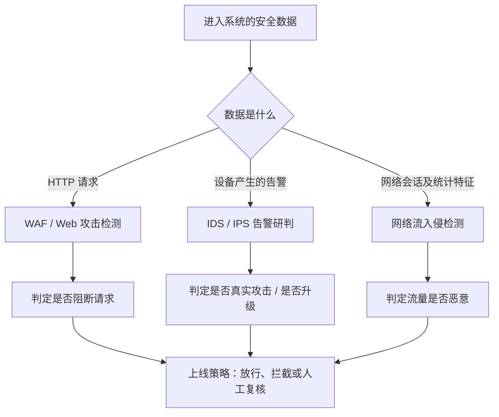

**核心区分**：

- **请求前拦截**：HTTP 请求到达业务系统前，依据 method、path、query、headers、body 预测是否应 BLOCK。这是最典型的 WAF 拦截任务。
- **告警后研判**：Suricata、Wazuh 等已经生成一条告警，由模型判断告警是真攻击还是误报，是否需要升级处置。它不一定能够在攻击请求发生前阻断。
- **流级检测**：以五元组、流持续时间、包数和统计特征判断恶意连接，适合 IDS/IPS，但不是直接理解原始文本日志。

### 0.1 八个核心数据集一览

| 编号 | 数据集 / 项目 | 最接近哪种任务 | 公开数据形态 | 标签可信度与关键注意事项 | 推荐用途 |
|---|---|---|---|---|---|
| 01 | [HTTP CSIC 2010](#01-http-csic-2010) | Web 请求异常拦截 | 自动生成 HTTP 请求 | “异常”含无恶意意图的格式异常 | 基线、训练、入门评测 |
| 02 | [WAF Comparison Project](#02-waf-comparison-project) | WAF 放行/拦截性能 | 合法请求集 + 恶意 Payload 集 | 两组样本来源不同，需防止来源特征捷径 | 大规模攻防覆盖与误拦率 |
| 03 | [Biblio-US17](#03-biblio-us17) | 真实 HTTP URI 恶意识别 | 真实站点日志及分层标签 | 仅部分日志字段，标签有置信等级 | 真实分布、时间漂移 |
| 04 | [HttpParamsDataset](#04-httpparamsdataset) | HTTP 参数攻击识别 | 参数值 CSV | 不是完整请求，部分与 CSIC 血缘重叠 | Payload 模型、专项增强 |
| 05 | [WAF-Bench 数据集](#05-waf-bench-77-条请求数据集) | 难例回归测试 | 77 条完整 JSONL 请求 | 规模小、人工挑选、非真实比例 | Hard-case 与烟雾测试 |
| 06 | [AIT-ADS](#06-ait-ads) | IDS/IPS 告警真假研判 | Wazuh / AMiner / Suricata 告警 | 需按文档进行时间戳和事件级真值关联 | 告警过滤、攻击链关联 |
| 07 | [CIC-IDS2017](#07-cic-ids2017) | 网络流入侵检测 | PCAP + 流量 CSV | 流级标签，非 WAF 日志 | 流级安全模型及跨模态对照 |
| 08 | [ModSecurity 30-Day](#08-modsecurity-30-day-真实-waf-命中日志) | 已命中 WAF 日志解释 | 真实 ModSecurity Audit Log | 只包括 WAF 命中请求；非人工确证的攻击真值 | 真实日志适配、命中原因分析 |

**最佳实践**：不要把八个数据集简单拼接后，随机拆分成训练/测试集。不同数据来源、采集机制、标签定义不同，容易出现重复样本、域偏移、来源泄漏和任务不一致。

### 0.2 图形化理解：它们之间的关系

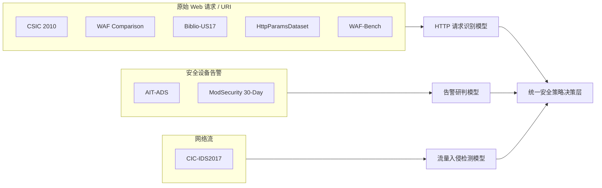

---

# 第一部分：八个核心 Benchmark 逐一介绍

## 01. HTTP CSIC 2010

### 1.1 它是什么？

**HTTP CSIC 2010** 是西班牙国家研究委员会（CSIC）研究人员围绕一个模拟电子商务网站构建的 HTTP 请求异常检测数据集。它具有请求内容和 `normal / anomalous` 标签，长期用于 Web 攻击检测、WAF 异常识别、HTTP 请求分类等研究。

- **规模**：约 36,000 条正常请求，超过 25,000 条异常请求；应以实际下载版本统计为准。
- **场景**：注册、购物车、参数提交等电子商务请求。
- **攻击/异常**：SQL 注入、XSS、CRLF 注入、文件泄露、路径或资源探索、参数篡改、不符合参数预期的请求等。
- **标签**：二元 `normal / anomalous`，**不是人工确证的“攻击 / 非攻击”**。
- **官方页面**：[IMPACT 数据集介绍](https://www.impactcybertrust.org/dataset_view?idDataset=940)；页面列有原始作者站点 [CSIC](http://www.isi.csic.es/dataset/)（旧站点可能不可用）。

### 1.2 数据长什么样？

```http
# 示意数据，非官方原始记录
POST /shop/login HTTP/1.1
Host: shop.example.test
Content-Type: application/x-www-form-urlencoded

user=alice&password=example
```

模型所见的“一个样本”可以是完整请求，而不只是 URI。构造时必须保留原始编码、方法、请求头、请求体等在真实判定时可用的字段。

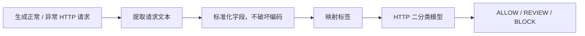

### 1.3 怎么用？具体步骤

1. **获取**：从 IMPACT 页面确认下载入口；若原作者站点已下线，应记录可访问的镜像来源与文件哈希。
2. **解析**：按照数据发行包中的实际文件格式读取请求。不要假定一定是 CSV；许多镜像以原始 HTTP 文本或预先转换表格提供。
3. **建立基础任务**：将 `normal → 0`、`anomalous → 1`，先称其为“请求异常识别”，不要直接把 1 命名为“必定应拦截的攻击”。
4. **纠正标签语义**：对异常样本抽样人工标注 `malicious / malformed / uncertain`。格式错误但没有攻击意图的请求未必应强制阻断。
5. **切分**：不同请求模板、参数值和高度相似编码 Payload 应做去重或按家族分组切分，避免模板记忆造成分数虚高。
6. **评测**：报告召回率、FPR、每种异常类型的检出情况，记录推理时延。

**建议评价任务**：`P(anomalous | HTTP_request)` 作为初始基线；经人工复核的高置信恶意子集再做 `P(block | HTTP_request)`。

### 1.4 适合哪些实际场景？

- 初步训练 HTTP 请求安全分类模型；验证 LoRA/SFT 数据转换和推理流程。
- 研究编码形式、请求参数顺序、URL 解码等对检测的影响。
- 小规模模型与 WAF 规则的初步对照。

### 1.5 局限与避坑

- 数据来自**单一合成网站**，不能代表现代 API、GraphQL、WebSocket 或多站点业务。
- **异常 ≠ 恶意**：包含没有恶意意图、但不符合业务参数规范的请求。
- 模板重复可能很高，随机切分会夸大泛化能力。
- 不适合单独宣称“生产场景拦截率”。

**来源**：[IMPACT 官方目录](https://www.impactcybertrust.org/dataset_view?idDataset=940)。

---

## 02. WAF Comparison Project

### 2.1 它是什么？

[WAF Comparison Project](https://github.com/openappsec/waf-comparison-project) 由 open-appsec 发布，是**用于测试 WAF 产品拦截效果的公开数据和评测工具集合**。与只提供攻击数据的仓库不同，它同时关注攻击检出与合法请求的误拦。

根据当前仓库 README 的某次公开版本：

- **合法请求集**：1,040,242 条，来自 185 个真实网站、12 个类别。
- **恶意样本集**：73,924 个恶意 Payload；覆盖 SQLi、XSS、XXE、路径遍历、命令执行、Log4Shell、Shellshock 等。
- **重要版本提醒**：项目关联的文档/报告存在不同年份和版本口径（网站数、攻击 Payload 数可能变化），论文和正式报告中必须记录所用 Git commit、数据包日期、条目数、SHA-256，不应混用版本统计数字。
- **公开入口**：[GitHub](https://github.com/openappsec/waf-comparison-project)；[方法简介](https://docs.openappsec.io/references/waf-comparison-project)。

### 2.2 它的测试逻辑

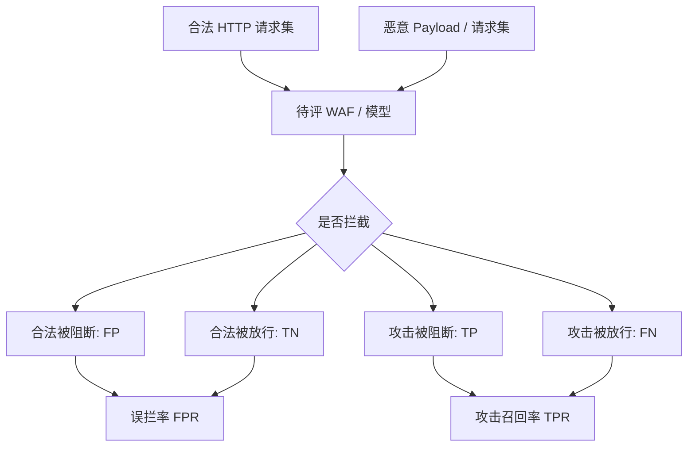

这比只看攻击检出数量更贴近生产需求：即使攻击拦截率很高，如果误拦大量正常登录、购物或 API 请求，也无法直接上线。

### 2.3 怎么用？

1. 克隆仓库，阅读当前 `README.md` 和配置文件；仓库提供数据下载方式以及重放/比较工具。
2. 固定评测版本，记录**正常数据**与**攻击数据**分别来自什么来源。
3. 将恶意 Payload 转为模型可处理的 HTTP 请求上下文（如果原数据仅含 Payload，不要假装它有真实方法、Header 和业务路径）。
4. 对合法请求、恶意请求采用一致的推理输入模板；不允许在输入中暴露数据包文件名或标签。
5. 跑原始 WAF、纯模型、WAF+模型三级对照。对于模型，决策应基于请求文本本身；对于真实 WAF，测试应在隔离/授权实验环境进行。
6. 分别报告 `TPR@固定FPR`、整体 FPR、各攻击类别 Recall，以及在线延迟。

**示例输出规范**：

```json
{
  "decision": "BLOCK",
  "attack_type": "SQLi",
  "score": 0.982,
  "evidence": ["query parameter contains suspicious SQL control structure"]
}
```

以上为建议的统一预测接口，不代表该项目自带上述 JSON 格式。

### 2.4 最适合的场景

- 企业 WAF 的拦截策略评估；传统规则 vs 大模型 vs 级联系统对照。
- 在正常流量上选阈值、约束误拦率。
- 比较已知常见 Web 攻击向量覆盖率。
- 大模型蒸馏后的小模型性能测试。

### 2.5 局限与避坑

- **合法请求与攻击 Payload 的构建来源不同**，容易被模型学习成“不同来源识别”，而不是学习攻击行为本身。
- Payload 与真实完整请求不等价；请求上下文会决定同一字符串是否危险。
- WAF 供应商发布的比较结果可能受版本、配置、测试策略影响。复现实验须公开配置、规则集版本与负载方式。
- 统计数据可能随更新变化，务必锁定版本。

**来源**：[项目 README](https://github.com/openappsec/waf-comparison-project/blob/main/README.md)；[配置文件](https://github.com/openappsec/waf-comparison-project/blob/main/config.py)。

---

## 03. Biblio-US17

### 3.1 它是什么？

**Biblio-US17** 是西班牙塞维利亚大学图书馆真实 Web 网站的脱敏请求日志集合。相较单一实验室流量，它的主要研究价值是**真实分布、长时间跨度和人工监督的分层标签**。

- **规模**：论文所述 RAW 目录有 **47,402,907** 条记录。
- **采集**：2017 年真实业务，跨约六个月。
- **数据内容**：HTTP 方法、URI、协议版本、响应状态码、响应大小、记录 ID（可表征日期/顺序）。
- **标签来源**：签名检测、URI 词汇审查以及专家人工监督的半自动流程，存在不同置信层级。
- **公开入口**：[数据记录页](https://idus.us.es/items/53034f60-d215-44b0-a198-eb8a5229218e)、[DOI](https://doi.org/10.12795/11441/148254)、[论文](https://link.springer.com/article/10.1186/s42400-024-00336-3)。若数据仓储访问有限制，请从 DOI 入口查看下载条件；并非所有网络环境都能直接下载。

### 3.2 它有什么文件？

| 目录 | 功能 | 建议用途 |
|---|---|---|
| `RAW/` | 脱敏原始请求记录 | 统一生成模型输入 |
| `LABEL/` | 规则触发、人工检查和分层标签 | 构造可信真值 |
| `CLEAN/` | 经净化选出的正常请求 | 低误拦测试 |
| `ATTACK/` | 高置信攻击记录 | 攻击召回率 |
| `SID/` | 触发的 IDS 规则标识 | 规则 / 模型对照（勿当作预测输入） |
| `PARTITIONS/` 等 | 研究用分区生成或划分材料 | 可复用划分方案 |

论文中的一条 RAW 记录结构类似：

```text
[RID] [METHOD] [URI] [PROTOCOL] [RESP_CODE] [RESP_SIZE]
```

### 3.3 怎么用？

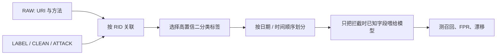

1. 按仓库发行结构读取 RAW；用 **RID** 关联 LABEL 或直接用 CLEAN、ATTACK 高置信子集。
2. 先明确只使用高置信攻击标签，还是将不确定攻击也纳入。两种实验应分开报告。
3. **离线“请求前拦截”只能使用** `method + URI` **等请求时已知字段**。响应码、响应大小是在请求处理后才产生的，拿它们做阻断判断会造成未来信息泄漏。
4. 首选**按时间顺序切分**，训练较早月份、测试较晚月份，检验分布漂移；若只按行随机划分，容易低估生产退化。
5. 同时建立两个测试结果：高置信正常/攻击的性能，以及全量数据中的覆盖率/不确定样本数量。

### 3.4 适用场景

- 真实网站 URI 级攻击识别与误拦率测量。
- 研究模型跨时间、跨部署环境的稳定性。
- 对比纯异常检测、规则引擎、LLM 与轻量分类器。
- 检验真实流量下合法请求的多样性。

### 3.5 局限与避坑

- **没有完整 Header 和 Body**，不能将其当成完整 HTTP 请求 benchmark。
- 记录没有完整时间戳，RID 只能表示日期和顺序，不能直接支持精确的速率分析。
- 专家监督标签不代表绝对完美真值，尤其上下文相关攻击仍可能存在灰区。
- 研究样本采自 2017 年单站点，Web 框架和攻击分布有时间偏差。

**来源**：[论文及原始字段说明](https://link.springer.com/article/10.1186/s42400-024-00336-3)；[机构数据记录](https://idus.us.es/items/53034f60-d215-44b0-a198-eb8a5229218e)。

---

## 04. HttpParamsDataset

### 4.1 它是什么？

[HttpParamsDataset](https://github.com/Morzeux/HttpParamsDataset) 是一个**HTTP 请求参数值（value）级别**的恶意 Payload 与正常值数据集，常被用于训练参数内容攻击识别器。

仓库 README 列出的数据规模：

| 类型 | 规模 |
|---|---:|
| 正常参数值 `norm` | 19,304 |
| 异常参数值 `anom` | 11,763 |
| 其中：SQLi | 10,852 |
| 其中：XSS | 532 |
| 其中：命令注入 | 89 |
| 其中：路径穿越 | 290 |
| **合计** | **31,067** |

异常子类的数量高度不平衡：SQLi 占大多数，命令注入样本特别少。仓库文字有“over 3100”的笔误，应以**各类数字之和和实际文件**为准。

文件包括 `payload_full.csv`、`payload_train.csv`、`payload_test.csv` 等。来源包括部分 CSIC 2010 正常值、sqlmap、XSS 工具和 FuzzDB 等。

### 4.2 为什么它和完整日志不同？

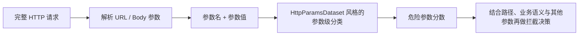

例如正常用户搜索 `select one item` 也会出现 SQL 相关单词，而恶意性不仅依赖字符串，还依赖该参数所处的业务路径和解析方式。因此它适合做**参数风险特征模型**，不能直接代替完整请求拦截决策。

### 4.3 怎么用？

1. 下载 `payload_*.csv`，读取实际字段和原始标签值，确认当前文件列名后再写适配代码。
2. 以二分类 `norm / anom` 建立参数级模型，再尝试四类攻击分类。
3. 对于 JSON 请求体、URL Query、表单参数，先抽取参数值，再保留**参数名、路径、编码层次**作为模型上下文。
4. 与 CSIC 2010 联合使用时必须做内容去重与来源核查，因为部分参数值来自 CSIC，**不能将这种重叠当独立外部测试**。
5. 报告类别级召回、Macro-F1 和编码变换前后的稳定性，而不是仅报告总体准确率。

### 4.4 适用场景

- WAF 中参数级检测分支；构造 SQLi / XSS / CMDi / Traversal 专项测试集。
- 低成本训练轻量 Encoder/MLP/小模型作为一级过滤器。
- 研究同一个 Payload 在不同路径与上下文中的风险变化。

### 4.5 局限

- **不是完整日志**、没有真实 Web 服务上下文，也没有真实的攻击效果信息。
- 类别高度失衡；不能用整体 Accuracy 评价弱势攻击类型。
- 公共工具生成的 Payload 可能和公开训练数据重复。

**来源**：[仓库与原始文件](https://github.com/Morzeux/HttpParamsDataset)。

---

## 05. WAF-Bench（77 条请求数据集）

### 5.1 先澄清一个容易混淆的名字

存在两个**不同**项目：

1. **[netgoat-ai/WAF-Bench](https://huggingface.co/datasets/netgoat-ai/WAF-Bench)**：77 条带标签的 HTTP 请求小基准。本节主要介绍它。
2. **[microsoft/WAFBench](https://github.com/microsoft/WAFBench)**：WAF 性能测试/流量重放工具，**不是**上述 77 条请求数据集。

若论文引用或下载，请务必写清创建者和仓库链接，不能把工具当作数据集。

### 5.2 它是什么？

WAF-Bench（Hugging Face 版本）是一套人工挑选的 **77 条完整、可重放 HTTP 请求**，适合针对“难检攻击”与“容易被误拦的合法请求”做快速回归测试。

- **标签**：`malicious / benign`。
- **期望动作**：`block / allow`。
- **字段**：`id`、`category`、`label`、`expected_action`、`method`、`path`、`query`、`headers`、`body`、`difficulty`、`evasion` 等。
- **样本结构**：约 57 条恶意、20 条正常；总量小且不平衡。
- **难度特征**：容易样本、中等难度、规避技巧和合法“误报陷阱”。

### 5.3 如何使用？

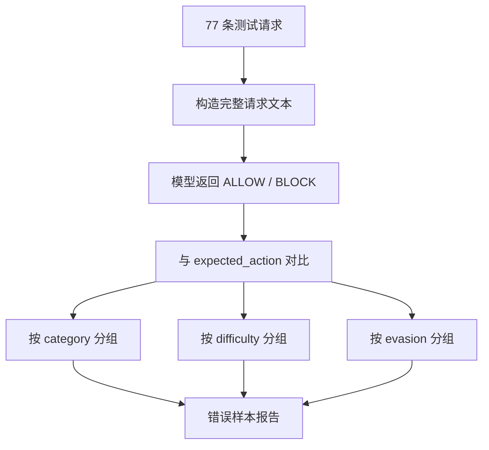

1. 使用 Hugging Face 数据集仓库中的 `test.jsonl`；数据仅有测试 split。
2. 将 `method + path + query + headers + body` 组成统一输入，模型返回唯一决策及置信度。
3. 与 `expected_action` 比较；汇总恶意召回、合法误拦、困难样本通过率和逐条错误列表。
4. 先将全部 77 条留作**完全独立**的回归测试；不要为了追这 77 条分数而反复直接训练它们。
5. 由于样本少，每次版本变更至少同时报告错了哪几条，而不是只写 92.2% 等精细数字。

### 5.4 适用场景

- 模型上线前 1～3 分钟级的 smoke/regression test。
- 检查是否把包含 `script`、SQL 关键字但无攻击意图的合法请求误拦。
- 针对编码、混淆、规避技巧的难例集。

### 5.5 局限

- 数量只有 77，不能支持可信的总体 FPR 或真实世界攻击分布估计。
- 合成且人工选样，含人为设计的“陷阱”；部分边界标签有合理争议。
- 单请求评测，不支持行为频率、会话和多阶段攻击。

**来源**：[Hugging Face 数据集卡](https://huggingface.co/datasets/netgoat-ai/WAF-Bench/blob/main/README.md)；[微软同名工具](https://github.com/microsoft/WAFBench)。

---

## 06. AIT-ADS

### 6.1 它是什么？

**AIT Alert Data Set（AIT-ADS）** 是奥地利技术研究所相关研究团队发布的**多步骤网络攻击安全告警数据集**，数据来源是 AIT-LDSv2 的多源日志经过安全检测器处理后的告警。

它不是“完整 HTTP 请求”的比赛，而是针对 **IDS 告警过滤、优先级分析、聚合、关联、攻击链还原** 的数据集。

- **数据源**：Wazuh、AMiner、以及经 Wazuh 处理的 Suricata 相关告警。
- **场景**：8 套企业网络模拟场景，每套包括正常背景活动及多阶段攻击。
- **攻击行为**：扫描、Web 攻击、WebShell 上传、密码破解、提权、远程执行、数据外传。
- **发布包**：Zenodo 提供 `ait_ads.zip`（约 96 MB）与 `labels.csv`。
- **链接**：[Zenodo](https://zenodo.org/records/8263181)；[项目代码](https://github.com/ait-aecid/alert-data-set)；[结构说明](https://fkie-cad.github.io/COMIDDS/content/datasets/ait_alert_dataset/)；[论文](https://doi.org/10.1145/3675741.3675748)。

### 6.2 数据从哪里来？

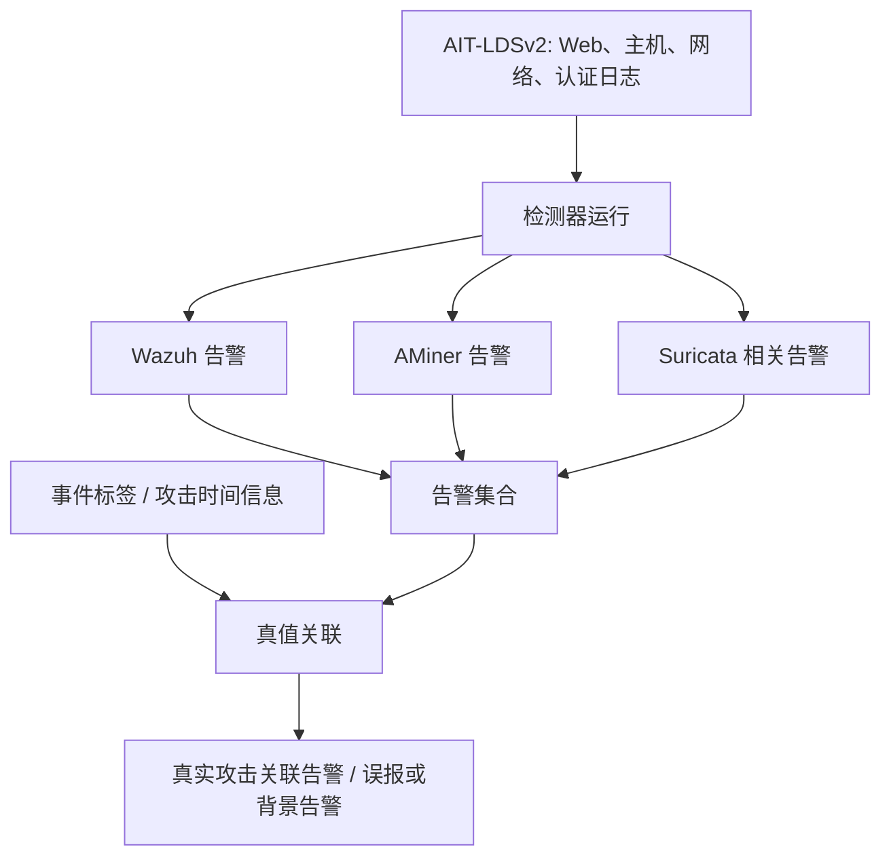

### 6.3 标签字段与时间戳陷阱

COMIDDS 文档展示的标签 CSV 包含：

```text
time,name,ip,host,short,time_label,event_label
```

- `time_label`：以攻击时间段推断是否相关，范围较宽，可能引入噪声。
- `event_label`：更精细的事件级关联，应优先用于高置信评测。
- **重要**：Wazuh 记录存在两种时间戳形式，文档明确提醒应采用 **ISO 时间戳** 转换后关联原始事件；直接使用其事件生成 epoch 时间可能匹配不上真值。

### 6.4 怎么用？

1. 下载压缩包，列出 8 套场景和 Wazuh/AMiner JSON 文件，读取 `labels.csv`。
2. 对每个事件按文档提供的事件时间戳、规则名、主机、IP 和场景信息关联真值；不能仅“同一分钟出现就标攻击”。
3. 定义实验一：**单条告警真假**（`true_attack / false_alert / uncertain`）。如果事件关联不充分，把它放入不确定集合，不强行标负例。
4. 定义实验二：**告警序列研判**。把固定时间窗内同主机/同源的若干告警组织成事件束，预测攻击链阶段或升级优先级。
5. 用“场景留一法”（例如训练若干场景、完整保留另一个场景测试）评估跨场景泛化，避免同一攻击链事件同时进入 train/test。
6. 报告单告警 Recall、FPR、Precision、每条攻击链检出率、告警压缩率及首报延迟。

### 6.5 应用场景

- 设备已经报出 IDS 告警，希望由 LLM 进一步判断“要不要封禁 IP / 阻断流 / 升级工单”。
- 关联多条 Wazuh / Suricata 告警而不是重复处置每一条。
- 评估安全运营中心（SOC）告警降噪和攻击链分析模型。

### 6.6 局限与避坑

- 虽有真实检测器，但场景来自**模拟的企业网络**，不是未加控制的真实生产 SOC 流量。
- 攻击相关告警与“是否应该立即阻断”不完全等价；封禁策略还需结合资产、业务影响、动作成本。
- 事件级真值对齐较复杂，时间误匹配会严重影响评价。

**来源**：[Zenodo 资源与标签](https://zenodo.org/records/8263181)；[官方研究代码](https://github.com/ait-aecid/alert-data-set)；[COMIDDS 标签提示](https://fkie-cad.github.io/COMIDDS/content/datasets/ait_alert_dataset/)。

---

## 07. CIC-IDS2017

### 7.1 它是什么？

**CIC-IDS2017** 是加拿大新不伦瑞克大学 Canadian Institute for Cybersecurity 发布的标注网络入侵检测数据集，提供 PCAP 和 CICFlowMeter 生成的流级 CSV 特征。

- **采集**：2017-07-03 至 2017-07-07，持续 5 天。
- **正常行为**：模拟不同用户的 HTTP、HTTPS、FTP、SSH、邮件等业务。
- **攻击**：FTP/SSH 暴力破解、DoS、DDoS、Web 攻击、Botnet、渗透、Heartbleed 等。
- **数据**：原始流量 PCAP、带标签的网络流 CSV（包含五元组、时长、包数、长度统计等特征）。
- **链接**：[CIC 官方数据主页](https://www.unb.ca/cic/datasets/ids-2017.html)。

### 7.2 为什么它不能被直接当成“攻击日志拦截”数据？

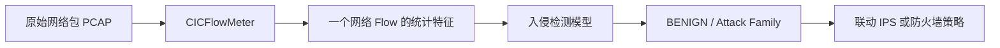

数据集中一行通常描述**一个网络流**，而不是一条 WAF 命中的 HTTP 请求；同一个 SQLi 字符串或 HTTP 参数通常不直接出现在 CSV 中。因此不能把它当作天然的 LLM 文本恶意请求判定集。

### 7.3 怎么用？

1. 首先选用官方提供的 ML CSV 作为传统流级分类基线；必要时再使用 PCAP 复现特征提取。
2. 对 CSV 做字段清洗，处理 `NaN / Inf`、异常取值、重复行、冲突标签。
3. 采用机器学习基线（逻辑回归、XGBoost、随机森林等）与将流特征文字化后的大模型做对照。
4. 不能只做随机划分；按**日期、攻击会话、主机/流关联**做额外保留集，检查场景泄漏。
5. 预测任务：`BENIGN / ATTACK`、多类别攻击分类，以及给定 FPR 预算下的拦截召回。

### 7.4 适合的场景

- IDS/IPS 进行基于流级统计的入侵拦截。
- 评估对扫描、DDoS、暴力破解等非 Web Payload 攻击的识别。
- 作为与 WAF 文本模型不同输入模态的辅助模型。

### 7.5 局限

- 采集于 2017 年实验环境，与现代加密流量、云原生网络有差异。
- 数值特征对树模型通常更自然；LLM 未必有优势，应避免忽视基线。
- 流级真值不应直接映射为“单条 HTTP 请求必须 BLOCK”。

**来源**：[CIC 官方页和论文引文](https://www.unb.ca/cic/datasets/ids-2017.html)。

---

## 08. ModSecurity 30-Day（真实 WAF 命中日志）

### 8.1 它是什么？

正式名称为 **A Thirty-Day Dataset of Malicious HTTP Requests Blocked by OWASP ModSecurity on a Production Web Server**，于 2025 年发布，作者记录生产 Web 服务器 30 天内由 ModSecurity / OWASP Core Rule Set（CRS）检测并阻断的请求。

- **时间范围**：2025-07-27 至 2025-08-25。
- **请求数**：147,205 条。
- **格式**：RAW ModSecurity Audit Log，带 HTTP 与规则匹配信息。
- **环境**：WordPress / WooCommerce 及 PHP 服务的真实生产部署。
- **数据包**：Zenodo 上 `owasp.zip`，约 29.5 MB 压缩大小。
- **入口**：[Zenodo 数据与下载](https://zenodo.org/records/17178461)；[同行评议数据论文](https://www.mdpi.com/2306-5729/10/11/186)。

### 8.2 典型日志信息是什么？

原始 ModSecurity 审计日志常按独立 Section 记录请求、响应、匹配规则及审计元信息。教学示意：

```text
[transaction-id]
Request: GET /wp-admin/?p=...
Headers: Host, User-Agent, Content-Type...
WAF matched: rule_id=xxxxxx
Action: intercepted / denied
```

以上仅展示**信息类别**，非数据集原始格式和具体样本。真实解析应以原始 ModSecurity Audit Log 分段规范为准。

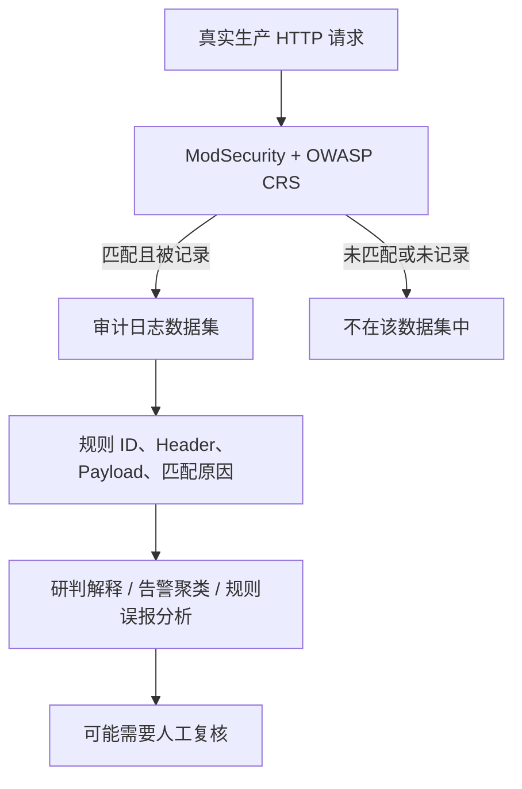

### 8.3 怎么用？

1. 下载压缩包并查阅论文数据段格式，解析事务边界、请求内容和规则触发明细。
2. 做脱敏复核、重复记录合并、请求编码和日期统一。
3. 定义任务为**“解释 WAF 告警 / 判断命中规则的风险证据”**，不要默认所有被阻断的请求都已被人工证明是攻击。
4. 如果要训练真正的 `ALLOW / BLOCK` 模型，**必须另行加入具有可靠标签的合法请求与误报审计样本**。
5. 进行跨时间划分；对相同 URI / Payload 模板去重；区分自定义早拒绝规则与 CRS 常规规则。
6. 评测模型能否识别可疑攻击类别、匹配规则解释是否一致、是否能发现待人工审核的可疑误报。

### 8.4 哪些场景特别适合？

- 真实 WAF 告警内容理解和攻击类型辅助归因。
- 检验 LLM 是否能解释规则触发理由，自动输出研判摘要。
- 研究不同攻击类别的分布、规则命中偏差。
- 构建需要人工校核的真实 WAF 数据候选池。

### 8.5 最重要的局限

- **选择偏差**：只记录被 WAF 标记/阻断的请求。未知的未命中攻击和全部正常流量不在其中。
- **不能独立计算 FPR / TNR / 全局 Accuracy**，也不能仅从该数据集计算完整攻击拦截率。
- 规则命中不等于真实攻击真值，且自定义 bot 规则可能影响类别分布。
- 如果将 `intercepted`、命中规则分数等作为训练输入去预测“是否拦截”，则模型可能只是在复述已发生的 WAF 决策；生产前置拦截必须排除这些未来信息。

**来源**：[Zenodo DOI 10.5281/zenodo.17178461](https://doi.org/10.5281/zenodo.17178461)；[数据论文](https://doi.org/10.3390/data10110186)。

---

# 第二部分：如何把公开数据集真正用于“攻击日志拦截模型”

## 09. 统一任务定义：先决定拦截对象

同样输出 `BLOCK`，意义可能完全不同：

| 对象 | 预测时刻 | 模型最小输入 | 标准输出 | 注意 |
|---|---|---|---|---|
| HTTP/WAF 请求 | 到达后端前 | method + path + query + headers + body | `ALLOW / BLOCK / REVIEW` | 不能用响应码、WAF 事后判定 |
| IDS/IPS 告警 | 告警触发后 | 设备、原始告警、时间、上下文 | `IGNORE / INVESTIGATE / ESCALATE` | 不等于立即封禁 |
| 网络 Flow | 建立或观察一段流后 | 可用的流量统计特征 | `BENIGN / ATTACK` | 看清能否在线计算这些特征 |

### 9.1 模型训练的统一样本结构（推荐自行构建）

```json
{
  "id": "datasetA:sample-0001",
  "dataset": "HTTP_CSIC_2010",
  "input_type": "http_request",
  "request": {
    "method": "GET",
    "path": "/items",
    "query": "q=book",
    "headers": {"content-type": "text/plain"},
    "body": null
  },
  "label": {
    "source_label": "normal",
    "binary_attack": 0,
    "action": "ALLOW",
    "attack_type": null,
    "label_confidence": "dataset"
  },
  "metadata": {
    "split": "test",
    "source_version": "PIN_SHA256_HERE"
  }
}
```

> 这是**建议的数据适配 Schema**，不是任何原始 benchmark 的通用格式。`source_label` 必须忠实保留原标签，映射关系另外记录。对于不能严格对应真实攻击的样本，`binary_attack` 或 `action` 应允许 `null/REVIEW`，不应强行标注。

### 9.2 训练与拦截数据流

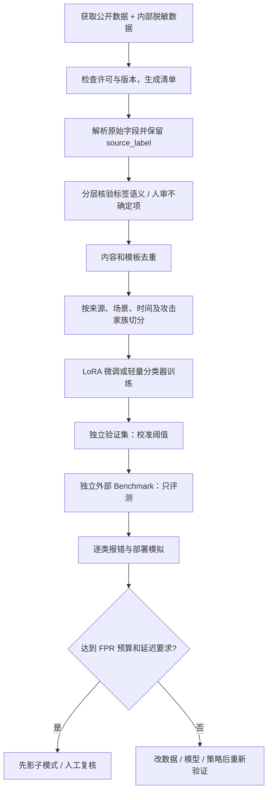

## 10. 推荐的三套实际实验组合

### 组合 A：只做 WAF/HTTP 请求拦截（最符合“拦截攻击日志”）

| 角色 | 数据集 | 使用方式 |
|---|---|---|
| 主训练集 | CSIC 2010、HttpParamsDataset | 清洗后训练请求异常 / 参数恶意分类；注意跨数据集重复 |
| 正常流量测试 | WAF Comparison 的合法请求 | 测误拦与请求覆盖；必须核查业务代表性 |
| 恶意攻击测试 | WAF Comparison 的恶意 Payload | 先规范为一致的测试请求上下文，再测攻击召回 |
| 真实外部测试 | Biblio-US17 高置信子集 | 测 URI 级真实分布泛化与时间漂移 |
| 难例回归 | WAF-Bench 77 条 | 逐条分析绕过、合法误报陷阱 |
| 日志解释专项 | ModSecurity 30-Day | 解释规则触发、真实结构适配；不算独立 FPR |

**切记**：如果测试对象是 URI 级模型，完整 Body/Hdr 模型应被裁剪到同样可用字段再横向比较；否则同一排行榜比较不公平。

### 组合 B：安全设备告警自动研判

- 主评测：AIT-ADS 的 Wazuh/AMiner 告警（优先事件级关联真值）。
- 真实结构适配：ModSecurity 30-Day 的规则命中审计日志。
- 输出：`TRUE_ATTACK / FALSE_ALERT / UNCERTAIN` + 严重程度 + 证据 + 人工升级建议。
- 评价：真攻击召回、错误升级率、告警量压缩率、攻击链检出延迟、理由是否引用真实证据。

### 组合 C：网络流入侵检测

- 主训练与评测：CIC-IDS2017 的流级 CSV；另配企业网络遥测以验证跨域。
- 建议对照：XGBoost / Random Forest / Logistic Regression vs 4B 分类模型。
- 输出：流级攻击概率和类型，不要无验证就转为封禁 IP 的生产动作。

## 11. 评测指标：为何 FPR 比 Accuracy 更重要？

以下以**正类 = 真实恶意攻击**为例：

| 真值 \ 预测 | BLOCK（预测攻击） | ALLOW（预测正常） |
|---|---:|---:|
| ATTACK（真实攻击） | TP | FN |
| BENIGN（真实正常） | FP | TN |

- **攻击召回率** `Recall / TPR = TP / (TP + FN)`：真实攻击有多少被识别。
- **正常请求误拦率** `FPR = FP / (FP + TN)`：正常请求有多少被错拦。
- **精确率** `Precision = TP / (TP + FP)`：被判断为攻击的请求中有多少真攻击。
- **F1**：精确率和召回率的调和平均。
- **Recall@FPR≤x%**：在规定最高误拦率时能达到的攻击召回；**这是安全拦截模型非常值得采用的主指标**。
- **P50/P95/P99 延迟**：预测单条请求需要多久；WAF 请求前阻断尤其重要。

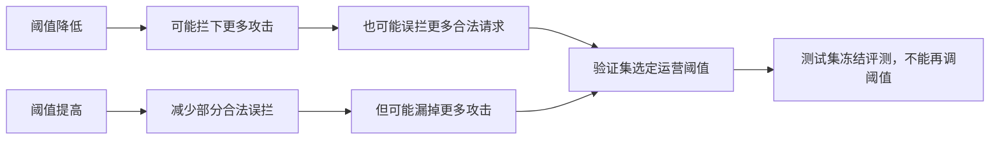

**简单示例**：假设每天 1,000,000 条合法请求、10,000 条攻击请求：

- 在 `Recall=95%` 时，攻击拦截 9,500 条、漏掉 500 条。
- 在 `FPR=1%` 时，合法请求会被误拦 **10,000 条**。

所以“95% 召回 + 1% FPR”不一定能满足核心业务系统上线要求，必须结合人工复核能力、用户损失和阻断动作成本看。上例为示意计算，不是任何 benchmark 的实测结果。

## 12. 防止模型评测虚高的七个问题

1. **标签不等价**：CSIC 异常不是全部恶意；WAF 命中并不全是人工确认攻击；AIT 攻击关联标签不等于封禁命令。
2. **数据来源泄漏**：恶意数据和正常数据来自不同网站或收集工具，模型可能学会区分来源。
3. **内容重复**：HttpParamsDataset 从 CSIC 提取部分正常值；多个公开 Payload 库容易出现同源内容。
4. **未来字段泄漏**：拦截前决策不能读 HTTP 响应码、WAF 最终动作、匹配规则分数或人工标签。
5. **随机切分泄漏**：同个 Payload、同一攻击会话、同一个站点 URI 模板跨训练和测试会降低测试难度。
6. **指标定义不统一**：把“异常检出率”“告警真攻击召回”“请求拦截率”并列成一个数是不严谨的。
7. **只算静态精度**：WAF 还必须测延迟、吞吐、正常业务损伤与动作可回滚性。

## 13. 最简模型调用接口与评测报告格式

模型输出示意：

```json
{
  "sample_id": "waf-001",
  "score_attack": 0.91,
  "decision": "BLOCK",
  "attack_type": "XSS",
  "reason": "Request parameter contains suspicious executable script content"
}
```

将基准测试结果落盘为：

```text
results/
├── benchmark_manifest.json       # 数据来源、版本、SHA-256、许可
├── label_mapping.yaml            # 每个数据集的原始标签与统一标签映射
├── split_manifest.json           # 样本分区、时间/场景隔离依据
├── predictions.jsonl             # 每条样本的预测分数及延迟
├── summary_metrics.json          # Recall、FPR、Precision、Macro-F1、CI 等
├── per_attack_type.csv           # 分攻击类别指标
├── error_cases.jsonl             # FP / FN / UNCERTAIN 明细
└── report.md                     # 结论、图表、数据局限与复现实验参数
```

### 13.1 报告至少应回答

- 是什么类型的输入（完整 HTTP、只有 URI、WAF 告警、IDS 告警还是 flow CSV）？
- 标签是否能严格解释为真实攻击和正常请求？不确定样本如何处理？
- 在固定 FPR 预算下 Recall 多少，误拦绝对数量是多少？
- 针对 SQLi/XSS/CMDi/Traversal/扫描/爆破等每一类表现怎样？
- 模型与规则引擎相比多拦了哪些真攻击，又多误拦了哪些正常请求？
- P95 延迟、吞吐量、平均 tokens/请求，以及输入截断比例是多少？
- 外部测试集是否与任何训练样本、模板或来源存在重叠？

---

# 第三部分：其他曾提及的公开数据与基准（与“直接拦截”关系较弱）

> 以下项目也可帮助研究安全告警研判和攻击链，但**不建议全部混同为请求级拦截 benchmark**。为了避免遗漏前面讨论出现的名称，这里给出定位、用法及链接；重点仍以上述八项为主。

| 项目 | 是什么、怎么用 | 适用场景 | 官方/项目链接 | 主要限制 |
|---|---|---|---|---|
| **SecAlertBench** | 标准化 SOC 安全告警真假分析基准。把告警文本交给模型，比较真实攻击判断 | 告警真伪研判 | [GitHub](https://github.com/Dxsssu/SecAlertBench) | 并非原始网络请求级拦截集；完整原始企业告警未必公开 |
| **SALAD-SOC** | 从 IDS 数据衍生的大规模 SOC 告警与处置任务集；适合分类、优先级与处置任务 | 模拟 SOC 多任务训练 | [GitHub](https://github.com/nutthakorn7/SALAD-SOC) | 与 CIC-IDS2017/UNSW-NB15 存在数据血缘，不能当独立外测 |
| **CAM-LDS** | 包含攻击技术标签的多源日志基准；将日志片段映射到 ATT&CK | 攻击技术识别与解释 | [Zenodo](https://zenodo.org/records/18861762) | 不适合独立估计生产误拦率 |
| **Splunk BOTS v3** | 多源安全事件调查数据及问题，重在找证据、还原事件 | SOC 调查问答/溯源 | [GitHub](https://github.com/splunk/botsv3) | 不是逐请求真值标签 |
| **AIT-LDSv2** | 多种主机、Web、DNS、认证和 VPN 原始日志，附攻击事件真值 | 多源原始日志攻击检出 | [Zenodo（v2.1）](https://zenodo.org/records/19483937) | 需做事件级关联；版本需固定 |
| **LANL Cyber Security Dataset** | 大型企业认证、进程、网络和 DNS 遥测 | 横向移动/异常认证 | [官方](https://csr.lanl.gov/data/) | 不直接给出每条 HTTP 请求拦截动作 |
| **UNSW-NB15** | 标注网络流量及 9 类攻击 | 流量恶意识别 | [UNSW 官方](https://research.unsw.edu.au/projects/unsw-nb15-dataset) | 不是文本 WAF 请求日志 |
| **CSE-CIC-IDS2018** | 企业模拟网络攻击流量与特征 | 网络 IDS/IPS | [CIC 官方](https://www.unb.ca/cic/datasets/ids-2018.html) | 与 Web 请求级拦截任务不同 |
| **CICIoT2023** | IoT 设备网络流量、多个攻击场景 | 物联网 IDS | [CIC 官方](https://www.unb.ca/cic/datasets/iotdataset-2023.html) | 不能直接代表企业 WAF |
| **Loghub** | HDFS、BGL、Thunderbird 等日志语料 | 日志解析、异常检测 | [GitHub](https://github.com/logpai/loghub) | 异常 ≠ 安全攻击，不能直接算阻断率 |
| **OTRF Security-Datasets** | 主机与网络攻击复现日志 | ATT&CK 技术检测、威胁狩猎 | [GitHub](https://github.com/OTRF/Security-Datasets) | 需要定义适合场景的正常对照及事件标签 |
| **WitFoo Precinct6** | SOC 事件和关联数据 | 事件关联、威胁狩猎 | [Hugging Face](https://huggingface.co/datasets/witfoo/precinct6-cybersecurity) | 产品生成标签需独立人工抽检 |
| **SOC Alert Triage Benchmark** | SOC 告警评级和处置的评测框架 | LLM 告警研判评测 | [GitHub](https://github.com/shandure/soc-triage-benchmark) | 需确认完整样本公开范围，不宜视为大型可下载训练集 |

---

# 第四部分：下载与复现清单

## 14. 全部主要链接（直达入口）

1. **HTTP CSIC 2010** — [IMPACT](https://www.impactcybertrust.org/dataset_view?idDataset=940)
2. **WAF Comparison Project** — [GitHub](https://github.com/openappsec/waf-comparison-project) · [项目文档](https://docs.openappsec.io/references/waf-comparison-project)
3. **Biblio-US17** — [数据 DOI](https://doi.org/10.12795/11441/148254) · [论文](https://link.springer.com/article/10.1186/s42400-024-00336-3)
4. **HttpParamsDataset** — [GitHub](https://github.com/Morzeux/HttpParamsDataset)
5. **WAF-Bench（77 样本）** — [Hugging Face](https://huggingface.co/datasets/netgoat-ai/WAF-Bench) · **注意不同于** [microsoft/WAFBench](https://github.com/microsoft/WAFBench)
6. **AIT-ADS** — [Zenodo](https://zenodo.org/records/8263181) · [生成/分析代码](https://github.com/ait-aecid/alert-data-set) · [论文 DOI](https://doi.org/10.1145/3675741.3675748)
7. **CIC-IDS2017** — [CIC 官方](https://www.unb.ca/cic/datasets/ids-2017.html)
8. **ModSecurity 30-Day** — [Zenodo](https://zenodo.org/records/17178461) · [论文 DOI](https://doi.org/10.3390/data10110186)

## 15. 下载后的验收检查表

- [ ] 保存原始压缩包，不覆盖；计算 SHA-256。
- [ ] 保存数据许可证和论文引用信息。
- [ ] 列出每个文件的行数、格式、字段与编码。
- [ ] 输出原始标签分布（包括未知和不确定）。
- [ ] 记录恶意、正常样本的不同采集来源。
- [ ] 检查训练/测试是否存在重复、模板相似、相同攻击会话。
- [ ] 为“前置拦截”剔除响应码和事后 WAF 判断。
- [ ] 输出每种攻击类型的独立统计。
- [ ] 只在验证集选阈值；最终测试集不再调参。
- [ ] 同时比较传统规则 / 轻量模型 / LLM / 级联系统。

### 15.1 一条典型的完整闭环（执行路线图）

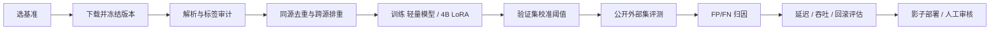

## 16. 最终选型建议

如果产品定义是“**HTTP 攻击请求到来时，AI 直接决定是否 BLOCK**”：

- **主评测基准**：WAF Comparison（合法/攻击双分布）+ Biblio-US17（真实 URI）+ WAF-Bench（难例）。
- **辅助训练**：CSIC 2010 + HttpParamsDataset（先修正异常标签语义与重叠问题）。
- **真实日志适配**：ModSecurity 30-Day（做告警解释，不单独算误拦率）。

如果产品定义是“**安全设备已经报出攻击告警，AI 再判断是否真实、是否拦截**”：

- **主基准**：AIT-ADS；辅以企业脱敏并经复核的 IDS/IPS 告警数据。
- **关键指标**：真实攻击召回、告警误报过滤率、处置误触发率、跨场景稳健性。

如果产品定义是“**网络流在 IPS 层判恶意**”：

- **主基准**：CIC-IDS2017，最好再用现代且独立来源的流量数据测跨域泛化。
- **对照基线**：树模型和轻量神经网络，不能只跟别的大模型比。

**一句话总结**：真正的攻击拦截 Benchmark，必须同时包含（或通过严格设计补齐）**可靠的恶意真值、足够多的合法业务请求、与实际决策时刻一致的可用输入**。只有攻击 Payload 的数据、只有 WAF 命中日志的数据、只有网络流统计的数据，都不能单独证明一个模型能够安全地进行生产请求级拦截。

---

## 资料使用声明

1. 本文按照公开项目页面、数据卡、数据论文和官方说明核对；由于公开仓库和数据包会更新，所有样本数应在实际下载时再次核验。
2. 所有实验路线、模型统一 Schema、输出 JSON 和 Mermaid 图均为本文整理的**建议性设计**，不是对应数据集作者提供的标准脚本。
3. 只在有授权的隔离环境开展 HTTP 回放与 WAF 测试，不对未知第三方系统发送攻击请求。
4. 文档适合用于工程方案设计和研究起步；如用于论文，请引用上述原始论文及数据记录，并固定数据版本与复现清单。
